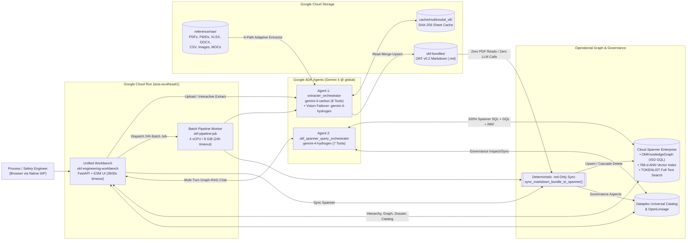

# Engineering OKF Knowledge Graph & Multi-Agent Workbench

An end-to-end **Engineering Knowledge Extraction, Cloud Spanner Graph-RAG Retrieval, Data Lineage, and HAZOP Analysis Platform** built with the **Google Agent Development Kit (`google-adk`)**, powered by **Gemini 4** (`gemini-4-carbon`, `gemini-4-hydrogen`, `gemini-4-argon`, `gemini-4-neon` via `GEMINI_LOCATION=global`), and delivered through a single **Unified Engineering Workbench** on **Google Cloud Run**.

---

## 👋 What Does This Platform Do?

In industrial and process plants, critical engineering knowledge is locked inside dense, multi-revision documents — **P&IDs**, **Process Data Sheets**, **PFDs**, **Operating & Inspection Manuals**, **HAZOP / Risk Standards**, **Excel Equipment Lists**, and **Management of Change (MOC)** packages.

This platform turns those raw files into a verified, queryable **Cloud Spanner Knowledge Graph** in **three stages**:

1. **Extract & Reconcile (`Agent 1: extracter_agent`):** Reads raw engineering documents — from scanned 300-DPI P&ID blueprints and AutoCAD vector drawings to Excel spreadsheets and manuals — and compiles them into structured, cross-linked **Open Knowledge Format (OKF v0.2) Markdown (`.md`)** files. Newer revisions supersede older ones cleanly, approved MOCs take authoritative precedence (`MOC_AUTHORITY`), and genuine cross-document disagreements are flagged side-by-side with `⚠️ CONFLICT`.
2. **Deterministic Spanner & Dataplex Sync (`sync_markdown_bundle_to_spanner`):** Projects the compiled `.md` bundle (`ADDED`, `UPDATED`, `REMOVED`, `UNCHANGED`) into **Google Cloud Spanner** (`OkfKnowledgeGraph` Property Graph + 768-d ANN Vector Search + Full-Text Search) and **Google Cloud Dataplex Universal Catalog** with **zero raw PDF reads and zero LLM calls**.
3. **Graph-RAG, Lineage & HAZOP Analysis (`Agent 2: query_agent`):** Answers engineering parameter lookups, multi-hop P&ID upstream/downstream traces (ISO GQL), PDF provenance & conflict audits, and 5-stage HAZOP studies (with Pre-Mitigation vs. Post-Mitigation Risk Matrices) **100% from Cloud Spanner and Dataplex**.

---

## ⚡ Platform Snapshot

| Component | Purpose | Runtime & Default Model | Key Capabilities |
| :--- | :--- | :--- | :--- |
| **Unified Web Workbench** (`okf-engineering-workbench`) | Single 2-tab web UI (**Query Agent** + **Extractor Studio**) with IAP Zero-Trust authentication | **Cloud Run Service** (`3600s` timeout, Pattern 1B Native IAP, zero `allUsers`) | Upload raw docs, run interactive or 24h batch extractions, inspect live Spanner graphs, node-focused Dataplex catalog, and multi-turn AI chat |
| **Batch Pipeline Worker** (`okf-pipeline-job`) | Long-running unattended multi-PDF extraction and full Spanner/Dataplex sync | **Cloud Run Job** (`4 vCPU / 8 GiB`, **`24h` timeout**) | Runs `extract`, `sync`, or `extract_and_sync` with live per-page GCS heartbeats and persistent job history |
| **Agent 1: Extracter Agent** (`extracter_orchestrator`) | Reads raw engineering files and builds/merges OKF v0.2 `.md` knowledge bundles | **Google ADK / Vertex AI Agent Runtime**<br>Default: `gemini-4-carbon` (**8 Tools**) | 6 document extraction paths, 300-DPI 7-tile P&ID vision, streaming + `gemini-4-hydrogen` failover, Read-Merge-Upsert, MOC & conflict handling |
| **Agent 2: Query Agent** (`okf_spanner_query_orchestrator`) | Grounded engineering Q&A, graph traversal, lineage & 5-stage HAZOP | **Google ADK / Vertex AI Agent Runtime**<br>Default: `gemini-4-hydrogen` (**7 Tools**) | ISO GQL graph traversal, Hybrid ANN Vector + FTS (RRF), backward/forward PDF lineage, 5-stage HAZOP, 100% Spanner-only reads |
| **Knowledge Graph & Catalog** | Unified operational store for entities, facts, edges, vectors & governance | **Cloud Spanner Enterprise** + **Dataplex Universal Catalog** | `OkfKnowledgeGraph` (ISO GQL), `idx_okf_chunks_vec` ANN index (`text-embedding-005`), `TOKENLIST` FTS, deduplicated source provenance |

---

## 📑 Table of Contents

1. [For Engineers: Using the Unified Workbench](#-1-for-engineers-using-the-unified-workbench)
2. [System Architecture & Data Flow](#-2-system-architecture--data-flow)
3. [Document & PDF Extraction Engine (All 6 Mechanisms)](#-3-document--pdf-extraction-engine-all-6-mechanisms)
4. [Deep Dive: Agent 1 — OKF Extracter Agent & Tools](#-4-deep-dive-agent-1--okf-extracter-agent--tools)
5. [Deterministic `.md`-to-Spanner & Dataplex Sync Bridge](#-5-deterministic-md-to-spanner--dataplex-sync-bridge)
6. [Deep Dive: Agent 2 — Spanner Graph-RAG Query Agent & Tools](#-6-deep-dive-agent-2--spanner-graph-rag-query-agent--tools)
7. [For Developers: Setup, Configuration, Deployment & APIs](#-7-for-developers-setup-configuration-deployment--apis)
8. [Testing, Security & Quality Verification](#-8-testing-security--quality-verification)
9. [Repository Structure & Documentation Links](#-9-repository-structure--documentation-links)

---

## 🧑‍🔧 1. For Engineers: Using the Unified Workbench

Open the **Unified Engineering Workbench** (`okf-engineering-workbench`) in your browser (protected by Google Cloud Identity-Aware Proxy — no anonymous public access). Switch between two workspaces from the top navigation bar:

### Tab 1: 🔍 Query Agent (Explore Graph, Provenance & Ask Engineering Questions)
- **Left Pane — Live Plant Hierarchy (`Cloud Spanner`):** Browse equipment grouped by **System → Equipment Class → Tag** (`Equipment`, `Instruments`, `OKF Concepts`, and `⚠️ Conflicts`), search instantly, or click **`↻ Sync Spanner`** to refresh.
- **Center Pane — Multi-Turn ADK Chat + Node-Aware Quick Studies:**
  - Pick any Gemini 4 model (`gemini-4-hydrogen` default for fast answers, or `gemini-4-neon` for deep safety reasoning).
  - Clicking **any equipment, instrument, or graph node** dynamically rewrites the 4 pre-built prompt chips for that exact tag:
    1. **HAZOP Study** *(all relevant guideword deviations + Pre-Mitigation vs. Post-Mitigation Risk Matrix)*
    2. **Upstream & Downstream Trace** *(multi-hop process piping & instrument loop propagation)*
    3. **Document Lineage & Conflicts** *(backing PDFs, revisions, MOC precedence & `⚠️ CONFLICT` audit)*
    4. **Safety Instruments & Safeguards** *(SIS interlocks, PSVs, alarms, trip setpoints)*
- **Right Pane — 100% Spanner & Dataplex Inspector (Zero Raw PDF / GCS Reads):**
  - **`Graph` Tab:** Interactive SVG Property Graph (`1–3` hops across `CONNECTS_TO`, `MONITORS_OR_TRIPS`, `DERIVED_FROM`). Click any node to focus or inspect; click **`↻`** to re-center.
  - **`Dossier` Tab:** Grounded equipment/concept specs, operating conditions, connections, instruments, and `⚠️ CONFLICT` callouts directly from Cloud Spanner.
  - **`Dataplex` Tab:** 3-section Node-Focused Governance view showing (1) Concept & Governance Metadata (Trust Tier, Approver, Bundle Version, MD5), (2) Deduplicated Source PDF Provenance table with `fact_count` and role priority (`MOC_AUTHORITY` > `CONFLICTING` > `PENDING_REDRAFT` > `PRIMARY`), and (3) Dataplex Entry / OpenLineage status.

### Tab 2: ⚙️ Extractor Studio (Upload Docs, Extract OKF Bundles & Run Batch Jobs)
- **Left Pane — Raw Sources & Extracted OKF Explorer:**
  - **`⬆ Upload Doc`:** Upload new engineering documents (`.pdf`, `.xlsx`, `.xlsm`, `.csv`, `.docx`, `.png`, `.jpg`, `.jpeg`, `.webp`, up to `50 MB`) directly into any of the 6 category folders (`data_sheets`, `pid`, `pfd`, `operating_manuals`, `standards`, `moc`). Duplicate filenames are safely blocked (`409 Conflict`) unless **Overwrite existing file** is explicitly checked.
  - **`↻ Sync GCS`:** Re-scan GCS raw files and extracted `.md` concepts immediately.
- **Center Pane — Side-by-Side Document & OKF Viewer:**
  - View any raw PDF or extracted OKF `.md` concept with rendered parameter tables, wikilinks, and a collapsible **`Referenced PDF Sources (N)`** card (`Show Sources` / `Hide Sources`).
- **Right Pane — Interactive Extraction & 24h Cloud Run Batch Jobs:**
  - **`Extract + Sync (Interactive)`:** Opens a sync-mode selector (**`INCREMENTAL`** pre-selected by default, or **`FULL_MIRROR`**), then runs the ADK extraction in a **detached background worker** with live incremental progress streaming. Even if you close or refresh your browser tab, the UI **automatically reconnects** to the running job, and an active-run banner locks competing actions until completion.
  - **`Jobs` Drawer (Cloud Run Batch Jobs):** Trigger unattended full-corpus `extract`, `sync`, or `extract_and_sync` jobs on `okf-pipeline-job` (up to **24 hours** runtime). Job status and history persist in GCS (`_job_status/*.json`) across container restarts and reconcile live with the Cloud Run Executions API.

---

## 🏗️ 2. System Architecture & Data Flow



### Core Design Principles
- **Strict Write/Read Isolation:** Heavy multimodal vision runs only during Stage 1 (`extracter_agent`). Once verified OKF `.md` files are synced into Cloud Spanner, `query_agent` and the Query Workbench read **100% from Cloud Spanner & Dataplex** — zero raw PDF or GCS reads during interactive engineering queries.
- **Global Gemini 4 + Regional Data Residency:** Model inference routes to Vertex AI's `global` endpoint (`GEMINI_LOCATION=global`), while Cloud Run, Cloud Spanner, GCS, Dataplex, and Agent Runtimes stay in your chosen region (default `asia-southeast1`).
- **Zero-Trust Security (WAF + SAIF 2.0):** Cloud Run enforces Native IAP (`--iap --invoker-iam-check`, zero `allUsers`), runs as a non-root container user (`uid 10001`), and wraps both ADK agents in **4-point SAIF 2.0 guardrails** (`before_agent`, `before_model`, `after_tool`, `after_model`).

---

## 🔬 3. Document & PDF Extraction Engine (All 6 Mechanisms)

Engineering files vary wildly — a 17"×11" scanned P&ID blueprint cannot be parsed the same way as a text-searchable HAZOP guide or an Excel valve register. Our ingestion engine ([`extracter_agent/pdf/processor.py`](./extracter_agent/pdf/processor.py) & [`extracter_agent/pdf/ooxml_parser.py`](./extracter_agent/pdf/ooxml_parser.py)) automatically inspects every file and routes it through the optimal extraction path:

### 3.1 All 6 Document Extraction Categories

| # | Document Category | Examples | How It Is Detected | Extraction Mechanism |
| :-: | :--- | :--- | :--- | :--- |
| **1** | **Scanned / Raster P&ID** | Scanned blueprints, NRC/Seabrook P&IDs (`ML101620329-part-1..8.pdf`) | `< 50` chars native text + landscape sheet or embedded image XObject | **1-page window** → Fast pure-Python lossless FlateDecode XObject extraction *(or `pdftoppm -r 300` fallback for CCITT/JBIG2/JPEG scans)* → **7 lossless PNG tiles** (`1` overview + `6` overlapping crops) → Gemini Vision |
| **2** | **True Vector CAD P&ID / PFD** | AutoCAD / SmartPlant / MicroStation vector PDF exports | `0` selectable text (`is_vector_drawing=True`) and `0` embedded `/Image` XObjects | **1-page window** → **`pdftoppm -r 300`** rasterizes vector lines/symbols at 300 DPI → **7 lossless PNG tiles** → Gemini Vision |
| **3** | **Hybrid Searchable P&ID or Mixed Manual + Diagrams** | Searchable CAD drawings, `Inspection_Manual_for_Heat_Exchangers_1.pdf` | `≥ 50` chars native text **AND** (landscape page with `< 1,500` chars OR embedded image `≥ 1,200 px`) | **Three complementary inputs:** sends **native `application/pdf`** + **300-DPI 7-PNG tiles** together inside Gemini Vision, AND merges deterministic **`pypdf` text** alongside the vision output. Landscape drawing pages auto-isolate into **1-page** windows while prose pages batch into **4-page** windows. |
| **4** | **Standard Printed / Searchable Text PDF** | `HAZOP_Training_Guide.pdf`, `Risk_Assessment_Matrix.pdf`, typed Data Sheets, SDS, MOCs | Portrait pages with `≥ 50` chars native text and no large diagram XObjects | **4-page windows** → sends **native `application/pdf`** directly to Gemini Vision *(no unnecessary tiling)* + merges deterministic **`pypdf` text** |
| **5** | **Structured Spreadsheets & Word Docs** | Instrument lists, Equipment registers, H&MB tables (`.xlsx`, `.xlsm`, `.csv`, `.docx`) | Extension in `.xlsx`, `.xlsm`, `.csv`, `.docx` | **100% lossless pure-Python OOXML/CSV parser** (`ooxml_parser.py`) — converts every sheet, merged header, table, and cell directly to Markdown tables with **zero vision/OCR overhead** |
| **6** | **Standalone Raster Image** | Screencapped P&IDs, photographed nameplates, risk charts (`.png`, `.jpg`, `.jpeg`, `.webp`) | Extension in `.png`, `.jpg`, `.jpeg`, `.webp` | Reads image dimensions directly in Python and sends raw image bytes at `MEDIA_RESOLUTION_HIGH` to Gemini Vision (`extract_image_multimodal_summary`) |

### 3.2 How the 3-Tier Visual PDF Rendering Pipeline Works

When a PDF needs visual inspection, `_render_pdf_pages_to_png_parts()` executes a **3-tier waterfall** from fastest/cleanest to most general:

1. **Tier 1 — Fast Pure-Python Lossless `FlateDecode` XObject Extraction:**
   - Many scanned P&IDs store each page inside the PDF's `/Resources -> /XObject` dictionary as an 8-bit `zlib`/`FlateDecode` bitmap image.
   - Python extracts the **exact 1:1 original pixels** in milliseconds using only `pypdf` + stdlib (`struct` + `zlib`) — zero re-rasterization blur, zero Pillow/OpenCV dependencies, and works even inside minimal runtimes without Poppler.
2. **Tier 2 — 300-DPI `pdftoppm` Rasterization (Poppler):**
   - If a PDF has **no** 8-bit FlateDecode XObjects — such as **true AutoCAD vector drawings** (mathematical paths/curves), **1-bit B&W CCITT/JBIG2 fax scans**, **JPEG scans**, rotated pages, or **layered redline/MOC overlays** — the extractor invokes `pdftoppm -r 300` (installed via `poppler-utils` in `Dockerfile`).
   - Rendering at **300 DPI** turns an 11"×17" P&ID into a razor-sharp `~5,100 × 3,300 px` RGB pixel grid (compared to blurry `792 × 1,224 px` at default 72 DPI), keeping tiny tags like `PDIS-2622`, `3/4"`, and `8` vs. `6` clearly legible.
3. **Tier 3 — Native `application/pdf` Direct Pass-Through:**
   - Used directly for portrait text/table PDFs (and paired **alongside** the 7 PNG tiles on Hybrid PDFs so Gemini gets exact vector fonts/tables AND zoomed pixel clarity for graphics).

### 3.3 Why 7 Multi-Scale Overlapping PNG Tiles per P&ID Sheet?

Sending a single `5,100 × 3,300 px` blueprint to a vision model causes internal downscaling that blurs small callouts. Instead, every landscape drawing (`w > h`, `≥ 1600×1000 px`) is sliced into **7 lossless PNGs**:

```text
+-------------------------------------------------------------------+
|  Image 1: Full-Sheet Overview (100% × 100%) — global flow & layout|
+-------------------------------------------------------------------+
| [Img 2: Top-Left]    [Img 3: Top-Center Bridge]  [Img 4: Top-Right]|
|   (0..45% × 0..55%)     (28..72% × 0..55%)         (55..100%)      |
|-------------------------------------------------------------------|
| [Img 5: Bottom-Left] [Img 6: Bot-Center Bridge]  [Img 7: Bot-Right]|
|   (0..45% × 45..100%)   (28..72% × 45..100%)       (55..100%)      |
+-------------------------------------------------------------------+
```

The **Top-Center** and **Bottom-Center Bridge** tiles intentionally overlap the left/right edges so no vessel symbol, pipe label, or instrument bubble is ever sliced in half at a seam.

### 3.4 Vision Reliability, Streaming, Failover & Caching
- **Streaming + Deduplicated Retries:** Every multimodal call uses streaming `generate_content_stream()` (`HttpRetryOptions(attempts=3, timeout=300_000 ms)`) across up to `8` parallel page workers, eliminating idle HTTP socket timeouts on dense sheets.
- **Automatic WAF Pillar 3 Failover (`gemini-4-hydrogen`):** If the primary vision model hits a transient `504 DEADLINE_EXCEEDED`, `503`, `429`, or timeout on an exceptionally dense P&ID sheet, the extractor automatically fails over that sheet to **`gemini-4-hydrogen`** configured with **`ThinkingConfig(thinking_level="LOW")`** (applied **only** on the fallback pass to prevent reasoning stalls; primary vision and agent reasoning remain untouched).
- **Deterministic SHA-256 Vision Cache (`cache/multimodal_v8/`):** Every transcribed sheet is cached locally and in GCS keyed by `(pdf_bytes, prompt)` SHA-256 — re-extracting or resuming a batch job reuses cached sheets in milliseconds at zero model cost.

---

## 🤖 4. Deep Dive: Agent 1 — OKF Extracter Agent & Tools

**ADK Root Agent:** `extracter_orchestrator` ([`extracter_agent/agent/orchestrator.py`](./extracter_agent/agent/orchestrator.py))
**Default Model:** `gemini-4-carbon` *(configurable via UI dropdown across the Gemini 4 allowlist)*

### Operational Modes
1. **Mode A — Entity-Centric Extraction:** Give an equipment tag (`RH-E-9A`, `F-33`) or domain concept (`hazop/risk-assessment-matrix`); the agent finds and reconciles all relevant source documents across folders.
2. **Mode B — File-by-File Incremental Extraction:** Process raw files one by one (`pid/ML101620329-part-1.pdf`, `moc/MOC-2026-014.pdf`). Uses non-destructive **Read-Merge-Upsert (`merge_existing=True`)** so new sheets enrich existing concepts without erasing prior facts.
3. **Mode C — Conversational Q&A & Bundle Audit:** Answers read-only questions about the OKF bundle or `log.md` history without triggering write tools.

### Engineering Governance Built into the Agent
- **Revision Supersession vs. `⚠️ CONFLICT`:** A newer revision of the *same* document (`Rev 0 → Rev 1`) updates values cleanly in-place. Disagreement across *different* active documents (e.g., Datasheet vs. P&ID) retains **both values side-by-side** and emits an explicit `⚠️ CONFLICT` warning.
- **Management of Change (`MOC_AUTHORITY` / `PENDING_REDRAFT`):** Ingesting an approved MOC/ECN from `reference/raw/moc/` updates setpoints, records structured `moc_history`, removes decommissioned instruments/connections, and flags un-redrafted master drawings as `PENDING_REDRAFT` instead of false conflicts.
- **Parallel Tool-Call Batching:** On multi-equipment P&IDs/datasheets, the orchestrator emits batches of **6–12 `generate_equipment_okf_tool` calls in parallel** per model turn for high throughput.
- **Strict Reference Immutability:** `reference/raw/` is strictly read-only — the agent can never edit or delete source files.
- **4-Point SAIF 2.0 Guardrails ([`extracter_agent/agent/guardrails.py`](./extracter_agent/agent/guardrails.py)):** Prompt-injection screening, PII/credential redaction, tool output sanitization, and grounded output verification on `before_agent`, `before_model`, `after_tool`, and `after_model`.

### All 8 Registered Tools (`extracter_agent/tools/`)

| # | Tool Name | Module | What It Does |
| :-: | :--- | :--- | :--- |
| 1 | `find_raw_documents_tool` | [`pdf_tools.py`](./extracter_agent/tools/pdf_tools.py) | Searches GCS (`gs://$BUCKET/reference/raw/`) or local `reference/raw/` across all 6 subfolders by tag, drawing number, or keyword. |
| 2 | `process_raw_pdf_tool` | [`pdf_tools.py`](./extracter_agent/tools/pdf_tools.py) | Runs the 6-path multi-format extraction engine (`pypdf` / OOXML / 300-DPI 7-tile Gemini Vision), returns page text, vision transcription, metadata, and extracted equipment tag candidates. |
| 3 | `inspect_existing_okf_concept_tool` | [`okf_tools.py`](./extracter_agent/tools/okf_tools.py) | Reads an existing `.md` concept (or `log.md`) or lists all concepts referencing a given source file so incremental merges preserve existing schema and rows. |
| 4 | `generate_equipment_okf_tool` | [`okf_tools.py`](./extracter_agent/tools/okf_tools.py) | Creates or Read-Merge-Upserts (`merge_existing=True`) `equipment/<TAG>.md` with typed `design_data`, `operating_conditions`, Spanner-Graph-ready `connections` (`direction`, `source_tag`, `target_tag`, `line_size`, `inline_components`), `instruments`, `hazards`, `moc_history`, and `removed_instruments`/`removed_connections`. Auto-syncs to GCS. |
| 5 | `generate_okf_concept_tool` | [`okf_tools.py`](./extracter_agent/tools/okf_tools.py) | Creates or merges non-equipment OKF v0.2 `.md` concepts (`sources/`, `instruments/`, `units/`, `hazards/`, `procedures/`, `troubleshooting/`, `parameters/`, `hazop/`), preserving H2 headings and Markdown table keys. |
| 6 | `build_okf_indexes_and_validate_tool` | [`okf_tools.py`](./extracter_agent/tools/okf_tools.py) | Generates progressive-disclosure category `index.md` files, the root Master Plant Catalog `index.md`, updates `log.md`, validates the bundle, and syncs indexes to GCS. |
| 7 | `validate_okf_bundle_tool` | [`okf_tools.py`](./extracter_agent/tools/okf_tools.py) | Audits the entire OKF bundle for YAML frontmatter validity, citation completeness, trust tiers, and zero broken `[[wikilinks]]`. |
| 8 | `export_bundle_to_gcs_tool` | [`gcs_tools.py`](./extracter_agent/tools/gcs_tools.py) | Parallel (`16`-worker) MD5-verified full-bundle upload from local staging to GCS (supports `dry_run=True`). |

---

## 🔄 5. Deterministic `.md`-to-Spanner & Dataplex Sync Bridge

Implemented in [`sync_markdown_bundle_to_spanner()`](./query_agent/spanner/repository.py) and [`lineage_extractor.py`](./query_agent/spanner/lineage_extractor.py), this bridge converts the `.md` bundle into **9 relational + graph tables** in Cloud Spanner (`OkfKnowledgeGraph`) and syncs governance metadata to **Dataplex Universal Catalog** — with **zero raw PDF reads and zero LLM calls**.

| `.md` File State | Detection | Action in Cloud Spanner (`okf_knowledge_graph`) |
| :--- | :--- | :--- |
| **`ADDED`** | New `concept_id` not yet in `OkfConcepts` | Parses YAML frontmatter, H2 chunks, entities, parameter facts, `⚠️ CONFLICT` markers, `CONNECTS_TO` / `MONITORS_OR_TRIPS` / `DERIVED_FROM` edges, and source provenance; computes 768-d `text-embedding-005` embeddings (via native Spanner `ML.PREDICT` by default); upserts across all 9 tables. |
| **`UPDATED`** | `new_md5 != existing_md5` | Atomically deletes stale child chunks, facts, and edges for that concept, then re-parses, re-embeds, and upserts. |
| **`REMOVED`** | `.md` deleted from bundle (`FULL_MIRROR` mode only) | Cascade-deletes the concept and all dependent edges, chunks, facts, entities, and orphaned source records in reverse Property Graph dependency order. |
| **`UNCHANGED`** | `new_md5 == existing_md5` | **Skipped in `< 1 ms`** (zero embedding calls, zero Spanner writes). |

- **`INCREMENTAL` mode** (default for interactive single-file extraction): Adds/updates touched concepts without removing other existing concepts.
- **`FULL_MIRROR` mode** (default for full-corpus batch jobs): Makes Cloud Spanner an exact 1:1 mirror of the GCS OKF bundle.
- **Canonical PDF Provenance Deduplication:** Source PDFs in Dataplex/Dossier views are deduplicated by `(filename, revision)` with aggregated `fact_count` and strict authority precedence (`MOC_AUTHORITY` > `CONFLICTING` > `PENDING_REDRAFT` > `PRIMARY`).

---

## 🧠 6. Deep Dive: Agent 2 — Spanner Graph-RAG Query Agent & Tools

**ADK Root Agent:** `okf_spanner_query_orchestrator` ([`query_agent/orchestrator.py`](./query_agent/orchestrator.py))
**Default Model:** `gemini-4-hydrogen` *(low-latency default; switchable to `gemini-4-neon` for complex safety analysis)*

### How It Retrieves Grounded Answers (6 Query Archetypes)
1. **Exact Entity & Parameter Lookup:** Instant SQL lookup of any equipment tag (`RH-E-9A`), instrument (`PDIS-2622`), line ID, chemical, or plant unit.
2. **Hybrid RRF Search (ANN Vector + Full-Text):** Combines Cloud Spanner Enterprise **Approximate Nearest Neighbor (`APPROX_COSINE_DISTANCE` via `idx_okf_chunks_vec`)** — with automatic exact `COSINE_DISTANCE` fallback in isolated snapshots — and **Full-Text Search (`SEARCH(ChunkTokens, ...)`)** fused via Reciprocal Rank Fusion ($k=60$).
3. **Multi-Hop Process & Instrument Graph Traversal (`ISO GQL`):** Traverses `1–4` hops upstream/downstream across `CONNECTS_TO` piping streams and `MONITORS_OR_TRIPS` safety/control loops inside `OkfKnowledgeGraph`.
4. **Bidirectional Data Lineage & Conflict Audit:**
   - **Backward (`BACKWARD_TO_PDF`):** Traces any equipment parameter back to its exact source PDFs, revisions, MOC overrides, and `⚠️ CONFLICT` alerts.
   - **Forward (`FORWARD_FROM_PDF`):** Computes the blast radius of revising a drawing or datasheet (every impacted concept, equipment item, and parameter).
5. **5-Stage Deterministic HAZOP & Risk Study:** Orchestrates (1) Risk Matrix classification (**Pre-Mitigation Risk** vs. **Post-Mitigation Risk**), (2) HAZOP guideword deviations & causes, (3) Upstream/Downstream GQL propagation, (4) Active safeguards (SIS interlocks, PSVs, alarms), and (5) Source PDF provenance & conflict disclosure.
6. **Dataplex Governance & OpenLineage Inspection:** Queries or refreshes live Dataplex Universal Catalog entries and governance aspect tags.

### All 7 Registered Tools ([`query_agent/tools/spanner_rag_tools.py`](./query_agent/tools/spanner_rag_tools.py))

| # | Tool Name | Backing Engine | What It Does |
| :-: | :--- | :--- | :--- |
| 1 | `lookup_entity_and_parameters` | Spanner SQL | Looks up an exact equipment tag, instrument tag, piping line, chemical, or unit with all extracted design/operating parameters and conflict flags. |
| 2 | `hybrid_search_okf_spanner` | Spanner ANN Vector + FTS (RRF) | Searches manuals, SOPs, troubleshooting guides, and SDS hazards by fusing 768-d semantic vector similarity and exact token matching. |
| 3 | `traverse_equipment_connectivity_graph` | Spanner Property Graph (`ISO GQL`) | Walks `1..4` hops upstream, downstream, or both across `CONNECTS_TO` and `MONITORS_OR_TRIPS` edges, returning inline valves, line sizes, and loop setpoints. |
| 4 | `trace_data_lineage_and_conflicts` | Spanner Graph (`DERIVED_FROM`) | Runs backward claim-to-PDF provenance audits (optional `conflicts_only=True`) or forward PDF revision blast-radius analysis. |
| 5 | `execute_multistage_risk_and_hazop_query` | Spanner SQL + GQL + Vector + Lineage | Executes the deterministic 5-stage HAZOP engine pulling plant risk matrices, deviations, upstream/downstream propagation, SIS/PSV safeguards, and conflicts. |
| 6 | `read_full_okf_concept_from_spanner` | Spanner `OkfConcepts` | Reads the complete Markdown document, YAML frontmatter, and outgoing wikilinks directly from Spanner (zero GCS reads). |
| 7 | `sync_or_inspect_knowledge_catalog` | Dataplex Universal Catalog (`dataplex_v1`) | Inspects (`action="INSPECT"`) or refreshes (`action="SYNC"`) Dataplex governance tags and OpenLineage metadata. |

---

## 🚀 7. For Developers: Setup, Configuration, Deployment & APIs

### 7.1 Supported Gemini 4 Models ([`unified_web/models.py`](./unified_web/models.py))

| Model ID | Default Role | Best For |
| :--- | :--- | :--- |
| **`gemini-4-carbon`** | Extractor Agent Default (`EXTRACTER_DEFAULT_MODEL`) | High-precision multimodal P&ID vision & technical document extraction |
| **`gemini-4-hydrogen`** | Query Agent Default (`QUERY_DEFAULT_MODEL`) & Vision Failover | Low-latency Spanner Graph-RAG chat & resilient `thinking_level="LOW"` P&ID fallback |
| **`gemini-4-argon`** | Balanced (`GEMINI_MODEL`) | Balanced multimodal vision and synthesis |
| **`gemini-4-neon`** | Deep Reasoning | Complex multi-step HAZOP, interlock philosophy, and root-cause analysis |

### 7.2 Source Document Folder Layout (`reference/raw/`)

All raw files live in 6 canonical folders locally and in `gs://$DESTINATION_GCS_BUCKET/reference/raw/`:

| Folder | Contents | Included Reference Files |
| :--- | :--- | :--- |
| [`reference/raw/pid/`](./reference/raw/pid/README.md) | P&IDs (scanned blueprints, vector AutoCAD, or hybrid CAD PDFs) | `ML101620329-part-1.pdf` .. `part-8.pdf` *(38 sheets)* |
| [`reference/raw/data_sheets/`](./reference/raw/data_sheets/README.md) | Equipment, control valve, and relief valve (PSV) datasheets (PDF/XLSX) | *(Upload via UI or copy locally)* |
| [`reference/raw/pfd/`](./reference/raw/pfd/README.md) | PFDs and Heat & Material Balance (H&MB) tables | *(Upload via UI or copy locally)* |
| [`reference/raw/operating_manuals/`](./reference/raw/operating_manuals/README.md) | Operating, inspection, and maintenance manuals | `Inspection_Manual_for_Heat_Exchangers_1.pdf` *(84 pages)* |
| [`reference/raw/standards/`](./reference/raw/standards/README.md) | HAZOP guides, Risk Matrices, design standards, SDS | `HAZOP_Training_Guide.pdf`, `Risk_Assessment_Matrix.pdf` |
| [`reference/raw/moc/`](./reference/raw/moc/README.md) | Approved Management of Change (MOC) / Engineering Change Notices (ECN) | *(Overrides un-redrafted master drawings cleanly)* |

### 7.3 Quick Start — Local Development

```bash
# 1. Create virtual environment & install dependencies
python3 -m venv .venv
.venv/bin/pip install -e ".[dev]"

# 2. Configure unified .env from template (single gitignored config file)
cp .env.example .env
# Edit .env with your GOOGLE_CLOUD_PROJECT, DESTINATION_GCS_BUCKET, SPANNER_INSTANCE_ID, etc.

# 3. Authenticate with Google Cloud ADC
gcloud auth application-default login

# 4. Run the Unified Engineering Workbench locally (http://localhost:8080)
PYTHONPATH=. .venv/bin/uvicorn unified_web.server:app --host 0.0.0.0 --port 8080 --reload
```

### 7.4 Deploying to Google Cloud (`./deploy.sh` & Bootstrap)

```bash
# First-time GCP project setup (APIs, IAM including Dataplex catalogEditor, GCS, Spanner DDL, Artifact Registry)
bash scripts/bootstrap_gcp_project.sh

# Deploy everything end-to-end (Infra + Agents + Unified Workbench + 24h Batch Job)
./deploy.sh --target all

# Or deploy individual targets:
./deploy.sh --target infra          # Provision GCS, sync reference/raw/, create Spanner DB & schema
./deploy.sh --target unified_web    # Build & deploy okf-engineering-workbench (Cloud Run Service + Native IAP)
./deploy.sh --target pipeline_job   # Build & deploy okf-pipeline-job (Cloud Run Job, 24h timeout)
./deploy.sh --target agent_runtime  # Deploy Agent 1 (extracter_orchestrator) to Vertex AI Agent Runtime
./deploy.sh --target query_agent    # Deploy Agent 2 (okf_spanner_query_orchestrator) to Vertex AI Agent Runtime
```

### 7.5 CLI Sync & Purge Commands

```bash
source .env

# Incremental or Full-Mirror sync from local OKF bundle into Cloud Spanner + Dataplex
PYTHONPATH=. .venv/bin/python scripts/ingest_okf_bundle_to_spanner.py \
  --no-purge --sync-mode FULL_MIRROR --bundle-dir build/okf_bundle --bundle-version v2-unified

# Destructive clean purge of all 9 Spanner tables + Dataplex entries, followed by fresh reload
PYTHONPATH=. .venv/bin/python scripts/purge_and_reload_spanner.py \
  --bundle-dir build/okf_bundle --bundle-version v2-unified
```

### 7.6 Key Unified Workbench REST APIs ([`unified_web/server.py`](./unified_web/server.py))

| Endpoint | Method | Purpose |
| :--- | :---: | :--- |
| `/healthz` | `GET` | Cloud Run liveness/readiness probe |
| `/api/models` | `GET` | Returns the allowlisted Gemini 4 catalog and default models |
| `/api/raw-docs/upload` | `POST` | Multipart upload to GCS `reference/raw/<subfolder>/` (`50 MB` max, `409` duplicate guard) |
| `/api/extractor/interactive/start` | `POST` | Starts a detached background interactive extraction + Spanner sync (`202 Accepted`) |
| `/api/extractor/interactive/active` | `GET` | Discovers any active interactive extraction so refreshed browsers auto-reconnect |
| `/api/extractor/interactive/{job_id}/events` | `GET` | Cursor-based incremental progress polling (`?after_seq=N`) |
| `/api/jobs/run` / `/api/jobs` / `/api/jobs/{id}` | `POST` / `GET` | Dispatch & track 24h Cloud Run batch jobs (GCS-persisted & reconciled with Cloud Run API) |
| `/api/spanner/hierarchy/summary` & `/items` | `GET` | Live Spanner plant hierarchy tree (systems, classes, equipment, instruments, conflicts) |
| `/api/spanner/graph` | `GET` | Multi-hop `OkfKnowledgeGraph` JSON subgraph centered on any equipment/concept node |
| `/api/spanner/concept/{concept_id}` | `GET` | Grounded OKF dossier from Spanner (zero GCS reads) |
| `/api/catalog` & `/api/catalog/sync` | `GET` / `POST` | Node-focused Dataplex governance & deduplicated source PDF provenance |
| `/api/query/chat/stream` | `POST` | Multi-turn streaming SSE chat with `okf_spanner_query_orchestrator` |

---

## ✅ 8. Testing, Security & Quality Verification

The repository includes **229 passing unit & Hypothesis property-based tests** (`2` optional live-only skips), JavaScript ESM syntax/regression checks, Ruff linting, and Bandit SAST scanning:

```bash
# 1. Run full Python unit + Property-Based Test (Hypothesis) suite
PYTHONPATH=. .venv/bin/pytest tests/ -q

# 2. Verify all frontend ESM modules compile cleanly
for f in unified_web/static/js/*.js; do node --check "$f"; done

# 3. Run static linter & Bandit SAST security check
.venv/bin/ruff check extracter_agent/ query_agent/ unified_web/ scripts/ tests/
.venv/bin/bandit -r extracter_agent/ query_agent/ unified_web/ -q

# 4. Run live ADK evaluations against Vertex AI Agent Runtime
bash scripts/run_dual_evals_v5.sh
bash scripts/run_query_agent_eval_live.sh
```

---

## 📁 9. Repository Structure & Documentation Links

```text
├── README.md                             # You are here — user & developer platform guide
├── AGENTS.md                             # AI-SDLC, WAF 6-Pillar & SAIF 2.0 governance manual
├── .env.example                          # Unified environment variable reference (NONPROD_* / PROD_*)
├── Dockerfile                            # Unified Cloud Run image (Python 3.12 + poppler-utils + nonroot)
├── deploy.sh                             # Multi-target deployment CLI (infra, unified_web, pipeline_job, agents)
├── unified_web/                          # Unified 2-Tab Engineering Workbench (FastAPI + Modular ESM UI)
│   ├── server.py                         # REST, SSE, detached interactive worker, upload & Spanner/Dataplex APIs
│   ├── jobs.py                           # Cloud Run Jobs v2 dispatcher + GCS job-status hydration & reconciliation
│   ├── models.py                         # Gemini 4 allowlist & Pydantic API contracts
│   └── static/                           # Vanilla ESM frontend (query-tab.js, extractor-tab.js, api.js, etc.)
├── extracter_agent/                      # Agent 1: OKF Extracter Agent
│   ├── agent/orchestrator.py             # ADK root agent (extracter_orchestrator) + 8 FunctionTools
│   ├── agent/guardrails.py               # 4-point SAIF 2.0 callbacks
│   ├── pdf/processor.py                  # 6-path extractor: FlateDecode XObject, 300-DPI pdftoppm, 7-PNG tiling, failover
│   ├── pdf/ooxml_parser.py               # Lossless .xlsx/.xlsm/.csv/.docx Markdown table parser
│   ├── okf/                              # OKF v0.2 schema, Read-Merge-Upsert synthesizer, MOC & conflict engine
│   └── tools/                            # 8 ADK FunctionTools (pdf_tools.py, okf_tools.py, gcs_tools.py)
├── query_agent/                          # Agent 2: Spanner Graph-RAG Query Agent
│   ├── orchestrator.py                   # ADK root agent (okf_spanner_query_orchestrator) + 7 FunctionTools
│   ├── guardrails.py                     # 4-point SAIF 2.0 callbacks
│   ├── spanner/
│   │   ├── schema.sql                    # Cloud Spanner DDL (9 tables, ANN Vector Index, FTS, OkfKnowledgeGraph)
│   │   ├── lineage_extractor.py          # 100% .md-only parser, chunker, edge & provenance extractor
│   │   ├── repository.py                 # sync_markdown_bundle_to_spanner(), Hybrid RRF, GQL, 5-Stage HAZOP
│   │   └── catalog_sync.py               # Dataplex Universal Catalog (dataplex_v1) & OpenLineage sync
│   └── tools/spanner_rag_tools.py        # 7 ADK FunctionTools for SQL, ISO GQL, RRF, HAZOP & Dataplex
├── scripts/                              # Operational & CI Scripts
│   ├── bootstrap_gcp_project.sh          # One-time GCP project bootstrap (APIs, IAM, GCS, Spanner)
│   ├── pipeline_job_runner.py            # Cloud Run Job entrypoint (24h batch extract + Spanner/Dataplex sync)
│   ├── ingest_okf_bundle_to_spanner.py   # Incremental / Full-Mirror Spanner sync CLI
│   └── purge_and_reload_spanner.py       # Clean purge + reload CLI
├── docs/                                 # Architecture Diagrams & Security Audit Reports
│   ├── engineering-kg-workbench-architecture.md
│   ├── high-level-system-architecture.html
│   ├── data-ingestion-architecture.html
│   └── codemender-security-audit-summary.md
├── specs/                                # Spec-Driven Development (SDD) Artifacts
│   ├── features/SPEC-20261120-UNIFIED-WORKBENCH-V2.md
│   └── plan/README.md
├── reference/raw/                        # STRICTLY READ-ONLY Source Engineering Documents (6 subfolders)
├── tests/ & evals/                       # 229 Unit + Hypothesis PBT Tests & Live Agent Eval Harnesses
└── terraform/                            # Declarative Infrastructure-as-Code (Cloud Run, Spanner, IAM)
```
