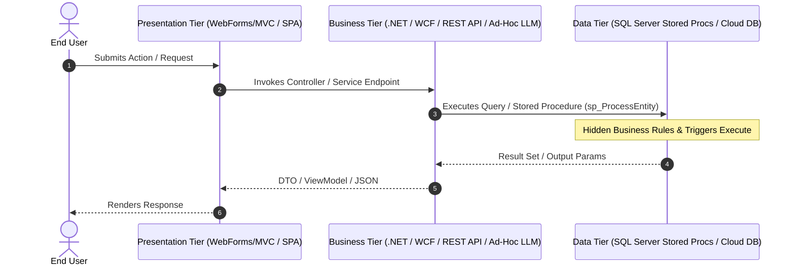

# Brownfield Baseline Specification: [SYSTEM_OR_SUBSYSTEM_NAME]

## Document Control

| Field | Value |
| :--- | :--- |
| **Baseline ID** | `BASELINE-YYYYMMDD-001` |
| **Workload Type** | `Regular App` \| `AI Agent` \| `Hybrid` |
| **Assessment Track** | `Track A: Legacy 3-Tier / .NET Framework` \| `Track B: Modern Cloud-Native (Undocumented/Untested)` \| `Hybrid` |
| **Status** | `Draft` \| `In Review` \| `Verified Baseline` |
| **Author** | |
| **Date** | `YYYY-MM-DD` |
| **Version** | `1.0` |
| **Discovery Reference** | `N/A` \| `specs/discovery/DISCOVERY-YYYYMMDD-001.md` |
| **Companion Artifacts** | `docs/<project>-architecture.md` \| `docs/codemender-01-vulnerability-scan-report.md` \| `docs/waf-saif-review_<project>.md` |

> [!IMPORTANT]
> **Workload Mode & Baseline Completion Mandate (`Analyze Repo First -> ask_question -> Zero Placeholders`):**
> - Set **`Workload Type`** to **`Regular App`** when reverse-engineering a non-AI legacy or cloud application (e.g., 3-Tier `.NET`/SQL, Java, Node, Python, Go REST/web app). **Omit or mark `N/A` every subsection or row tagged `[AI-Agent Only]`.**
> - Set **`Workload Type`** to **`AI Agent`** or **`Hybrid`** when the existing codebase contains LLM calls, RAG pipelines, prompt chains, or conversational agents (or is being assessed for Dual-Runtime decoupling).
> - **Mandatory Baseline Completion Protocol:** Reverse-engineer existing code, SQL stored procedures/schemas, configs, and user context **first** to populate `Document Control` + Sections `1–8`; then invoke **`ask_question`** to resolve undocumented operational SLAs, business quirks (Invariant vs. Defect), or modernization strategy choices—leaving **zero `TBD` or unfilled placeholders** in `Verified Baseline` specs.

---

## 1. Executive Summary & Problem Framing (As-Is)

### 1.1 Business Context, As-Is Purpose & Brownfield Track Classification
- **Current System Purpose & Footprint:** Summarize what the existing system or subsystem currently does in production, its target users, and its current hosting environment.
- **Brownfield Track Classification:**
  - [ ] **Track A — Legacy Enterprise / 3-Tier Application (e.g., `.NET Framework`, ASP.NET WebForms/MVC, WCF/SOAP, SQL Server Stored Procedures):** Tightly coupled UI/Business/Data tiers, server-side `ViewState`/`HttpContext.Session`, `Web.config`/`App.config`, and hidden business logic inside SQL Stored Procedures or Triggers.
  - [ ] **Track B — Modern Cloud-Native Codebase Lacking Documentation & Testing (e.g., React/Node/Python/Go microservices, or ad-hoc LLM/Agent code):** Modern frameworks/containers that grew organically without formal specs, strict schemas, unit/property-based tests, or WAF[/SAIF] guardrails.

### 1.2 As-Is Operational Scope & `[AI-Agent Only]` Autonomy Boundaries
- **Automated Legacy Workflows & Batch Jobs (Universal):** Existing synchronous transactions, cron/SQL Agent batch jobs, and automated integrations.
- **Manual / Role-Gated Processes & Out-of-Scope Modules (Universal):** Current human approval steps, admin-only screens, and legacy subsystems excluded from this baseline.
- **`[AI-Agent Only]` Existing LLM / Agent Autonomy & HITL Gaps:** *(Omit for `Regular App`)* Document any existing autonomous tool calls, inline prompt mutations, or missing externalized HITL gates (`SAIF RAC`).

### 1.3 Observed Baseline SLAs, Traffic & Quality Metrics
- **Observed Operational Metrics (Universal):** Current availability, peak RPS/concurrency, observed p50/p95 latency, batch window durations, and current RTO/RPO reality.
- **`[AI-Agent Only]` Observed Agent / LLM Baseline Metrics:** *(Omit for `Regular App`)* Observed TTFT, hallucination/error frequency, or absence of live evaluation benchmarks.

---

## 2. "As-Is" System Architecture, Topology & Reverse-Engineered Contracts

### 2.1 "As-Is" Architecture Diagram


### 2.2 Tier / Component Interaction Flow & `[AI-Agent Only]` Existing Agent Topology
| Tier / Layer | Existing Component | Technology & Version | Source Path(s) | Key Responsibilities & State Coupling |
| :--- | :--- | :--- | :--- | :--- |
| **Presentation / UI Tier** | *(e.g., ASP.NET MVC / WebForms / React SPA)* | *(e.g., .NET 4.8 / React 18)* | `...` | *(e.g., Renders views, holds `Session`/`ViewState`)* |
| **Business / Service Tier** | *(e.g., C# Class Libraries, WCF `.svc`, FastAPI/Express routes)* | *(e.g., WCF / Python 3.11)* | `...` | *(e.g., Pricing rules, synchronous SOAP/REST calls)* |
| **Data & Persistence Tier** | *(e.g., SQL Server, Stored Procs, Triggers, PostgreSQL/Firestore)* | *(e.g., MSSQL 2019)* | `...` | *(e.g., Tables, Stored Procedures, Triggers, batch jobs)* |
| **`[AI-Agent Only]` LLM / Agent Layer** | *(Omit or `N/A` for `Regular App`; e.g., inline LangChain / raw SDK loop)* | *(e.g., Unpinned LLM SDK)* | `...` | *(e.g., Coupled inside web server, regex routing, no ADK separation)* |

### 2.3 Current Compute Runtime, Config Inventory & `[AI-Agent Only]` Model Usage
- **Current Compute & Hosting (Universal):** VMs / IIS / App Service / GKE / Cloud Run configuration and region footprint.
- **Configuration Inventory (`Web.config` / `.env.*` $\rightarrow$ Unified `.env`):**
  | Config Key / Connection String | Current Source (`Web.config` / `.env.*` / Hardcoded) | Purpose | Target Unified `.env` / Secret Manager Mapping |
  | :--- | :--- | :--- | :--- |
  | `DefaultConnection` | `Web.config <connectionStrings>` | Primary DB | `NONPROD_DB_URI` / `PROD_DB_URI` (Secret Manager) |
- **`[AI-Agent Only]` Current Model Selection & Runtime Coupling:** *(Omit for `Regular App`)* Document any unpinned model IDs, direct API keys, or missing `agent_runtime` separation.

### 2.4 Reverse-Engineered Data Models, API Contracts & Hidden Business Logic Matrix
- **Core Data Entities & Schemas (As-Is SQL DDL / DTOs / Interfaces):**
  ```sql
  -- As-Is Database Table & Constraints
  ```
- **Existing Endpoints / WCF Operations / RPCs:** Document path/operation, auth mechanism, request/response payloads, and error codes.
- **Hidden Business Logic Extraction Matrix *(Critical for Track A 3-Tier & Undocumented Track B Code)*:**
  | Logic ID | Source Location (File / Stored Proc / Trigger) | Discovered Business Rule / Calculation | Side Effects / State Mutations | Target Destination in Modernized SDD |
  | :--- | :--- | :--- | :--- | :--- |
  | `BL-001` | *(e.g., `dbo.usp_CalculateDiscount`)* | *(e.g., Applies tiered discount when tenure > 3 yrs)* | *(Writes `AuditLog` via `trg_OrderUpdate`)* | *(Extract to explicit domain service)* |
  | `BL-002` | *(e.g., `OrderController.cs:L142`)* | *(e.g., Rejects `Status == 4` outside `US`)* | *(Mutates `HttpContext.Session["LastError"]`)* | *(Codify in Pydantic/Zod schema + stateless API)* |

---

## 3. "As-Is" Security, Privacy & `[AI-Agent Only]` SAIF Gap Assessment

### 3.1 Existing Input/Output Validation & `[AI-Agent Only]` Guardrail Gaps
- **Application Security & SAST Baseline (Universal):** Document current input validation, SQL parameterization vs. dynamic SQL risks, XSS/CSP posture, PII handling, and baseline **CodeMender** scan results (`docs/codemender-01-vulnerability-scan-report.md`).
- **`[AI-Agent Only]` Prompt Injection & DLP Callback Gaps:** *(Omit for `Regular App`)* Document missing Model Armor Direct/Indirect `PIJ` hooks or unredacted PII sent to LLMs (`EDH`/`SDD`).

### 3.2 Existing Identity, Authorization & Execution Isolation
- **As-Is Auth & IAM Posture (Universal):** Document Windows Auth/AD, session cookies, OAuth/JWT, or unauthenticated/`allUsers` exposure and container/VM privilege level.
- **`[AI-Agent Only]` Confused-Deputy & Sandboxing Gaps:** *(Omit for `Regular App`)* Document shared ambient Service Account usage vs. per-caller `User Auth` propagation.

### 3.3 Existing Network Perimeter, Secrets & Compliance Posture
- **Perimeter & Encryption Gaps (Universal):** Document public IPs, VPC/firewall posture, encryption-at-rest (default keys vs. CMEK), hardcoded secrets, and data residency constraints.

### 3.4 Governance (Rules 1–13), WAF 6-Pillar & `[AI-Agent Only]` SAIF Gap Matrix
| Governance Rule / Framework | Applicability | Current Brownfield State ("As-Is") | Status | Target SDD Remediation |
| :--- | :--- | :--- | :--- | :--- |
| **Google Cloud WAF 6 Pillars** | **Universal** | *(e.g., Single-zone DB, no SLOs, no CMEK/VPC-SC, no FinOps labels or CFE % tracking)* | `Non-Compliant` \| `Partial` | Remediate across Sections 3–6 of target Feature SDD. |
| **Pre-Build CodeMender SAST & SLSA L3 (Rules 3–4)** | **Universal** | *(Baseline scan: `docs/codemender-01-vulnerability-scan-report.md`; no Binary Auth)* | `Pending` \| `Audited` | Remediate Critical/High findings; add SLSA L3 + Binary Auth. |
| **Cloud Run `/healthz`, Unified `.env` & Zero-Trust IAM (Rules 6, 8, 10)** | **Universal** | *(e.g., No `/healthz`; `Web.config`/`.env.*` sprawl; legacy auth or `allUsers`)* | `Non-Compliant` \| `Compliant` | Add `/healthz`, single `.env` + Secret Manager, Pattern 1A ALB+Cloud Armor+IAP / 1B Direct Cloud Run IAP / 2 OAuth2. |
| **4-Step RCA & Zero Mockup Fallbacks (Rule 13)** | **Universal** | *(e.g., Silent catch blocks or hardcoded fallback dicts)* | `Non-Compliant` \| `Compliant` | Replace with transparent WAF graceful degradation. |
| **Dual-Runtime, Google ADK, SAIF 2.0 & Live Eval (Rules 11–12)** | **`[AI-Agent Only]`** *(Mark `N/A` for `Regular App`)* | *(e.g., Inline LLM SDK in web app, regex routing, zero Model Armor/DLP callbacks, no live evals)* | `Non-Compliant` \| `N/A` | Decouple to `agent_runtime` (`google-adk`) + 4-point callbacks + `agents-cli eval`. |

---

## 4. "As-Is" Resiliency, Reliability & State Integrity

### 4.1 Timeouts, Rate Limits & `[AI-Agent Only]` Anti-Loop Gaps
- **Universal:** Document existing HTTP/DB timeouts, rate-limiting gaps, unbounded queries, or retry storms.
- **`[AI-Agent Only]`:** *(Omit for `Regular App`)* Document missing `max_iterations` or unbounded LLM token/loop risks (`SAIF DMS`).

### 4.2 Idempotency, Stateful Coupling (`Session` / `ViewState`) & Transactions
- **State Integrity (Universal):** Document sticky-session dependencies (`HttpContext.Session`, `ViewState`, in-memory caches), distributed/DB transaction boundaries, and duplicate-submission vulnerabilities (missing `X-Idempotency-Key`).

### 4.3 Current HA, Error Handling & `[AI-Agent Only]` Model Fallback Gaps
- **Universal:** Document single-point-of-failure hosts/DBs, backup/restore posture, and any Rule 13 anti-patterns (silent error swallowing or synthetic fallback data).
- **`[AI-Agent Only]`:** *(Omit for `Regular App`)* Document PayGo 429 quota bottlenecks or missing regional model fallbacks.

---

## 5. "As-Is" Observability, Characterization Safety Net & `[AI-Agent Only]` AgentOps

### 5.1 Current Health Probes, Tracing & Monitoring Gaps
- **Universal:** Document presence/absence of `/healthz` probes, distributed tracing (OpenTelemetry), and actionable SLO alerts *(plus `[AI-Agent Only]` LLM/tool trace visibility if applicable)*.

### 5.2 Current Logging & Audit Trail Posture
- **Universal:** Document flat-file/EventLog/stdout logging, missing trace correlation, or raw PII exposure in logs.

### 5.3 Characterization Test Suite (Golden Master), Baseline PBTs, CI/CD & `[AI-Agent Only]` Baseline Eval
*(Mandatory Safety Net: Before refactoring or migrating brownfield code, lock in baseline behavior with automated Characterization Unit Tests and Property-Based Tests.)*
- **Deterministic Characterization Tests (Universal):**
  - **Location:** `tests/characterization/` or `tests/unit/baseline/`
  - **Coverage:** Golden-master input/output parity for happy paths and confirmed edge cases (Section 7.1).
- **Generative Property-Based Tests (PBT) for Baseline Invariants (Universal):**
  - **Framework:** `hypothesis` (Python) / `fast-check` (TypeScript) / `FsCheck` (.NET)
  - **Verified Invariants:** Calculation parity (`modernized_fn(x) == legacy_fn(x)`), serialization round-tripping, and domain conservation laws (e.g., non-negative balances).
- **As-Is CI/CD Pipeline:** Document existing manual or automated build/release steps.
- **`[AI-Agent Only]` Baseline Agent Evaluation:** *(Omit for `Regular App`)* Record baseline `agents-cli eval` precision/groundedness scores prior to refactoring.

---

## 6. "As-Is" Performance, Caching & Cost / FinOps Baseline

### 6.1 Observed Latency Bottlenecks & Current Caching
- **Universal:** Document N+1 queries, synchronous blocking calls, lock contention, and existing CDN/in-memory/Redis caches *(plus `[AI-Agent Only]` uncached prompt latency if applicable)*.

### 6.2 Current Infrastructure Run-Rate, Sustainability (`CFE %`) & `[AI-Agent Only]` Token Spend
- **Universal:** Current monthly hosting/license run-rate, idle over-provisioning, missing FinOps cost labels, and current region `CFE %` *(plus `[AI-Agent Only]` current LLM token spend if applicable)*.

---

## 7. Ambiguity Triage Log (`ask_question`) & Modernization ADRs

### 7.1 Ambiguities, Legacy Quirks & Defect Triage Log (`ask_question` Decisions)
*(Every undocumented quirk or suspected bug discovered during reverse-engineering MUST be clarified with the user via `ask_question` before locking in Section 5.3 tests.)*

| Item ID | Source Location | Observed Behavior / Anomaly | User Decision (`ask_question`) | Action in Target Spec |
| :--- | :--- | :--- | :--- | :--- |
| `AMB-01` | `...` | *(e.g., Negative quantities silently rounded to 0 instead of HTTP 400)* | `Preserve as Baseline Invariant` \| `Remediate as Defect` | *(Keep in characterization test OR fix in `SPEC-YYYYMMDD`)* |

### 7.2 Confirmed Modernization Strategy & Architectural Decision Records (`ADRs`)
- **Confirmed Modernization Strategy (via `ask_question`):**
  - [ ] **ADR-01 (Strangler Fig / Incremental API Facade):** Carve out bounded contexts into Cloud Run (`cloud_run`) *(and `agent_runtime` if `AI Agent`/`Hybrid`)* behind an ALB/API Facade while incrementally retiring legacy tiers.
  - [ ] **ADR-01 (Full Cloud-Native / Dual-Runtime Re-Architecture):** Re-implement presentation, extracted stored-procedure business logic, and data/AI layers cleanly on GCP with 100% PBT parity verification.
  - [ ] **ADR-01 (In-Place Cloud-Native Hardening — Track B):** Retain modern service codebase while backfilling SDD contracts, Characterization + PBTs, `/healthz`, unified `.env`, WAF Zero-Trust ingress *(and `agent_runtime` decoupling if `AI Agent`/`Hybrid`)*.
- **ADR-02:** *[Additional key migration/architecture decision & trade-offs]*

---

## 8. "As-Is" Failure Mode & Effects Analysis (FMEA) & Migration Risks

| ID | Legacy Component / Migration Boundary | Failure Mode / Cutover Risk | Impact | Detection Signal | Mitigation & Cutover Safeguard |
| :--- | :--- | :--- | :--- | :--- | :--- |
| **FMEA-01** | Stateful UI / Session Tier *(Universal)* | Server restart or multi-instance load balancing drops in-memory `Session` / `ViewState` | Mid-transaction data loss / forced logout | HTTP 500 / session-null errors | Externalize state to stateless tokens / Memorystore / DB before horizontal scaling |
| **FMEA-02** | Hidden DB Triggers / Stored Procs *(Universal)* | New Cloud Run service writes directly to table, bypassing legacy stored-proc side effects | Silent audit/ledger drift between old and new paths | Characterization / reconciliation PBT mismatch | Extract all Section 2.4 `BL-*` rules into shared domain API or transactionalfacade |
| **FMEA-03** | **`[AI-Agent Only]`** Legacy Inline LLM Calls | Unscreened external data or regex misrouting triggers prompt injection / wrong tool | Sensitive data leak or unintended mutation | Baseline red-team eval / audit log | Migrate to `agent_runtime` (`google-adk`) with 4-point Model Armor/DLP callbacks & externalized HITL |
