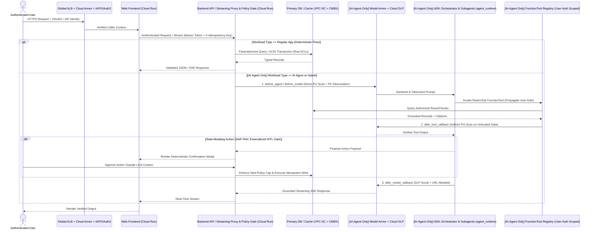

# Enterprise Solution Design & Specification: [SPEC-YYYYMMDD-TITLE]

## Document Control

| Field | Value |
| :--- | :--- |
| **Spec ID** | `SPEC-YYYYMMDD-001` |
| **Workload Type** | `Regular App` \| `AI Agent` \| `Hybrid` |
| **Status** | `Draft` \| `In Review` \| `Approved` \| `Implemented` |
| **Author** | |
| **Date** | `YYYY-MM-DD` |
| **Version** | `1.0` |
| **Discovery Reference** | `N/A` \| `specs/discovery/DISCOVERY-YYYYMMDD-001.md` |
| **Baseline Reference** | `N/A (Greenfield)` \| `specs/baseline/system-overview.md` |

> [!IMPORTANT]
> **Workload Mode & Section Completion Mandate (`Analyze First -> ask_question -> Zero Placeholders`):**
> - **`Regular App` (Non-AI Web, API, Microservice, or Data Workload):** Enforces **Google Cloud Well-Architected Framework (6 Pillars)** and **Governance Rules 1–10 & Rule 13** on **Google Cloud Run (`cloud_run`)** / native GCP services. **Omit or mark `N/A` every subsection, table row, or step tagged `[AI-Agent Only]`.**
> - **`AI Agent` / `Hybrid` Workload:** Enforces **Dual-Runtime Separation** (`cloud_run` + `agent_runtime`), **Google Cloud WAF (6 Pillars)**, **Google SAIF / SAIF 2.0**, and **all Governance Rules 1–13**.
> - **Mandatory Section Completion Protocol:** Before requesting Step 2.3 stakeholder sign-off, you **MUST** (1) **analyze user requirements, repository code/configs, and `specs/baseline/` first** to populate every derivable field without asking redundant questions, (2) **invoke `ask_question`** with `(Recommended)` WAF/SAIF options for any required section (`Document Control` + Sections `1–10`) whose inputs remain underspecified, and (3) **replace all template placeholders** (`[SPEC-YYYYMMDD-TITLE]`, `[e.g., ...]`, `[Decision Title]`, `YYYY-MM-DD`, `TBD`, and unselected `|` unions in `Document Control`) with concrete, verified values.

---

## 1. Executive Summary & Problem Framing

### 1.1 Business Context & Problem Statement
- **Context & Motivation:** Describe the business background, current pain points, target user personas, and expected measurable outcome.
- **Goals:** Concrete, testable outcomes delivered by this specification.

### 1.2 Scope Definition & Operational / `[AI-Agent Only]` Autonomy Boundaries
- **In-Scope Automated Capabilities (Universal):** Deterministic system workflows, background jobs, and automated API operations.
- **Human-Gated / Role-Approved Capabilities (Universal):** Operations requiring RBAC privilege checks, maker-checker approval, or administrative sign-off.
- **Explicit Non-Goals (Out-of-Scope):** Capabilities intentionally excluded to prevent scope creep.
- **`[AI-Agent Only]` Autonomous Agent vs. Externalized HITL Boundaries (`SAIF RAC`):**
  - **Autonomous Read-Only Scope:** Informational queries and grounded RAG lookups permitted without human confirmation.
  - **Deterministic Human-in-the-Loop (HITL) Gated Scope:** State-mutating, financial, or destructive actions requiring hard microservice policy caps and externalized human signature approval outside the LLM context window.

### 1.3 Workload-Specific Acceptance Criteria & SLAs
- **Universal Operational SLAs (WAF Pillars 3 & 5):**
  - **Composite Availability SLO & Error Budget:** `[e.g., 99.95% monthly availability; 21.6m error budget]`
  - **API / Page Latency & Throughput:** `[e.g., API p95 <= 300ms at N RPS]`
  - **Recovery Objectives:** `RTO: [e.g., <= 15m]` | `RPO: [e.g., <= 5m]`
- **`[AI-Agent Only]` Agentic Quality & Streaming SLAs (Rule 12 & SAIF 2.0):**
  - **Streaming Latency:** `TTFT p95 <= 800ms` | `End-to-End Turn p95 <= 2.5s`
  - **Agent Evaluation Gates (`agents-cli eval`):** Tool Selection Precision `>= 95%`, Factual Groundedness `1.000` (`100%`), SAIF Adversarial Block Rate `100%`.

---

## 2. System Architecture, Topology & Code Contracts

### 2.1 Architecture Diagram
*(For **`Regular App`**, depict the Single-Runtime `cloud_run` + Database/Cache/Queue Zero-Trust topology. For **`AI Agent` / `Hybrid`**, include the Dual-Runtime `cloud_run` + `agent_runtime` topology and SAIF 2.0 4-point callback flow below.)*



### 2.2 Service Interaction Flow & `[AI-Agent Only]` Agent Topology
- **Service & Component Interaction Flow (Universal):** Describe frontend, API gateway/backend services, async workers/queues, and database interactions.
- **`[AI-Agent Only]` Agent Topology & Orchestration Flow (Rule 11):** *(Omit for `Regular App`)*
  - **Root Orchestrator & Subagents:** Official `google-adk` `OrchestratorAgent` delegating to least-privilege Read-Only Retrieval Subagents vs. Bounded Action Subagents.
  - **Canonical MECE Intent Topology:** Enumerate mutually exclusive, collectively exhaustive intents (always including `OTHERS`) routed strictly via LLM cognitive reasoning (zero regex/keyword heuristics).

### 2.3 Compute Runtime, WAF 6-Pillar Alignment & `[AI-Agent Only]` Model Selection
| Dimension | Web Frontend, Backend APIs & Policy Gate *(Universal)* | `[AI-Agent Only]` Conversational AI & Reasoning Engine *(Omit for Regular App)* |
| :--- | :--- | :--- |
| **Target Runtime** | **Google Cloud Run (`cloud_run`)** + Managed GCP Data Services | **Gemini Enterprise Agent Platform (`agent_runtime`)** |
| **Compute & Sizing** | Stateless non-root containers, CPU/memory bounds, `min-instances` (`0` in `nonprod`), co-located **`High CFE %`** (`Low CO2`) region | Managed ADK runtime co-located in the same GCP region |
| **`[AI-Agent Only]` Model Selection** | `N/A (Deterministic Application)` | Pinned model IDs (`gemini-2.5-flash-001` / `gemini-2.5-pro-001`); Vertex AI Provisioned Throughput (GSUs) + PayGo spillover |
| **Deployment & Governance** | Cloud Build (`cloudbuild.yaml` + SLSA Level 3 / Binary Auth) + Terraform Infrastructure Manager ([`devops_security_and_quality_standards.md`](../../_agents/rules/devops_security_and_quality_standards.md)) | `agents-cli deploy --deployment-target agent_runtime` inside VPC-SC + CMEK ([`google_adk_and_agent_runtime.md`](../../_agents/rules/google_adk_and_agent_runtime.md)) |

- **Google Cloud Well-Architected Framework (6 Pillars) Summary ([`gcp-well-architected-saif`](../../_agents/skills/gcp_well_architected_saif/SKILL.md)):**
  1. **Operational Excellence:** Cloud Monitoring SLIs/SLOs & Error Budgets, OpenTelemetry Cloud Trace, structured JSON Cloud Logging, 100% Terraform IaC, Cloud Build canary rollouts + automated rollback (Section 5).
  2. **Security, Privacy & Compliance:** Zero-Trust ALB + Cloud Armor + IAP/OAuth2 ingress, VPC-SC + Private Service Connect, Cloud KMS (CMEK), Secret Manager, CodeMender SAST + SLSA Level 3 / Binary Auth, Cloud DLP *(+ `[AI-Agent Only]` Model Armor & SAIF 2.0)* (Section 3).
  3. **Reliability:** Multi-zone/multi-region HA, RTO/RPO targets, idempotency, bounded timeouts, circuit breakers, exponential backoff + jitter, and transparent graceful degradation (Section 4).
  4. **Cost Optimization (FinOps):** Unit economics KPI, mandatory cost labels (`env`, `service`, `owner`, `cost_center`), BigQuery Billing Export + Anomaly Alerts, `nonprod` scale-to-zero, CUDs *(+ `[AI-Agent Only]` Context Caching & model routing)* (Section 6).
  5. **Performance Optimization:** Co-located region, CDN/Memorystore/DB indexing, Startup CPU Boost *(+ `[AI-Agent Only]` SSE streaming & parallel `FunctionTool` fan-out)* (Section 6).
  6. **Sustainability:** High-CFE % (`Low CO2`) region via Region Picker within residency/RTT bounds, scale-to-zero idle compute, storage/log TTL lifecycles, and BigQuery Carbon Footprint export (Section 6).

### 2.4 Data Models, API Contracts & UI State Schemas
- **Data Models & Type Contracts (Single Source of Truth — TypeScript / Pydantic / SQL DDL):**
  ```typescript
  export interface ExampleDataModel {
    id: string;
    name: string;
    status: 'PENDING' | 'ACTIVE' | 'ARCHIVED';
    createdAt: string;
    updatedAt: string;
  }
  ```
- **REST / gRPC API Contracts (Universal):**
  - **Endpoint:** `POST /api/v1/example`
  - **Headers:** `Authorization: Bearer <token>`, `X-Idempotency-Key: <uuid>`, `Content-Type: application/json`
  - **Request / Response (`200 OK`) Payloads:** Document exact JSON schemas.
  - **Error & Degraded-Mode Contracts:** `400`, `401`, `403`, `404`, `429`, and `503` (`status: "UPSTREAM_UNAVAILABLE_DEGRADED"` with transparent metadata; zero fabricated data).
- **`[AI-Agent Only]` ADK `FunctionTool` Contracts:** *(Omit for `Regular App`)* Document tool signatures, Pydantic args, *"When to use"* / *"When NOT to use"* docstrings, `User Auth` token requirement, and externalized HITL policy caps.
- **UI/UX Behavioral State Machine:** `Idle` $\rightarrow$ `Loading` *(or `[AI-Agent Only]` `Streaming` / `Awaiting External HITL Confirmation`)* $\rightarrow$ `Success` | `Degraded Mode` | `Error`.

---

## 3. Security, Privacy, Compliance & `[AI-Agent Only]` SAIF Alignment

### 3.1 Input/Output Guardrails & Injection Defenses
- **Universal Application Defenses:** Cloud Armor WAF rules (OWASP Top 10, SQLi, XSS — *Pattern 1A/2*) or Direct Cloud Run IAP + strict app-layer rate/schema controls (*Pattern 1B*), strict input schema validation (Pydantic/Zod), parameterized SQL queries, output HTML escaping + Content Security Policy (CSP), Sensitive Data Protection (Cloud DLP) PII classification/redaction, pre-build **CodeMender** SAST (`cm find/verify/fix`), Artifact Analysis CVE scanning, and **SLSA Level 3 provenance + Binary Authorization**.
- **`[AI-Agent Only]` 4-Point Inline Model Armor + Cloud DLP Callbacks:** *(Omit for `Regular App`)*
  1. `before_agent_callback` & `before_model_callback`: Direct Prompt Injection (`PIJ`) screening via **Model Armor** + bidirectional **Cloud DLP** PII/PCI tokenization (`EDH`) prior to LLM, context cache, `agentengine://`, or logs.
  2. `after_tool_callback`: Mandatory **Indirect Prompt Injection (`PIJ`)** scan via **Model Armor** across all untrusted RAG chunks, database fields, and external API tool outputs before re-entering model context.
  3. `after_model_callback`: Outbound **Cloud DLP** sensitive data scrubbing (`SDD`) + strict outbound URL allowlist verification (`IMO`).

### 3.2 Identity Delegation, Authorization & Execution Sandboxing
- **Universal Zero-Trust IAM & Container Sandboxing (Rule 10):**
  - **Ingress Pattern:** Pattern 1A (**Global External ALB + Cloud Armor + Identity-Aware Proxy `[Default for Tier-1/Regulated]`**), Pattern 1B (**Direct Cloud Run IAP `--iap` + `INGRESS_TRAFFIC_ALL` + `x-goog-iap-jwt-assertion` JWT check + ADR trade-off `[Internal Workforce / Single-Region / Cost-Optimized]`**), or Pattern 2 (**App-Level OAuth 2.0/OIDC + Cloud Armor**); `--no-allow-unauthenticated` and zero `allUsers` / `allAuthenticatedUsers` bindings (`constraints/iam.allowedPolicyMemberDomains`). *(Pattern 3 restricted strictly to public non-sensitive static pages).*
  - **Service Identity & Runtime Isolation:** Dedicated per-service IAM Service Accounts (zero default compute SAs), row/tenant-level RBAC/ACLs, non-root container user, and read-only root filesystem where supported.
- **`[AI-Agent Only]` Agentic Identity & Anti-Confused-Deputy (`SAIF 2.0`):** *(Omit for `Regular App`)*
  - **Caller Propagation (`User Auth`):** Propagate down-scoped end-user OAuth 2.0 access tokens to `FunctionTool`s and RAG data stores alongside attested `Agent Identity`—never query user-scoped data using an over-privileged shared agent SA.
  - **Subagent & Tool Sandboxing:** Separate read-only retrieval subagent principals from action principals; execute untrusted parsing or code tools in isolated sandboxes; enforce externalized deterministic HITL signatures outside the LLM context.

### 3.3 Network Security, Perimeter & Compliance
- **Perimeter & Encryption (Universal — WAF Pillar 2 & Rules 8–9):** **VPC Service Controls (VPC-SC)** perimeter + **Private Service Connect** (zero public DB IPs), **Cloud KMS Customer-Managed Encryption Keys (CMEK)** across stateful stores/logs/artifacts, unified single-file `.env` (`NONPROD_*` / `PROD_*` blocks) + **Secret Manager** for secrets, **Assured Workloads** / `constraints/gcp.resourceLocations`, and immutable **Cloud Audit Logs** (`Bucket Lock`).

### 3.4 Governance Checklist (Rules 1–13) & `[AI-Agent Only]` SAIF 15-Risk Matrix
| Rule / Framework | Applicability | Requirement Verification |
| :--- | :--- | :--- |
| **Google Cloud WAF (6 Pillars)** | **Universal** | Validated via [`gcp-well-architected-saif`](../../_agents/skills/gcp_well_architected_saif/SKILL.md) (`validate_waf_saif.py`); takes strict precedence on conflicts. |
| **Rules 1–5 (SCM, Quality, CodeMender SAST, SLSA L3, Cloud Build)** | **Universal** | Multi-branch Git (`main`/`develop` $\rightarrow$ PR to `prod`), linters/type-checks, `cm find/verify/fix`, Artifact Analysis + SLSA L3 / Binary Auth, immutable Cloud Build tags. |
| **Rules 6–10 (Cloud Run `/healthz`/SLOs, Smoke Test, `.env`/CMEK, Terraform/VPC-SC/FinOps/CFE, Zero-Trust IAM)** | **Universal** | `/healthz` probes, SLO burn-rate alerts, post-deploy smoke test + auto-rollback, single `.env` + Secret Manager/CMEK, Terraform Infra Manager + VPC-SC + High-CFE %, IAP/OAuth2 (zero `allUsers`). |
| **Rule 13 (4-Step RCA & WAF Graceful Degradation)** | **Universal** | Mandatory 4-Step RCA + `ask_question` sign-off on any test/eval failure; zero mockup data or regex patches. |
| **Rules 11–12 (`google-adk`, SAIF 2.0 Guardrails & DLP-Safe Live Eval)** | **`[AI-Agent Only]`** *(Mark `N/A` for `Regular App`)* | Official `google-adk` on `agent_runtime`, MECE intents (`OTHERS`), `User Auth`, externalized HITL, 4-point Model Armor/DLP hooks, and DLP-safe live `agents-cli eval` ($\ge 95\%$ precision, $1.000$ groundedness). |

- **`[AI-Agent Only]` Google SAIF & SAIF 2.0 15-Risk Mitigation Summary:** *(Omit or mark `N/A` when `Workload Type` is `Regular App`; see full catalog in [`solution_design_compliance_template.md`](../../_agents/skills/gcp_well_architected_saif/references/solution_design_compliance_template.md))*
  - **Data (`DP`, `UTD`, `EDH`):** Locked ingestion IAM + SHA-256 checksums; zero customer-data training; `before_agent_callback` Cloud DLP tokenization.
  - **Infrastructure (`MST`, `MXF`, `MDT`, `DMS`):** CodeMender + SLSA L3 + Binary Auth; VPC-SC + CMEK; Terraform drift checks; Cloud Armor / app-level per-user rate limits + ADK step/token ceilings + Provisioned Throughput spillover.
  - **Model (`MRE`, `IIC`, `PIJ`, `MEV`, `SDD`, `ISD`):** Per-user throttling & SCC AI Protection; vetted `FunctionTool` allowlist; Model Armor on `before_agent` (Direct `PIJ`) and `after_tool_callback` (Indirect `PIJ`); input canonicalization; `User Auth` row/doc ACLs + `after_model_callback` DLP scrubbing.
  - **Application & Agent (`IMO`, `RAC`):** $1.000$ groundedness citations, Pydantic validation, safe UI escaping & URL allowlist (`IMO`); read-only retrieval subagents, `User Auth` propagation, deterministic policy caps, externalized signed HITL gate, and idempotency keys (`RAC`).

---

## 4. Resiliency, Reliability & State Integrity

### 4.1 Execution Boundaries & `[AI-Agent Only]` Anti-Loop Safeguards
- **Universal Execution Boundaries:** Bounded HTTP/RPC/DB connection and request timeouts, Cloud Armor (*Pattern 1A/2*) or app-layer (*Pattern 1B*) per-user/IP rate limits, `max-instances` caps, bounded retry budgets, API pagination limits, and async queue Dead-Letter Queues (DLQs).
- **`[AI-Agent Only]` Anti-Loop & Denial-of-ML-Service Safeguards (`SAIF DMS`):** *(Omit for `Regular App`)* Explicit ADK `max_iterations` / step ceilings, subagent recursion cycle detection, and per-session token/wall-clock execution budgets.

### 4.2 Idempotency & Transactional Consistency
- **State Integrity (Universal):** Enforce `X-Idempotency-Key` deduplication on all state-mutating `POST`/`PUT`/`PATCH`/`DELETE` operations (and `[AI-Agent Only]` action tools / HITL endpoints), ACID database transactions or transactional outbox patterns, optimistic concurrency control, and deterministic server-side business policy caps.

### 4.3 High Availability, Graceful Degradation & `[AI-Agent Only]` Model Fallbacks
- **Multi-Zone / Multi-Region HA & Graceful Degradation (Universal — WAF Pillar 3 & Rule 13):**
  - Regional multi-zone Cloud Run + HA database failover (Cloud SQL HA / AlloyDB / Spanner) + cross-region backup/DR meeting RTO/RPO.
  - Circuit breakers and retries with **exponential backoff + jitter**. When upstream dependencies remain unavailable, return explicit **`status: "UPSTREAM_UNAVAILABLE_DEGRADED"`** or verified read-only cached reference data stamped with `is_cached_degraded: true` and `as_of_timestamp`—**strictly zero fabricated/mockup records**.
- **`[AI-Agent Only]` Model Capacity & Endpoint Fallbacks:** *(Omit for `Regular App`)* Vertex AI **Provisioned Throughput** baseline with automatic **PayGo spillover** on burst traffic and secondary-region Vertex AI endpoint failover.

---

## 5. Observability, Operations & `[AI-Agent Only]` AgentOps

### 5.1 End-to-End Tracing, Health Probes & Span Hierarchy
- **Universal Probes, SLOs & Distributed Tracing (Rule 6):**
  - Unauthenticated container-local **`GET /healthz`** startup and liveness probe verifying dependency readiness; Cloud Monitoring **SLO burn-rate alerts** paged on error-budget consumption.
  - **OpenTelemetry Cloud Trace** propagating W3C `traceparent` across `ALB or Direct IAP Ingress -> Cloud Run UI/API -> Cache/Database/Queue`.
- **`[AI-Agent Only]` AgentOps Span Hierarchy:** *(Omit for `Regular App`)* Extend OpenTelemetry spans across `Cloud Run Proxy -> Model Armor/DLP Pre-Hook -> ADK Orchestrator -> Subagent -> Gemini LLM Call -> FunctionTool -> Post-Tool PIJ Scan`.

### 5.2 Structured Logging & Correlation
- **DLP-Safe Structured Telemetry (Universal):** Emit JSON-structured logs to **Cloud Logging** correlated via `logging.googleapis.com/trace` and `spanId` (plus `[AI-Agent Only]` DLP-tokenized `session_id` / `turn_id`), with zero raw PII/secrets/tokens and immutable **Cloud Audit Logs** (`Bucket Lock`) for administrative and data-access events.

### 5.3 CI/CD, Automated Testing & `[AI-Agent Only]` Continuous Evaluation
- **Universal CI/CD & Verification Gates (Rules 2–7):**
  - **Cloud Build (`cloudbuild.yaml`):** Automated lint/type-check $\rightarrow$ **Deterministic Unit Tests** + **Generative Property-Based Tests (PBT)** (`hypothesis` / `fast-check`) $\rightarrow$ **CodeMender SAST** + Artifact Analysis + SLSA L3 attestation $\rightarrow$ canary revision deployment $\rightarrow$ live `/healthz` & functional smoke tests $\rightarrow$ automated rollback on failure.
- **`[AI-Agent Only]` Continuous Evaluation & Golden Datasets (Rule 12):** *(Omit for `Regular App`)*
  - Automated **`agents-cli eval run`** in CI/CD against DLP-de-identified / synthetic Non-Prod live backends using golden + red-team datasets (`evals/datasets/*.jsonl`), gating promotion on `>= 95%` tool precision, `1.000` groundedness, and `100%` SAIF adversarial block rate.

---

## 6. Performance Optimization, FinOps & Sustainability

### 6.1 Latency Engineering & Caching Strategy
- **Universal Performance Optimization (WAF Pillar 5):** Co-locate compute, KMS, and databases in a single GCP region; leverage **Cloud CDN** (*static assets on Pattern 1A/2*), **Memorystore** (hot state/read cache), database query indexing & connection pooling, and Cloud Run **Startup CPU Boost** + `prod` `min-instances`.
- **`[AI-Agent Only]` LLM Latency & Context Caching:** *(Omit for `Regular App`)* **Vertex AI Context Caching** for system instructions/schemas, end-to-end **SSE token streaming** (`X-Accel-Buffering: no`), and parallel asynchronous `FunctionTool` fan-out.

### 6.2 Unit-Cost Modeling, Sustainability & `[AI-Agent Only]` Token Economics
- **Universal FinOps & Sustainability (WAF Pillars 4 & 6, Rule 9):**
  - **Unit Economics KPI:** `[e.g., $X.XX per 1,000 API requests or active user]` (modeled via [`gcp-cost-estimator`](../../_agents/skills/gcp_cost_estimator/SKILL.md) with live GCP Billing API rates).
  - **FinOps Governance:** Mandatory labels (`env`, `service`, `owner`, `cost_center`), **BigQuery Billing Export** + Budget & Anomaly Alerts, `nonprod` scale-to-zero (`min-instances=0`), and Cloud Run / Database **Committed Use Discounts (CUDs)**.
  - **Sustainability (`GreenOps`):** Document selected region **`CFE %`** (`Low CO2`), configure Cloud Storage / BigQuery / Log retention TTLs, and track **Carbon Footprint export to BigQuery**.
- **`[AI-Agent Only]` Token Economics:** *(Omit for `Regular App`)* Track `$ / 1,000 agent turns` or `$ / resolved session`, enforce input/output token caps, route simple intents to **Gemini Flash** vs. complex reasoning to **Gemini Pro**, capture 50%–90% cached input savings via **Context Caching**, use **Batch API** (-50%) for offline jobs, and right-size **Provisioned Throughput (GSUs)**.

---

## 7. Architectural Decision Records (ADRs)

| ADR ID | Competing WAF Pillars / Constraints | Architectural Tension | Selected Resolution & Justification |
| :--- | :--- | :--- | :--- |
| **ADR-01** | **Security & Compliance** vs. **Performance (Latency)** | Inline Zero-Trust auth, Cloud Armor / IAP JWT verification, CMEK/VPC-SC *(and `[AI-Agent Only]` 4-point Model Armor + DLP inspection)* vs. strict p95 latency budget. | Co-locate all compute, security, KMS, and data services in the same GCP region; use connection pooling/caching *(and `[AI-Agent Only]` Context Caching + SSE streaming)*. |
| **ADR-02** | **Reliability (HA)** vs. **Cost Optimization** | Multi-zone/multi-region HA *(and `[AI-Agent Only]` reserved GenAI Provisioned Throughput)* 24/7 vs. baseline infrastructure spend. | Run multi-zone HA + CUDs *(and baseline GSUs + PayGo spillover)* in `prod`, while scaling `nonprod` to zero (`min-instances=0`) *(and if Pattern 1B Direct Cloud Run IAP is selected, document `$0` LB baseline vs. single-region `*.run.app` & no Cloud Armor WAF)*. |
| **ADR-03** | **Sustainability (`CFE %`)** vs. **Data Sovereignty & Latency** | Lowest-carbon region vs. regulatory residency (`constraints/gcp.resourceLocations`) and end-user RTT. | Filter candidate regions by Assured Workloads / residency and RTT bounds first, then select the highest **`CFE %`** region in that compliant set. |

### ADR-01: [Decision Title]
- **Context & Options Considered:**
- **Decision & Consequences:**

### ADR-02: [Decision Title]
- **Context & Options Considered:**
- **Decision & Consequences:**

---

## 8. Failure Mode & Effects Analysis (FMEA)

| ID | Component / Flow | Failure Mode | Blast Radius & User Impact | Detection Signal (SLO / Alert / Probe) | Automated Mitigation & WAF Graceful Degradation |
| :--- | :--- | :--- | :--- | :--- | :--- |
| **FMEA-01** | Primary Database / Upstream API *(Universal)* | Regional outage, connection pool exhaustion, or 5xx timeout | Write operations fail; uncached reads stall | `/healthz` readiness failure, Cloud Monitoring 5xx & latency SLO burn-rate alert | Trip circuit breaker after bounded retries (exponential backoff + jitter); return `503 UPSTREAM_UNAVAILABLE_DEGRADED` or verified `is_cached_degraded: true` reference data (zero mockup records) |
| **FMEA-02** | Edge / Auth Layer *(Universal)* | Invalid/expired OAuth2/IAP token or L7 DDoS traffic spike | Unauthorized requests or edge saturation | Cloud Armor / IAP 401/403 & app rate-limit spike alert | Block/throttle at Global ALB + Cloud Armor edge (*Pattern 1A/2*) or Google IAP proxy + `x-goog-iap-jwt-assertion` JWT check + `max-instances`/per-user rate caps (*Pattern 1B*); trigger client token refresh flow |
| **FMEA-03** | CI/CD Release *(Universal)* | Bad container revision fails startup or regresses error budget | Elevated 5xx on canary slice | `/healthz` probe failure, post-deploy smoke test failure, or SLO alert | Halt canary rollout and automatically roll Cloud Run traffic back to last healthy SHA-pinned revision |
| **FMEA-04** | **`[AI-Agent Only]`** Tool / RAG Ingestion | Indirect Prompt Injection (`PIJ`) embedded in untrusted external data | Attempted prompt hijack or data exfiltration | `after_tool_callback` Model Armor block event + SCC AI Protection alert | Quarantine tool payload before LLM re-entry, abort turn safely, and log sanitized security event |
| **FMEA-05** | **`[AI-Agent Only]`** Vertex AI / ADK Runtime | 429 token quota burst, reasoning loop, or ungrounded output | Delayed agent response or blocked action | ADK `max_iterations` guard, Vertex 429 metric, or `after_model_callback` check | Spill over from Provisioned Throughput to PayGo; enforce `max_iterations` timeout; require externalized HITL signature before any mutation |

---

## 9. Step-by-Step Implementation Plan & Test Design

> [!IMPORTANT]
> Every step MUST define both **Deterministic Unit Tests** and **Generative Property-Based Tests (PBT)** before writing production code.
> If any test or evaluation fails during implementation, execute the **Mandatory 4-Step Root Cause Investigation Protocol (Rule 13)** ([`ai_sdlc_and_sdd_standards.md`](../../_agents/rules/ai_sdlc_and_sdd_standards.md)) — zero quick fixes, fake fallback data, or assertion weakening.

### Step 1: Core Data Models, Type Contracts & Validation Schemas *(Universal)*
- **Implementation:** Codify foundational domain models, schema validators, and database DDL/migrations (Section 2.4).
- **Unit Tests:** Deterministic boundary tests verifying valid payload parsing and malformed/missing field rejection.
- **Property-Based Tests (PBT):** Invariant testing (`fast-check` / `hypothesis`) verifying serialization round-tripping and schema constraints across generated permutations.
- **Completion Criteria:** 100% unit and PBT pass rate.

### Step 2: `[AI-Agent Only]` ADK Agent Architecture, SAIF 2.0 4-Point Callbacks & Tool Registry (`agent_runtime`)
*(Skip and mark **`N/A — Regular App`** when `Workload Type` is `Regular App`.)*
- **Implementation:** Implement `google-adk` `OrchestratorAgent`, Read-Only vs. Action subagents, pinned model IDs, execution budgets (`DMS`), Canonical MECE Intent routing (`OTHERS` included), 4-point Model Armor + Cloud DLP callbacks, and `User Auth`-scoped `FunctionTool`s.
- **Unit Tests:** Mock-free validation of tool schemas, `User Auth` checks, deterministic policy caps, 4-point callback interception, and degraded-mode handling.
- **Property-Based Tests (PBT):** Canonical intent enum membership, zero raw PII leakage after DLP tokenization across fuzzed inputs, and 100% rejection of unconfirmed/over-cap mutations (`RAC`).
- **DLP-Safe Live Agent Evaluation:** Run `agents-cli eval run` against de-identified/synthetic Non-Prod backends (`>= 95%` precision, `1.000` groundedness, `100%` SAIF adversarial block rate).

### Step 3: Backend API Services, Policy Gates & Health Check (`cloud_run`) *(Universal)*
- **Implementation:** Implement stateless REST/gRPC APIs *(plus SSE streaming proxy & externalized HITL confirmation gate if `AI Agent`/`Hybrid`)*, `X-Idempotency-Key` enforcement, circuit breakers with WAF graceful degradation, and `GET /healthz` probe (Rule 6).
- **Unit Tests:** Standard request flows, 4xx/503 degraded status codes, auth/RBAC *(and HITL signature)* validation, and `/healthz` probe response.
- **Property-Based Tests (PBT):** Idempotency invariants, monotonic rate-limiter/policy-cap enforcement, and zero stack-trace leakage across fuzzed error payloads.
- **Completion Criteria:** Backend endpoints, policy gates, and `/healthz` verified with 100% passing tests.

### Step 4: Frontend User Interface & Behavioral State Machines *(Universal — or mark `N/A` for headless APIs)*
- **Implementation:** Implement UI components, state transitions (`Idle`, `Loading`, `Degraded Mode`, `Success`, `Error` *(+ `Streaming` / `Awaiting HITL` if `AI Agent`/`Hybrid`)*), and accessible error/degraded banners.
- **Unit Tests:** Component rendering, form validation, accessibility checks, and degraded/error state rendering.
- **Property-Based Tests (PBT):** State reducer transition invariants across randomized event sequences.
- **Completion Criteria:** UI states verified with 100% passing unit and property tests.

### Step 5: Security Gates, CodeMender SAST Scanning & WAF[/SAIF] Audit *(Universal)*
- **Implementation:** Run static analysis/type-checkers (Rule 2), **CodeMender** SAST (`cm find`, `cm verify`, `cm fix`) (Rule 3), and `validate_waf_saif.py` compliance audit.
- **Unit Tests:** Security regression tests covering any patched vulnerability findings.
- **Property-Based Tests (PBT):** Input validation/sanitization & URL allowlist invariants across fuzzed untrusted strings.
- **Completion Criteria:** Zero Critical/High SAST findings (`docs/codemender-*.md`) and zero WAF/SAIF compliance conflicts.

### Step 6: Multi-Environment Terraform IaC (VPC-SC/CMEK), Cloud Build (SLSA L3) & Smoke Verification *(Universal)*
- **Implementation:** Author `terraform/` for Infrastructure Manager (VPC-SC, Private Service Connect, CMEK, Cloud Armor + IAP/OAuth2, SLO burn-rate alerts), `cloudbuild.yaml` (SLSA Level 3 + Binary Auth), and unified `.env.example` (`NONPROD_*` / `PROD_*`).
- **Unit Tests:** `terraform validate` / `tflint` and post-deploy smoke test scripts (`GET /healthz` + authenticated workflow).
- **Property-Based Tests (PBT):** Unified `.env` configuration loader isolation invariants across `NONPROD_*` and `PROD_*` namespaces.
- **Completion Criteria:** Passing deployment, smoke verification, and `validate_sdlc_gate.py --phase operation`.

---

## 10. Plan Progress Tracking & Living Spec Synchronization
- **Progress Report:** Record step completion, unit/PBT/eval pass rates, and deployment verification in `specs/plan/PROGRESS_REPORT_<YYYYMMDD>.md`.
- **Living Spec Sync:** Update this specification in the same commit whenever schemas, API contracts, ADRs, or failure modes evolve (**Zero Spec Drift**).
- **RCA Log (Rule 13):** Document any test/eval failure root-cause analyses and stakeholder `ask_question` decisions in `specs/plan/`.
