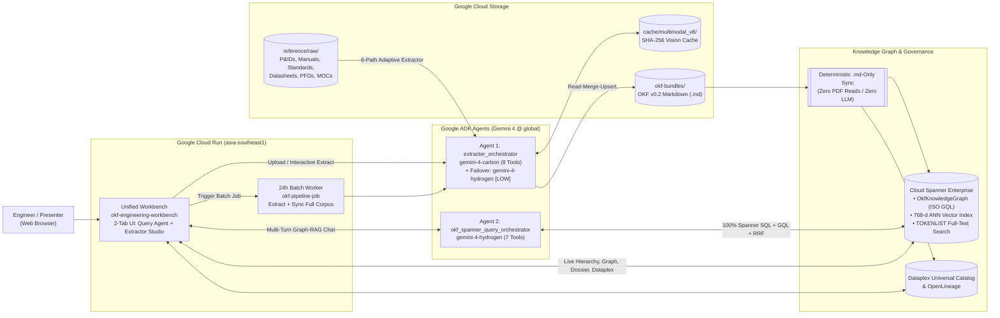

# From P&ID Blueprints to Live Engineering Knowledge Graph: Multi-Agent HAZOP, Lineage & Graph-RAG with Gemini 4 & Cloud Spanner

* **Status:** Ready for Review / Submission
* **Document Owner:** `<moma link>`
* **Tech Lead:** `<google email>`
* **Demo Leads & Contributors:** `<names / emails>`
* **Document Self-link:** `<go self link, e.g., go/engineering-kg-demo-guide>`
* **Link to go/demos:** `go/demos/demo/<demoid>` *(video recording, codebase & resources)*
* **Source Code Repository:** https://github.com/pantana-na/engineering-kg-and-extractor
* **Live Demo URL:** https://okf-engineering-workbench-435347747480.asia-southeast1.run.app

> **Sharing Note for `go/demos` Submission:** Right-click this document in Google Docs → **Share** → set General Access to **Alphabet (All Google FTE) — Viewer**, and share with `alphabet-extendedworkforce@google.com` (Viewer) and `googlers-intern@google.com` (Viewer).

---

## Table of Contents

1. [Introduction & Overview](#introduction-and-overview)
2. [Argolis Set Up & Access](#argolis-set-up)
3. [License & Restrictions](#license-and-restrictions)
4. [Setup (Use Live Demo OR Deploy in Your Argolis Project)](#setup)
5. [Demo Walkthrough — Part 1: Knowledge Extraction (`Extractor Studio`)](#demo-walkthrough-part-1-extraction)
6. [Demo Walkthrough — Part 2: Graph-RAG, Lineage & HAZOP (`Query Agent`)](#demo-walkthrough-part-2-query)
7. [Sample Queries Library (Copy & Paste)](#sample-queries-library)
8. [Presenter Talk Track (10–15 Minute Live Demo)](#talk-track)
9. [Output & Validation](#output)
10. [Organization Policies](#organization-policies)
11. [Costs & Cost-Saving Tips](#costs)
12. [Qwiklabs & Learning Resources](#qwiklabs)
13. [Feedback](#feedback)
14. [Summary](#summary)
15. [Demo Release Notes](#demo-release-notes)

---

## 1. Introduction & Overview {#introduction-and-overview}

### The Business Problem (In Plain English)
In oil & gas, chemical, power, and industrial manufacturing plants, critical engineering truth is trapped inside thousands of unstructured files:
- **Piping & Instrumentation Diagrams (P&IDs)** — giant 11"×17" scanned or CAD blueprints packed with tiny valve numbers, instrument bubbles, flow arrows, and pipe sizes.
- **Process Data Sheets & PFDs** — equipment ratings, design pressures, metallurgy, and mass/energy balances.
- **Operating & Inspection Manuals** — 80+ page maintenance, corrosion, and testing guides.
- **Safety Standards & Management of Change (MOC) Packages** — HAZOP guides, Risk Assessment Matrices, and field change notices that override older drawings.

When an engineer needs to trace an upset upstream/downstream, prepare a **HAZOP safety study**, or verify which document revision is authoritative, they often spend **hours or days** manually cross-checking conflicting PDFs.

### What This Demo Showcases
This platform turns raw engineering files into an interactive, citation-grounded **Cloud Spanner Knowledge Graph** using **two autonomous Google ADK agents** powered by **Gemini 4** inside one unified web application:

1. **Tab 2 — Extractor Studio (`Agent 1: extracter_orchestrator`, default `gemini-4-carbon`):**
   - Automatically detects each file's format (scanned P&ID, AutoCAD vector P&ID, hybrid manual, text PDF, Excel/CSV/Word, or standalone image) and runs the optimal extraction path—including **300-DPI multi-scale 7-tile zooming** on dense P&ID blueprints.
   - Reconciles multi-sheet and multi-revision documents into structured **Open Knowledge Format (OKF v0.2) Markdown** files, automatically flagging cross-document discrepancies (`⚠️ CONFLICT`) and honoring approved Management of Change (`MOC_AUTHORITY`) updates.
   - Syncs `.md` bundles deterministically into **Cloud Spanner** (Property Graph + 768-d Vector Search + Full-Text Search) and **Dataplex Universal Catalog** with **zero raw PDF reads and zero LLM calls**.
2. **Tab 1 — Query Agent (`Agent 2: okf_spanner_query_orchestrator`, default `gemini-4-hydrogen`):**
   - Answers engineering, piping connectivity, provenance, and safety questions **100% from Cloud Spanner & Dataplex** (zero raw PDF/GCS reads at query time).
   - Combines **ISO GQL multi-hop graph traversal**, **Hybrid ANN Vector + Full-Text Search (RRF)**, **bidirectional PDF lineage**, and a **5-stage HAZOP Risk Assessment engine** (calculating Pre-Mitigation vs. Post-Mitigation risk).

### Target Audience
- **Executives & Operations Leaders (Manufacturing, Energy, Chemicals, Utilities):** Reducing HAZOP prep time, preventing costly design conflicts, and unlocking institutional plant knowledge.
- **Process, Mechanical & Safety Engineers:** Interactive P&ID tracing, instant parameter provenance, conflict audits, and structured HAZOP tables.
- **Enterprise & Cloud Architects / Developers:** Production reference architecture for **Google ADK**, **Gemini 4**, **Cloud Spanner Graph + Native `ML.PREDICT` + ANN Vector Search**, **Dataplex Universal Catalog**, and **Cloud Run Services + 24h Batch Jobs**.

### High-Level Architecture



*(Interactive standalone architecture diagrams are also available in [`docs/high-level-system-architecture.html`](./high-level-system-architecture.html) and [`docs/data-ingestion-architecture.html`](./data-ingestion-architecture.html).)*

---

## 2. Argolis Set Up {#argolis-set-up}

> **Note:** Skip this section if you are using the live hosted demo URL or already have an Argolis GCP environment.

### Environment: Argolis (`go/argolis`)
- CEs are encouraged to deploy this demo into their own Argolis GCP project when customizing documents or demonstrating GCP console views (Cloud Spanner, Dataplex, Cloud Run Jobs).
- Check eligibility at `go/argolis-eligibility` and request your environment at `go/argolis`.

### Open GCP Cloud Console
- Open [Google Cloud Console](https://console.cloud.google.com) using a dedicated Chrome profile signed in with your Argolis credentials (`go/argolis-tips`).

---

## 3. License & Restrictions {#license-and-restrictions}

All included demo documents in `reference/raw/` are **100% public, non-proprietary engineering documents** (zero customer confidential data):

| Category Folder | Included Public Documents | Origin / License |
| :--- | :--- | :--- |
| `reference/raw/pid/` | `ML101620329-part-1.pdf` through `ML101620329-part-8.pdf` *(38 P&ID sheets)* | Public US Nuclear Regulatory Commission (NRC) ADAMS archive — Seabrook Station License Renewal P&IDs (`ML101620329`) |
| `reference/raw/operating_manuals/` | `Inspection_Manual_for_Heat_Exchangers_1.pdf` *(84 pages)* | Public refinery heat exchanger inspection & NDT technical manual |
| `reference/raw/standards/` | `HAZOP_Training_Guide.pdf` *(9 pages)*, `Risk_Assessment_Matrix.pdf` *(5 pages)* | Public process safety HAZOP methodology & Risk Assessment Matrix training guides |
| `reference/raw/data_sheets/`, `pfd/`, `moc/` | Ready for live upload during demo | Supports `.pdf`, `.xlsx`, `.xlsm`, `.csv`, `.docx`, `.png`, `.jpg`, `.jpeg`, `.webp` |

- **Code License:** Internal Google Cloud CE demo repository (`https://github.com/pantana-na/engineering-kg-and-extractor`).

---

## 4. Setup {#setup}

### Option A — Instant Access (Use the Live Hosted Demo — Zero Setup)
Open the public workbench directly in your browser (no login required for demo review):
- **Live Unified Workbench:** https://okf-engineering-workbench-435347747480.asia-southeast1.run.app
- **Health Check API:** https://okf-engineering-workbench-435347747480.asia-southeast1.run.app/api/healthz

### Option B — Deploy Into Your Own Argolis GCP Project (~15 Minutes)

1. **Clone the repository and configure `.env`:**
   ```bash
   git clone https://github.com/pantana-na/engineering-kg-and-extractor.git
   cd engineering-kg-and-extractor
   cp .env.example .env
   ```
   Edit `.env` to set your `GOOGLE_CLOUD_PROJECT`, `GOOGLE_CLOUD_PROJECT_NUMBER`, and `DESTINATION_GCS_BUCKET`.

2. **Install Python environment & authenticate:**
   ```bash
   python3 -m venv .venv
   .venv/bin/pip install -e ".[dev]"
   gcloud auth login
   gcloud auth application-default login
   gcloud config set project "$GOOGLE_CLOUD_PROJECT"
   ```

3. **Run one-time GCP project bootstrap (enables APIs, IAM including Dataplex, GCS, Cloud Spanner Enterprise DB + DDL, Artifact Registry):**
   ```bash
   bash scripts/bootstrap_gcp_project.sh
   ```

4. **Deploy the Unified Workbench (`okf-engineering-workbench`) and 24-Hour Batch Job (`okf-pipeline-job`):**
   ```bash
   ./deploy.sh --target infra
   ./deploy.sh --target unified_web    # Deploys publicly with --no-invoker-iam-check --no-iap (zero allUsers)
   ./deploy.sh --target pipeline_job   # Deploys 24h Cloud Run batch worker
   ```
   *(To require Google Cloud IAP login instead of public demo access, run `UNIFIED_WEB_SECURITY_MODE=iap ./deploy.sh --target unified_web`.)*

5. **Run the initial full extraction + Spanner/Dataplex sync** via the UI (`Extractor Studio` → `Jobs` → `extract_and_sync`) or CLI:
   ```bash
   gcloud run jobs execute okf-pipeline-job --region=asia-southeast1
   ```

---

## 5. Demo Walkthrough — Part 1: Knowledge Extraction (`Extractor Studio`) {#demo-walkthrough-part-1-extraction}

Click **`Extractor Studio`** in the top navigation bar to show how raw engineering files become a structured, verified knowledge base.

### How the Extraction Engine Handles Any Engineering Document (6 Mechanisms)
Before clicking buttons, audiences love understanding *why* ordinary PDF text extractors fail on plant drawings and how this platform solves it automatically:

| Document Type | How the Extractor Handles It |
| :--- | :--- |
| **1. Scanned / Raster P&IDs** *(e.g. `ML101620329-part-1..8.pdf`)* | Extracts lossless 1:1 raw pixels directly from PDF `FlateDecode` XObjects → slices each 17"×11" sheet into **7 lossless PNG tiles** (**1 full-sheet overview + 6 overlapping 3×2 zoomed crops** with Center Bridges so no valve or tag is cut in half) → streams to **Gemini 4 Vision**. |
| **2. True Vector AutoCAD P&IDs** | Rasterizes vector CAD paths at **300 DPI** via `pdftoppm` → generates the same **7 overlapping PNG tiles** → **Gemini 4 Vision**. |
| **3. Hybrid Searchable P&IDs / Mixed Manuals** *(e.g. `Inspection_Manual_for_Heat_Exchangers_1.pdf`)* | Combines **3 inputs together**: native `application/pdf` (crisp printed text/tables) + **300-DPI 7-PNG tiles** (zoomed diagrams) + deterministic **`pypdf` text**. Auto-isolates landscape diagram pages into 1-page windows and batches prose into 4-page windows. |
| **4. Standard Printed PDFs** *(e.g. `HAZOP_Training_Guide.pdf`, `Risk_Assessment_Matrix.pdf`)* | Sends native `application/pdf` in 4-page windows + deterministic `pypdf` text (no unnecessary tiling). |
| **5. Spreadsheets & Word Docs** (`.xlsx`, `.xlsm`, `.csv`, `.docx`) | **100% lossless pure-Python OOXML/CSV parser** — converts equipment registers and valve lists directly into Markdown tables with zero OCR cost. |
| **6. Standalone Images** (`.png`, `.jpg`, `.jpeg`, `.webp`) | Sends raw image bytes at `MEDIA_RESOLUTION_HIGH` directly to Gemini 4 Vision. |

- **Built-In Resilience:** Dense sheets that hit a Vertex AI `504` deadline or return an empty stream automatically fail over to **`gemini-4-hydrogen` (`thinking_level="LOW"`)** (~35s recovery), and every completed sheet is permanently cached in GCS (`cache/multimodal_v8/`) by SHA-256 hash.

---

### Step-by-Step Extraction Demo Instructions

#### Step 1A: Browse Raw Documents & Extracted OKF Concepts
1. In the **Left Pane**, switch between **`Raw Docs`** (`11` source files across `pid/`, `operating_manuals/`, `standards/`) and **`Extracted OKF`** (`290+` structured `.md` files across `equipment/`, `instruments/`, `units/`, `hazards/`, `hazop/`, `procedures/`, `standards/`, `sources/`).
2. Click any raw P&ID (e.g., `pid/ML101620329-part-1.pdf`) to preview the original scanned blueprint in the **Center Pane**.
3. Click an extracted equipment concept (e.g., `equipment/RH-E-9A` or `equipment/F-33`) to inspect its structured YAML frontmatter, design/operating parameter tables, `Connections & Stream Summary`, `⚠️ CONFLICT` callouts, and click **`Show Sources`** on the collapsible **`Referenced PDF Sources`** card to verify source traceability.

#### Step 1B: Upload a New Engineering Document (Optional Live Demo)
1. Click **`⬆ Upload Doc`** in the Left Pane header.
2. Select a target category folder (`data_sheets`, `pid`, `pfd`, `operating_manuals`, `standards`, or **`moc`** for Management of Change).
3. Choose any supported file (`.pdf`, `.xlsx`, `.docx`, `.csv`, `.png`, `.jpg`, up to `50 MB`).
   - *Safety check:* Uploading an existing filename is blocked (`409 Conflict`) unless **Overwrite existing file** is explicitly checked.
4. Click **`Upload`**. The file uploads directly to GCS and appears immediately in the Left Pane.

#### Step 1C: Run Interactive Extraction + Spanner Sync (Single Document — Live)
> **Presenter Tip:** For a live 2–3 minute demonstration, pick a small fast document like **`standards/Risk_Assessment_Matrix.pdf`** (5 pages) or a newly uploaded datasheet/MOC, or any already-cached P&ID (`pid/ML101620329-part-1.pdf`, which reuses cached vision transcriptions in seconds!).

1. Select a Gemini 4 model in the **Right Pane** model selector (default: **`gemini-4-carbon`**; or pick **`gemini-4-hydrogen`** for fastest live speed).
2. Click **`Extract + Sync (Interactive)`** on your chosen document (or select the target in the Right Pane).
3. In the sync-mode modal, keep **`INCREMENTAL`** (default — adds/updates touched concepts without removing other plant concepts) or pick **`FULL_MIRROR`**, then confirm.
4. **Show the Live Progress Stream:**
   - Watch the prominent **Running Banner** lock competing actions while the detached background worker streams per-page Vision, ADK Tool Calls (`process_raw_pdf_tool` → parallel `generate_equipment_okf_tool` batches → `build_okf_indexes_and_validate_tool`), and Spanner Sync progress.
   - *Bonus resilience trick:* Refresh your browser page mid-extraction — the UI **automatically reconnects** to the running job via cursor polling!

#### Step 1D: Inspect / Trigger 24-Hour Cloud Run Batch Jobs
1. Click **`Jobs`** in the top bar (or Right Pane) to open the **Pipeline Jobs Drawer**.
2. Show previously completed or running **Cloud Run Jobs (`okf-pipeline-job`)** with persisted GCS status and live Cloud Spanner row counts.
3. Explain the 3 batch modes:
   - **`extract`** — Extract all raw documents (or a selected subfolder/file list) into OKF `.md` in GCS.
   - **`sync`** — Run fast deterministic `.md`-to-Spanner + Dataplex sync only (skips unchanged `.md` files in `< 1 ms` via MD5).
   - **`extract_and_sync`** — Full end-to-end unattended pipeline (up to **24-hour** Cloud Run Job timeout).

---

## 6. Demo Walkthrough — Part 2: Graph-RAG, Lineage & HAZOP (`Query Agent`) {#demo-walkthrough-part-2-query}

Click **`Query Agent`** in the top navigation bar. Highlight to the audience that **everything in this tab reads 100% from Cloud Spanner and Dataplex Universal Catalog — zero raw PDF or GCS reads at query time**.

### Step-by-Step Query Demo Instructions

#### Step 2A: Explore the Live Spanner Plant Hierarchy & Interactive Graph
1. In the **Left Pane**, browse the plant tree grouped by **System → Equipment Class → Tag**, or click the **`⚠️ Conflicts`** and **`OKF Concepts`** filter tabs.
2. Search for **`RH-E-9A`** *(RHR Loop A Heat Exchanger)* or **`F-33`** *(Spent Fuel Pool Prefilter)* or **`SI-P-6A`** *(Safety Injection Pump A)* and click it.
3. Look at the **Right Pane** (3 tabs):
   - **`Graph` Tab:** Interactive SVG Property Graph (`OkfKnowledgeGraph`) showing multi-hop **`CONNECTS_TO`** piping lines and **`MONITORS_OR_TRIPS`** instrument loops. Click any neighbor node (e.g., `RH-P-8A`, `P-12`, `DM-8`, `X-25`) to pivot the graph and update the active focus!
   - **`Dossier` Tab:** Grounded design parameters, operating conditions, piping connections, instruments, and any `⚠️ CONFLICT` alerts directly from Spanner.
   - **`Dataplex` Tab:** 3-section Node-Focused Governance view showing Trust Tier, Bundle Version/MD5, **deduplicated Source PDF Provenance** (`filename`, `revision`, `fact_count`, role priority `MOC_AUTHORITY` > `CONFLICTING` > `PENDING_REDRAFT` > `PRIMARY`), and live Dataplex Universal Catalog status.

#### Step 2B: Run 1-Click Node-Aware Quick Studies
1. Notice the **4 pre-built prompt chips** above the chat box in the **Center Pane**—they dynamically rewrite themselves for whichever equipment/instrument node you clicked!
2. With **`RH-E-9A`** (or **`SI-P-6A`** or **`F-33`**) selected:
   - Click **Chip 1 — HAZOP Study** to watch `query_agent` call `execute_multistage_risk_and_hazop_query` and produce a full **5-Stage HAZOP Study** with a **Pre-Mitigation Risk vs. Post-Mitigation Risk Matrix**, upstream/downstream propagation paths, active SIS/PSV safeguards, and exact PDF citations.
   - Click **Chip 2 — Upstream & Downstream Trace** to watch live **ISO GQL** graph traversal across `CONNECTS_TO` and `MONITORS_OR_TRIPS` edges (even across multiple P&ID drawing sheets!).
   - Click **Chip 3 — Document Lineage & Conflicts** to inspect every backing PDF, revision, and cross-document discrepancy.
   - Click **Chip 4 — Safety Instruments & Safeguards** to enumerate relief valves, trip switches, and interlock setpoints.
3. Point out the **Model Selector** (`gemini-4-hydrogen` default for fast interactive Q&A; switch to **`gemini-4-neon`** when demonstrating deep multi-step HAZOP reasoning) and the **live tool-call trace** showing exactly which Spanner SQL / ISO GQL / RRF tools the agent invoked.

---

## 7. Sample Queries Library (Copy & Paste) {#sample-queries-library}

Use these verified, copy-paste queries tailored to the included Seabrook P&ID, Heat Exchanger Inspection Manual, and HAZOP/RAM dataset:

### A. Quick Executive Wow-Factor Queries (Non-Technical Friendly)
1. **End-to-End Equipment Overview:**
   > `Give me a complete engineering summary of RH-E-9A, including its process role, upstream and downstream connections, relief valve setpoints, and exact source PDF drawings.`
2. **Instant Plant-Wide Conflict Audit:**
   > `Audit all cross-document conflicts (⚠️ CONFLICT) currently recorded in the Knowledge Graph. Summarize the top 5 discrepancies, showing both values and which PDF drawings disagree.`
3. **One-Click Safety Study (5-Stage HAZOP):**
   > `Run a 5-stage HAZOP study for Safety Injection Pump SI-P-6A covering No/Low Flow, High Pressure, and Loss of Cooling Water. Include a Pre-Mitigation vs. Post-Mitigation Risk Matrix grounded in our plant Risk Assessment Matrix.`

### B. Multi-Hop Piping & P&ID Graph Traversal (ISO GQL)
4. **Spent Fuel Pool Purification Train Trace (`part-1.pdf`):**
   > `Trace the complete upstream and downstream piping path around Fuel Pool Prefilter F-33 (2 hops), listing all inline valves, bypass lines, line sizes, and differential pressure switches.`
5. **Cross-Sheet Safety Injection Topology (`part-1.pdf` + `part-2.pdf`):**
   > `Trace upstream and downstream connections for RHR Heat Exchanger RH-E-9A across 3 hops, including containment penetrations, relief valves, and safety injection trains.`
6. **Instrument & Safeguard Loop Check:**
   > `Which instruments, relief valves, and interlocks monitor or protect SI-P-6A and SI-P-6B? List their exact tags, setpoints (PSIG), and source P&ID drawings.`

### C. Bidirectional Data Lineage & Revision Impact (Blast Radius)
7. **Forward Blast-Radius Analysis (What breaks if a P&ID is revised?):**
   > `If drawing ML101620329-part-1.pdf (PID-1-SI-LR20448) is revised, what is the forward blast radius? List all impacted equipment, concepts, and parameters.`
8. **Backward Provenance Verification:**
   > `Where do the design parameters and relief setpoints for RH-E-9A come from? Trace every claim back to its source PDF, drawing number, and revision.`

### D. Hybrid Vector + Full-Text Search (Manuals, Maintenance & Standards)
9. **Heat Exchanger Inspection & Passivation Procedure (`Inspection_Manual_for_Heat_Exchangers_1.pdf`):**
   > `What are the NACE RP-0170 austenitic stainless steel shutdown passivation requirements to prevent polythionic acid stress corrosion cracking (PTA SCC) in heat exchangers?`
10. **NDT & Online Leak Detection (`Inspection_Manual_for_Heat_Exchangers_1.pdf`):**
    > `Compare IRIS ultrasonic tube inspection and Packinox welded plate exchanger online leak detection methods from our inspection manual, including limits and hazards.`
11. **HAZOP Methodology & Risk Matrix Thresholds (`HAZOP_Training_Guide.pdf` + `Risk_Assessment_Matrix.pdf`):**
    > `Explain our Risk Assessment Matrix (RAM) severity categories, probability levels, and Risk Assessment Code (RAC) thresholds, and how HAZOP guide words map to process deviations.`

### E. Multi-Turn Follow-Up Conversation (Show Session Memory)
Ask these **3 prompts in sequence** inside the same chat session:
1. > `What equipment is directly connected downstream of pump P-12?`
2. > `What differential pressure instrument monitors the prefilter in that train, and which valve isolates its bypass?`
3. > `Now run a 5-stage HAZOP study for a plugged filter (High Differential Pressure / Low Flow) on that prefilter using our plant Risk Assessment Matrix.`

### F. Dataplex Universal Catalog Governance
12. **Live Governance Inspection:**
    > `Inspect the Dataplex Universal Catalog governance metadata and OpenLineage status for our Engineering Knowledge Graph.`

---

## 8. Presenter Talk Track (10–15 Minute Live Demo) {#talk-track}

| Stage | Talk Track (What to Say) | Action (What to Click) | Area of Focus |
| :--- | :--- | :--- | :--- |
| **1. Hook (1 min)** | *"In any industrial plant, vital safety and piping facts live across thousands of scanned P&IDs, 80-page manuals, and competing revisions. Answering a simple HAZOP or revision-impact question can take days. Today we'll show how Gemini 4, Google ADK, and Cloud Spanner turn raw blueprints into a live, 100%-cited Engineering Knowledge Graph."* | Open the live Workbench URL on the **Query Agent** tab | Unified Workbench Overview |
| **2. Extractor Studio — How P&IDs Are Read (2–3 min)** | *"First, let's see how knowledge enters the system. Ordinary OCR mangles dense P&ID blueprints. Our Extractor Agent automatically detects each file type—extracting lossless pixels or rendering at 300 DPI and slicing every P&ID into 7 overlapping zoom tiles (with center bridges) so Gemini 4 reads tiny valve numbers, pipe sizes, and flow arrows accurately. It also supports Excel, Word, standalone images, and Management of Change (MOC) overrides."* | Switch to **Extractor Studio** → Click `pid/ML101620329-part-1.pdf` (raw blueprint) → Click `equipment/RH-E-9A` (extracted OKF `.md`) → Click **`Show Sources`** | 300-DPI 7-Tile Vision & Structured OKF `.md` |
| **3. Live Extraction & Batch Scale (2 min)** | *"Engineers can upload a new PDF, Excel register, or MOC directly here and run interactive extraction with live progress—or kick off a 24-hour Cloud Run batch job for an entire plant archive. Notice how every `.md` change syncs deterministically into Cloud Spanner and Dataplex with zero LLM calls and zero raw PDF reads at query time."* | Click **`⬆ Upload Doc`** (show 6 folders incl. `moc/`) → Open **`Jobs`** drawer to show `okf-pipeline-job` history & Spanner counts *(optional: run interactive extract on `Risk_Assessment_Matrix.pdf`)* | Upload, Interactive Sync & 24h Cloud Run Jobs |
| **4. Query Agent — Graph & Provenance (3 min)** | *"Now let's switch hats to a Process or Safety Engineer. Everything on this screen queries Cloud Spanner and Dataplex directly—sub-second, zero PDF reads. When I select RHR Heat Exchanger `RH-E-9A` (or `F-33`), we immediately see its live multi-hop Spanner Property Graph, its grounded engineering dossier, and deduplicated PDF provenance in the Dataplex tab."* | Switch to **Query Agent** → Click **`RH-E-9A`** (or **`F-33`**) → Toggle **`Graph`**, **`Dossier`**, and **`Dataplex`** tabs in the Right Pane | Spanner Property Graph (`ISO GQL`) & Dataplex Provenance |
| **5. Automated 5-Stage HAZOP & Conflicts (3–4 min)** | *"Notice the 4 study buttons automatically adapted to `RH-E-9A`. Let's run a 5-stage HAZOP study. Behind the scenes, our ADK Query Agent combines our Risk Assessment Matrix, ISO GQL upstream/downstream propagation, active SIS/PSV safeguards, and source citations—giving engineers a structured Pre-Mitigation vs. Post-Mitigation Risk table in seconds, while explicitly calling out any cross-document `⚠️ CONFLICT`s."* | Click **HAZOP Study** chip (or paste Query #3 / #4) → Highlight the **Pre-Mitigation vs. Post-Mitigation Risk Matrix**, tool trace, and PDF citations | 5-Stage HAZOP Engine & `⚠️ CONFLICT` Transparency |
| **6. Hybrid Search + Wrap-Up (2 min)** | *"Because Cloud Spanner unifies Property Graph, 768-d Vector Search, and Full-Text Search in one operational database, the same agent also searches 84-page inspection manuals (like NACE RP-0170 passivation) or computes the forward blast radius of revising a single P&ID drawing—giving plant teams speed, governance, and 100% citation groundedness."* | Paste Query #7 (Blast Radius) or Query #9 (NACE RP-0170) → Wrap up with architecture takeaways | Hybrid RRF Search & Enterprise Readiness |

---

## 9. Output & Validation {#output}

After a full `extract_and_sync` run across all 11 included documents (`38` P&ID sheets + `84`-page manual + `14` pages of safety standards), verify the output via:

1. **Cloud Spanner Live Counts (`GET /api/status` or `Jobs` Drawer):**
   - **~290–310** OKF Concepts (`equipment/`, `instruments/`, `units/`, `hazards/`, `hazop/`, `procedures/`, `standards/`, `sources/`)
   - **~1,200+** Engineering Entities, **~4,000+** Fact Assertions (including verified `⚠️ CONFLICT` flags)
   - **~1,000+** `CONNECTS_TO` process edges, **~1,200+** `MONITORS_OR_TRIPS` instrument loops, **~5,000+** `DERIVED_FROM` lineage edges
   - **~2,000+** 768-d vector-embedded chunks (`text-embedding-005` via native Spanner `ML.PREDICT` + `idx_okf_chunks_vec` ANN index)
2. **Dataplex Universal Catalog:** `catalog_sync_status: SYNCED_LIVE` (`okf-knowledge-assets` entry group + OpenLineage metadata).
3. **Automated Quality Gate (`pytest`):**
   ```bash
   PYTHONPATH=. .venv/bin/pytest tests/ evals/test_eval_benchmarks.py -q
   # Expected: 235 passed, 2 skipped
   ```

---

## 10. Organization Policies {#organization-policies}

This demo is engineered to work cleanly inside standard **Argolis** organizations with **minimal or zero Org Policy relaxations**:

| Organization Policy | Required Change? | How This Demo Handles It |
| :--- | :---: | :--- |
| **`constraints/iam.allowedPolicyMemberDomains`** *(Domain Restricted Sharing)* | **NO relaxation required** | **Zero `allUsers` IAM bindings!** Public demo access uses Cloud Run's Org-Policy-safe **`--no-invoker-iam-check --no-iap`** flag (`invoker_iam_disabled`), and production mode uses **Cloud Run Native IAP** (`--iap --invoker-iam-check`). |
| **`constraints/compute.vmExternalIpAccess`** | **NO relaxation required** | Uses fully serverless **Cloud Run** (Direct VPC Egress) + **Cloud Spanner** + **Vertex AI** — zero Compute Engine VMs created. |
| **`constraints/compute.requireShieldedVm`** | **NO relaxation required** | No GCE VMs required. |

---

## 11. Costs {#costs}

### Approximate Cost Estimate (`asia-southeast1`)

| Component | Idle Cost (Per Day) | Active Demo Day | Notes |
| :--- | :---: | :---: | :--- |
| **Cloud Spanner Enterprise** (`100 PU`) | **~$5.50 / day** | **~$5.50 / day** | Largest fixed cost (Enterprise edition enables Property Graph + ANN Vector Index + `ML.PREDICT`). |
| **Cloud Run Service (`okf-engineering-workbench`)** | **$0.00 / day** | **~$0.50 – $1.50** | Configured with `min-instances=0` (scales to zero when idle). |
| **Cloud Run Job (`okf-pipeline-job`)** | **$0.00 / day** | **~$1.00 – $2.00** | Pay-per-second only while batch extraction runs. |
| **Vertex AI Gemini 4 & `text-embedding-005`** | **$0.00 / day** | **~$1 – $3** *(querying)*<br>**~$8 – $18** *(one-time full 11-PDF cold extraction)* | Re-extractions hit the **GCS SHA-256 vision cache (`cache/multimodal_v8/`)** at **$0 vision token cost**. |
| **Cloud Storage + Dataplex Catalog** | **< $0.10 / day** | **< $0.20 / day** | Raw PDFs + `.md` bundles + cached vision outputs are `< 100 MB` total. |
| **Estimated Total** | **~$5.60 / day** | **~$8 – $12 / day** *(steady-state demos)* | One-time cold extraction of all 38 P&ID sheets adds ~$10–$18 once. |

### Cost-Saving Tips
- **Reuse the GCS Vision Cache:** Never clear `gs://<bucket>/cache/multimodal_v8/` unless you explicitly want to re-run Gemini 4 Vision from scratch—cached sheets cost $0 to re-extract.
- **Keep `min-instances=0`** on Cloud Run so compute drops to $0 between demos.
- **Delete or Pause Between Engagements:** Cloud Spanner (`100 PU`) is ~95% of idle cost. Delete the Spanner instance (or the Argolis project via [Cloud Resource Manager](https://console.cloud.google.com/cloud-resource-manager)) when you no longer need the demo—re-seeding Spanner from your saved GCS `.md` bundle takes only **~3 minutes** with zero LLM calls!

---

## 12. Qwiklabs & Learning Resources {#qwiklabs}

To build deeper hands-on familiarity with the Google Cloud technologies powering this demo:
1. **Cloud Spanner & Spanner Graph:** [Cloud Spanner: Qwik Start](https://www.cloudskillsboost.google/) & [Spanner Graph Documentation](https://cloud.google.com/spanner/docs/graph/overview)
2. **Google Agent Development Kit (ADK) & Vertex AI:** [Build Multi-Agent Systems with ADK](https://google.github.io/adk-docs/) & [Vertex AI Gemini Multimodal Documentation](https://cloud.google.com/vertex-ai/generative-ai/docs/multimodal/overview)
3. **Google Cloud Run Services & Jobs:** [Cloud Run Quickstarts](https://cloud.google.com/run/docs/quickstarts)
4. **Dataplex Universal Catalog & Data Lineage:** [Dataplex Universal Catalog Overview](https://cloud.google.com/dataplex/docs/catalog-overview)

---

## 13. Feedback {#feedback}

Comments and feedback are always welcome and help improve this demo for customer engagements!
- Use the **Feedback** button on the `go/demos` page and mention **"Engineering OKF Knowledge Graph & Multi-Agent Workbench"** along with suggestions on new document types, queries, architecture, or deployment experience.

---

## 14. Summary {#summary}

> *"As you've seen today, Google Cloud makes it practical to turn a plant's hardest unstructured engineering assets—scanned P&IDs, multi-revision datasheets, 80-page manuals, and Management of Change records—into a single, governed Cloud Spanner Knowledge Graph. By combining Gemini 4's 300-DPI multimodal vision, Google ADK's multi-agent orchestration, Cloud Spanner's unified Property Graph + Vector + Full-Text engine, and Dataplex governance, process and safety engineers get instant multi-hop piping traces, automatic conflict detection, and 5-stage HAZOP risk assessments backed 100% by verifiable PDF citations."*

---

## 15. Demo Release Notes {#demo-release-notes}

| Date | Version | Notes |
| :--- | :---: | :--- |
| **Nov 21, 2026** | **v2.3** | Added 6-path multi-format extractor (FlateDecode XObject lossless extraction, 300-DPI `pdftoppm`, 7-PNG 3×2 bridge tiling, OOXML Excel/CSV/Word), empty-stream guard + `gemini-4-hydrogen (thinking_level=LOW)` vision failover, native Spanner `ML.PREDICT` SELECT + batch update, deduplicated Dataplex PDF provenance, persistent GCS Cloud Run Job drawer, dynamic node-aware HAZOP Pre-/Post-Mitigation Risk Matrix prompts, direct Upload modal, and Org-Policy-safe public demo mode (`--no-invoker-iam-check --no-iap`, zero `allUsers`). |
| **Nov 20, 2026** | **v2.0** | Unified 2-Tab Engineering Workbench (`okf-engineering-workbench`) combining Query Agent + Extractor Studio, 24-hour Cloud Run Batch Job (`okf-pipeline-job`), selectable Gemini 4 models (`carbon`, `hydrogen`, `argon`, `neon`), Spanner Enterprise ANN Vector Index (`idx_okf_chunks_vec`), and MOC/ECN change-control lifecycle (`MOC_AUTHORITY` / `PENDING_REDRAFT`). |
| **Sep 2026** | **v1.0** | Initial release of dual-agent OKF v0.2 Extracter Agent and Spanner Graph-RAG Query Agent with Dataplex Universal Catalog integration. |
