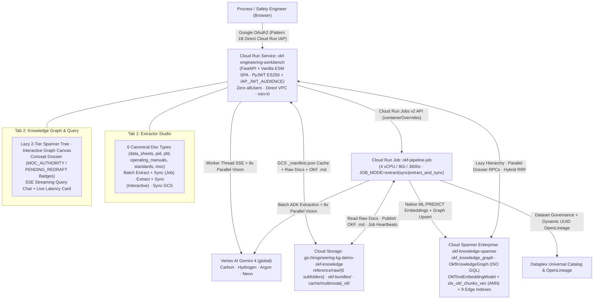

# Engineering Knowledge Graph & OKF Workbench v2 — System Architecture, Ingestion & Demo Guide

## Document Control

| Field | Value |
| :--- | :--- |
| **Document Type** | Unified Technical Architecture, Data Ingestion & Executive Demo Guide |
| **Version** | `2.2` (Unified Workbench + Cloud Run Job + MOC Lifecycle + Live Telemetry) |
| **GCP Project / Region** | `engineering-kg-demo` (`435347747480`) · `asia-southeast1` |
| **Governance Frameworks** | Google Cloud Well-Architected Framework (6 Pillars) & Google SAIF 2.0 |
| **Master Specification & Plan** | [`specs/features/SPEC-20261120-UNIFIED-WORKBENCH-V2.md`](../specs/features/SPEC-20261120-UNIFIED-WORKBENCH-V2.md) |
| **Visual Diagram Assets** | [`high-level-system-architecture.html`](./high-level-system-architecture.html) · [`data-ingestion-architecture.html`](./data-ingestion-architecture.html) · [`okf-query-agent-mockup.html`](./okf-query-agent-mockup.html) |
| **Last Updated** | `2026-11-20` |

---

## 1. Executive Summary

The **OKF Engineering Knowledge Workbench v2** transforms unstructured chemical and nuclear plant engineering artifacts—P&IDs, PFDs, Process Data Sheets, Operating Manuals, Standards/SDS, Office/tabular schedules (`.xlsx`, `.docx`, `.csv`), and **Management of Change (MOC)** packages—into a governed, versioned **Open Knowledge Format (OKF v0.2)** Markdown bundle in Google Cloud Storage (GCS) and a queryable **Cloud Spanner Property Graph** with native **`ML.PREDICT` embeddings**, **ANN `VECTOR INDEX`**, backward PDF lineage, and **Dataplex Universal Catalog** governance.

### Key Capabilities
- **Unified Zero-Build Tabbed Workbench (`okf-engineering-workbench`):** Single Cloud Run service combining **Tab 1: Extractor Studio** and **Tab 2: Knowledge Graph & Query** with per-tab **Gemini 4** model selection (`gemini-4-carbon` Extractor default, `gemini-4-hydrogen` Query default, `gemini-4-argon`, `gemini-4-neon`).
- **Timeout-Free Batch Pipeline (`okf-pipeline-job`):** Parameterized Cloud Run Job (`3600s` timeout, `4 vCPU / 8Gi`, Direct VPC) supporting `JOB_MODE=extract | sync | extract_and_sync`, scope filtering (`All Documents` vs. any of the 6 canonical document types), and HITL-gated `Purge & Reload`.
- **Live Streaming Observability in Both Chats:** Dedicated worker-thread SSE streaming (`/api/extractor/chat/stream` & `/api/query/chat/stream`) with a shared live timeline card (`telemetry-card.js`) displaying per-page vision cache/multimodal latency, ADK tool calls, guardrail verdicts, and total turn latency in real time.
- **MOC & Document Revision Lifecycle:** Deterministic revision ranking (`compare_revision_tokens`), authoritative `MOC_AUTHORITY` / `PENDING_REDRAFT` lineage roles (distinct from unauthorized `⚠️ CONFLICT` discrepancies), topological removals (`removed_instruments`, `removed_connections`), cross-filename supersession (`superseded_sources`), and auto-clearing resolved conflict callouts.

---

## 2. High-Level Dual-Runtime & Zero-Trust Architecture

---

## 3. Multi-Format Data Ingestion, Vision Caching & MOC Pipeline

### 3.1 Canonical Source Taxonomy (`reference/raw/` & GCS)
All raw documents are organized under 6 read-only canonical subfolders (exposed in the Extractor UI even at count `0`):
- `data_sheets/` — Process & mechanical equipment datasheets, PSV/control valve packages.
- `pid/` — Piping & Instrumentation Diagrams (vector/scanned CAD drawings).
- `pfd/` — Process Flow Diagrams and Heat & Material Balance sheets.
- `operating_manuals/` — Operating procedures, inspection manuals, startup/shutdown SOPs.
- `standards/` — Engineering standards, HAZOP guides, risk matrices, Safety Data Sheets (SDS).
- `moc/` — Approved Management of Change (MOC), Engineering Change Notices (ECN), and Field Change Requests (FCR).

### 3.2 High-Precision Multimodal Extraction & Vision Caching
1. **Multi-Format Dispatch (`extracter_agent/pdf/processor.py`):**
   - Office/tabular files (`.xlsx`, `.xlsm`, `.docx`, `.csv`) use lossless native OOXML/CSV parsing.
   - Vector/scanned landscape P&IDs (`is_vector_drawing=True`) are split into 1-page windows, rasterized at 300 DPI (`pdftoppm`) into multi-scale overlapping tiles (1 full sheet + 4 quadrants), and processed concurrently across up to **`max_workers=8`** threads with `180s` per-attempt HTTP timeout using the user's selected Gemini 4 model (`multimodal_execution_context`).
   - Every page transcription is deterministically cached in GCS under `cache/multimodal_v8/<stem>_p<n>-<n>_<sha256>.md`, making repeat extractions near-instantaneous.
2. **OKF v0.2 Synthesis & Read-Merge-Upsert (`extracter_agent/okf/synthesizer.py`):**
   - Non-destructive merge across multiple source documents preserving exact engineering units and backward citations.
   - **MOC & Revision Lifecycle:** `compare_revision_tokens()` prevents older revisions from overwriting newer revisions; approved MOCs (`moc_history`) override base P&IDs/Datasheets with `MOC_AUTHORITY` / `PENDING_REDRAFT` lineage rather than false `⚠️ CONFLICT` alerts; `removed_instruments` and `removed_connections` cleanly decommission obsolete tags/lines; resolved conflict callouts are auto-cleared.
3. **Cloud Spanner Graph + Native `ML.PREDICT` Sync (`query_agent/spanner/`):**
   - `FULL_MIRROR` (default) adds/updates changed `.md` files (MD5 skip for unchanged) and deletes removed concepts; `INCREMENTAL` adds/updates without deleting missing concepts; `Purge & Reload` wipes and reloads all 9 Spanner tables behind a typed `PURGE SPANNER` HITL confirmation gate.
   - Embeddings are computed inside Spanner via `CREATE OR REPLACE MODEL OkfTextEmbeddingModel` (`text-embedding-005`) + batched `ML.PREDICT` and indexed with Enterprise ANN `VECTOR INDEX` (`idx_okf_chunks_vec`, `APPROX_COSINE_DISTANCE`) plus 9 secondary graph/filter indexes.

---

## 4. Security & Governance Posture (WAF 6 Pillars & SAIF 2.0)

- **Zero-Trust Ingress (Rule 10 Pattern 1B):** Direct Cloud Run Native IAP (`--iap`, `--no-allow-unauthenticated`, `--invoker-iam-check`, **zero `allUsers`**) + backend cryptographic verification of `x-goog-iap-jwt-assertion` using `PyJWT[crypto]` against cached RFC 7517 Google IAP JWKs (`ES256`, strict `iss=https://cloud.google.com/iap`, strict `aud=/projects/435347747480/locations/asia-southeast1/services/okf-engineering-workbench`).
- **4-Point SAIF 2.0 Guardrails:** Pre-flight prompt injection screening (`before_agent_callback` / `before_model_callback`), Indirect Prompt Injection + DLP scrubbing on tool outputs (`after_tool_callback`), response DLP redaction (`after_model_callback`), strict Gemini 4 model allowlist, and per-principal sliding-window rate limiters.
- **Deterministic HITL (`SAIF RAC`):** Destructive Spanner purge cannot be invoked by any LLM; it requires typed UI confirmation (`PURGE SPANNER`) + `X-Confirm-Purge: CONFIRMED` + `X-Idempotency-Key`.

---

## 5. Executive Walkthrough & Demo Script (5 Minutes)

1. **Open Unified Workbench:** Navigate to `https://okf-engineering-workbench-435347747480.asia-southeast1.run.app` (authenticates via Google IAP).
2. **Extractor Studio (Tab 1):**
   - Point out the top Gemini 4 model selector (defaulting to **Gemini 4 Carbon** for Extractor) and all 6 canonical document type filter chips (`data_sheets`, `pid`, `pfd`, `operating_manuals`, `standards`, `moc`).
   - Click a raw P&ID (`pid/ML101620329-part-1.pdf`) and click **`Extract + Sync (Interactive)`** — watch the Assistant drawer auto-open without pressing Enter and stream live per-page vision cache/multimodal latency, ADK tool calls, GCS publish, and incremental Spanner sync.
   - Click **`Batch Extract + Sync (Job)`** to show the interactive scope launcher (`All Documents` vs. specific doc type, `Full Mirror` vs. `Incremental`, and Advanced HITL `Purge & Reload`) backed by Cloud Run Job `okf-pipeline-job`.
   - Click **`↻ Sync GCS`** to pull newly uploaded PDFs or MOC packages from GCS in `< 1s`.
3. **Knowledge Graph & Query (Tab 2):**
   - Switch to **Knowledge Graph & Query** — notice the top model selector automatically switches to **Gemini 4 Hydrogen** (persisted independently per tab).
   - Expand the lazy 2-tier Spanner tree, inspect an equipment tag's interactive multi-hop graph and Concept Dossier (with color-coded `MOC_AUTHORITY`, `PENDING_REDRAFT`, `CONFLICTING`, and `PRIMARY` lineage badges), and run a pre-built 5-stage HAZOP or conflict audit query with live SSE tool/latency telemetry.
