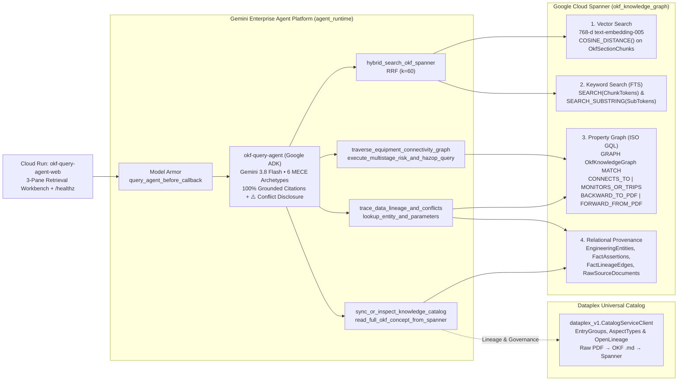

# High-Level Dual-Runtime System Architecture: Multimodal Extraction & Hybrid Spanner Retrieval

> 📊 **Interactive Standalone HTML/SVG Diagram:** Open [`docs/high-level-system-architecture.html`](./high-level-system-architecture.html) in any browser (`xdg-open ./docs/high-level-system-architecture.html`) to view the dark-themed dual-runtime architecture visualizer.

---

## 1. Executive Architectural Overview

The **`engineering-kg-and-extractor`** platform separates **Knowledge Compilation (Flow 1)** from **Knowledge Retrieval & Lineage Governance (Flow 2)** across a **Dual-Runtime Cloud Architecture**:

| Runtime / Tier | Flow 1: Data Extraction (`extracter_agent`) | Flow 2: Data Retrieval & Lineage (`query_agent`) |
| :--- | :--- | :--- |
| **Cloud Run (`cloud_run`)** | `extracter-agent-web` — 3-Pane Split Extraction Workbench UI + FastAPI SSE proxy (`/healthz`). | `okf-query-agent-web` — 3-Pane Spanner Graph & Retrieval Workbench UI + FastAPI SSE proxy (`/healthz`). |
| **Gemini Enterprise Agent Platform (`agent_runtime`)** | `extracter_orchestrator` (Google ADK) powered by **Multimodal `gemini-3.8-flash`** (`GEMINI_LOCATION=global`) + Model Armor `before_agent_callback` + 8 `FunctionTools`. | `okf-query-agent` (Google ADK) powered by **`gemini-3.8-flash`** (`GEMINI_LOCATION=global`) + Model Armor `query_agent_before_callback` + 7 `FunctionTools`. |
| **Storage, Search & Lineage** | GCS Raw PDFs (`reference/raw/`) $\rightarrow$ **OKF v0.2 Markdown Bundle** (`okf-bundles/`) $\rightarrow$ `.md`-only MD5 delta sync (`sync_markdown_bundle_to_spanner()`). | **Google Cloud Spanner (`okf_knowledge_graph`)** (Vector + Keyword FTS + ISO GQL Property Graph + SQL) & **Dataplex Universal Catalog** (`dataplex_v1` + OpenLineage). |

---

## 2. How Data Extraction Works (Multimodal Gemini on `agent_runtime`)

The extraction pipeline ([`extracter_agent/agent/orchestrator.py`](../extracter_agent/agent/orchestrator.py)) runs inside **Gemini Enterprise Agent Platform (`agent_runtime`)** and uses **Multimodal `gemini-3.8-flash`** to convert heterogeneous engineering PDFs (CAD P&IDs, PFDs, equipment datasheets, operating manuals, and safety standards) into structured, cross-linked **Open Knowledge Format (`OKF v0.2`)** Markdown bundles.

```mermaid
flowchart LR
    RAW["Raw Engineering PDFs\n(GCS: reference/raw/)\nP&IDs, PFDs, Data Sheets, Manuals"] --> WEB["Cloud Run: extracter-agent-web\n3-Pane Workbench + FastAPI SSE"]
    WEB --> GUARD["Model Armor\nbefore_agent_callback"]
    subgraph AgentRuntime["Gemini Enterprise Agent Platform (agent_runtime)"]
        GUARD --> ORCH["extracter_orchestrator (Google ADK)\nMultimodal Gemini 3.8 Flash (Vertex Global)"]
        ORCH --> DISC["1. find_raw_documents_tool\nMulti-folder discovery (Mode A / Mode B)"]
        DISC --> VISION["2. process_raw_pdf_tool\nPyMuPDF Text + 300 DPI Adaptive Vision\nwindow=2 (CAD P&ID) | window=4 (Tables)\nSHA-256 Prompt-Hashed Cache"]
        VISION --> MERGE["3. Read-Merge-Upsert Engine\ninspect_existing_okf_concept_tool\ngenerate_equipment_okf_tool\ngenerate_okf_concept_tool\nRevision Supersession & ⚠️ CONFLICT"]
        MERGE --> VAL["4. Index & Validate\nbuild_okf_indexes_and_validate_tool\nvalidate_okf_bundle_tool (0 broken links)"]
    end
    VAL --> GCS["OKF v0.2 Markdown Bundle (GCS)\nequipment/, instruments/, hazop/,\nsources/, index.md, log.md"]
    GCS --> SYNC["100% .md-Only Sync Pipeline\nsync_markdown_bundle_to_spanner()\n(0 LLM Calls, MD5 Delta)"]
```

### Key Multimodal & Agent Runtime Mechanisms
1. **Model Armor Guardrail (`before_agent_callback`):** Every incoming extraction prompt or file-ingestion command is screened before reaching the orchestrator.
2. **Adaptive 300 DPI Multimodal Vision Windowing ([`extracter_agent/pdf/processor.py`](../extracter_agent/pdf/processor.py)):**
   - Extracts native PDF text via PyMuPDF alongside high-resolution **300 DPI** page renders sent to **Multimodal `gemini-3.8-flash`**.
   - Automatically adjusts sliding window size: **`window_size=2`** for dense vector CAD drawings (P&IDs/PFDs where instrument tags, pipe specs, and flow arrows require spatial vision) and **`window_size=4`** for multi-sheet tabular datasheets/standards.
   - Results are cached deterministically using **SHA-256 prompt-hashed keys**.
3. **Non-Destructive Read-Merge-Upsert & Conflict Detection:**
   - Before writing any concept, the agent inspects existing `.md` files (`inspect_existing_okf_concept_tool`).
   - Reconciles parameters across multiple PDF revisions, superseding older revisions and flagging cross-document discrepancies with `⚠️ CONFLICT` and deterministic provenance footnotes (`[^src]`).
4. **Validation & `.md`-Only Downstream Sync:**
   - `validate_okf_bundle_tool` verifies YAML frontmatter, trust tiers, and `0` broken Markdown links before `export_bundle_to_gcs_tool` syncs to GCS.
   - [`query_agent/spanner/repository.py`](../query_agent/spanner/repository.py) (`sync_markdown_bundle_to_spanner()`) ingests **only `.md` files** (zero PDF scanning, zero LLM calls) into Cloud Spanner and emits **OpenLineage** events to Dataplex Universal Catalog.

---

## 3. How Data Retrieval for Query Works (Spanner Multi-Model + Knowledge Catalog)

At query time, [`query_agent/orchestrator.py`](../query_agent/orchestrator.py) operates with **Zero GCS Reads** — 100% of answers, citations, graph traversals, and lineage audits are served from **Google Cloud Spanner (`okf_knowledge_graph`)** and **Google Cloud Dataplex Universal Catalog (`dataplex_v1`)**.

### Combined Spanner Search (Vector + Graph + Keyword)
1. **Vector Search (`OkfSectionChunks`):** Semantic similarity via `768`-dimensional `text-embedding-005` embeddings using `COSINE_DISTANCE()`.
2. **Keyword / Full-Text Search (`OkfSectionChunks`):** Exact tag, document code, and substring matching via Spanner `TOKENLIST` indexes (`SEARCH(ChunkTokens, ...)` and `SEARCH_SUBSTRING(SubTokens, ...)`).
3. **Reciprocal Rank Fusion (RRF, $k=60$):** `hybrid_search_okf_spanner` fuses Vector and Keyword rankings so both conceptual HAZOP queries and exact equipment tags (e.g., `D-2304`, `PSV-2301`) surface with high precision.
4. **Property Graph (`GRAPH OkfKnowledgeGraph` via ISO GQL):**
   - `traverse_equipment_connectivity_graph` executes `1..4`-hop ISO GQL `MATCH` queries across `CONNECTS_TO` (`ProcessConnections`) and `MONITORS_OR_TRIPS` (`InstrumentControlEdges`).
   - `execute_multistage_risk_and_hazop_query` orchestrates a 5-stage deterministic HAZOP dossier combining Risk Matrix rules, upstream causes, downstream consequences, active SIS/PSV safeguards, and conflict audits.

### Knowledge Catalog & Bidirectional Data Lineage
1. **Dataplex Universal Catalog ([`query_agent/spanner/catalog_sync.py`](../query_agent/spanner/catalog_sync.py)):**
   - Synchronizes OKF concepts, Spanner tables, and raw source PDFs as governed Dataplex Entries with custom AspectTypes (extraction metadata, provenance tier, conflict status) and emits **OpenLineage** run events (`Raw PDF` $\rightarrow$ `OKF .md` $\rightarrow$ `Spanner Knowledge Graph`).
2. **Bidirectional Lineage & Blast-Radius Audit ([`query_agent/spanner/lineage_extractor.py`](../query_agent/spanner/lineage_extractor.py)):**
   - **`BACKWARD_TO_PDF`:** Traces any equipment parameter or `⚠️ CONFLICT` assertion back through `FactLineageEdges` to the exact `RawSourceDocuments` filename, document code, and revision.
   - **`FORWARD_FROM_PDF`:** Computes the downstream blast radius of revising a raw engineering PDF (e.g., `PID-23-0013`) across all affected OKF concepts, equipment tags, and HAZOP safeguards.

---

## 4. Related Artifacts
- **Interactive SVG Diagram:** [`docs/high-level-system-architecture.html`](./high-level-system-architecture.html)
- **Detailed Data Ingestion Architecture:** [`docs/data-ingestion-architecture.md`](./data-ingestion-architecture.md)
- **Extracter Agent Specification:** [`specs/features/SPEC-20260922-OKF-EXTRACTER-AGENT.md`](../specs/features/SPEC-20260922-OKF-EXTRACTER-AGENT.md)
- **Spanner Graph-RAG Query Agent Specification:** [`specs/features/SPEC-20260929-OKF-SPANNER-GRAPH-RAG-AGENT.md`](../specs/features/SPEC-20260929-OKF-SPANNER-GRAPH-RAG-AGENT.md)
