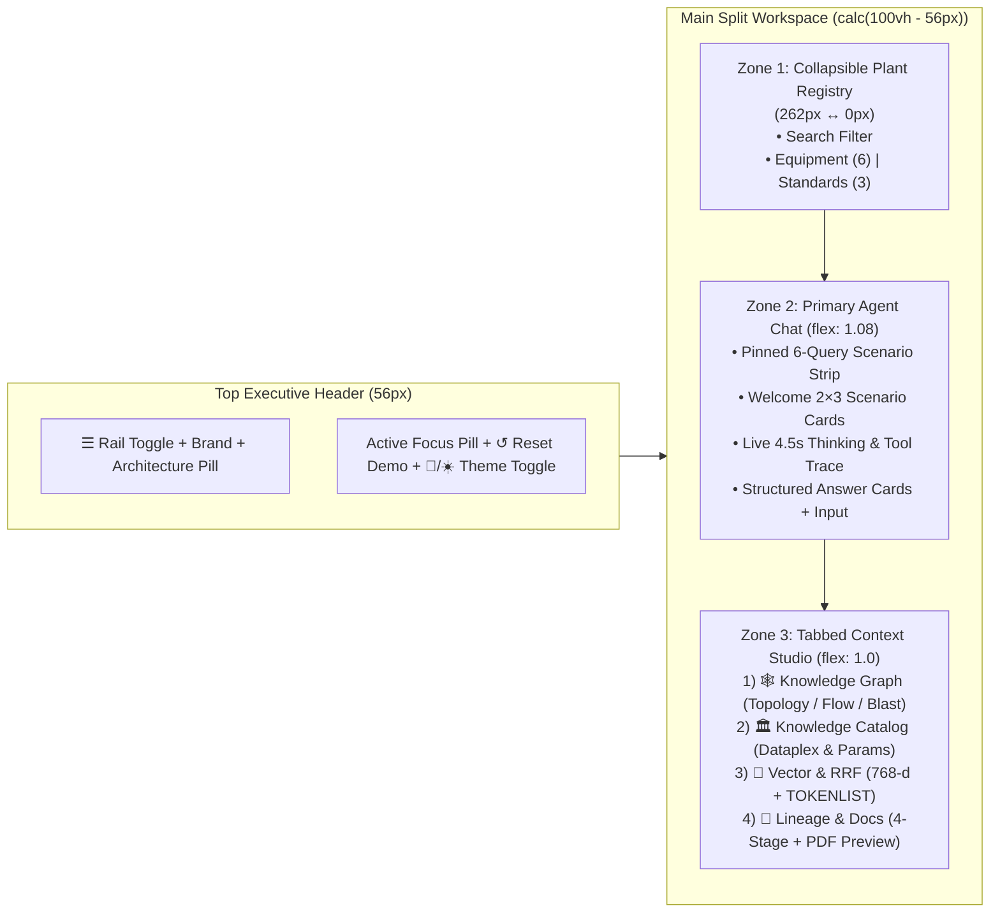
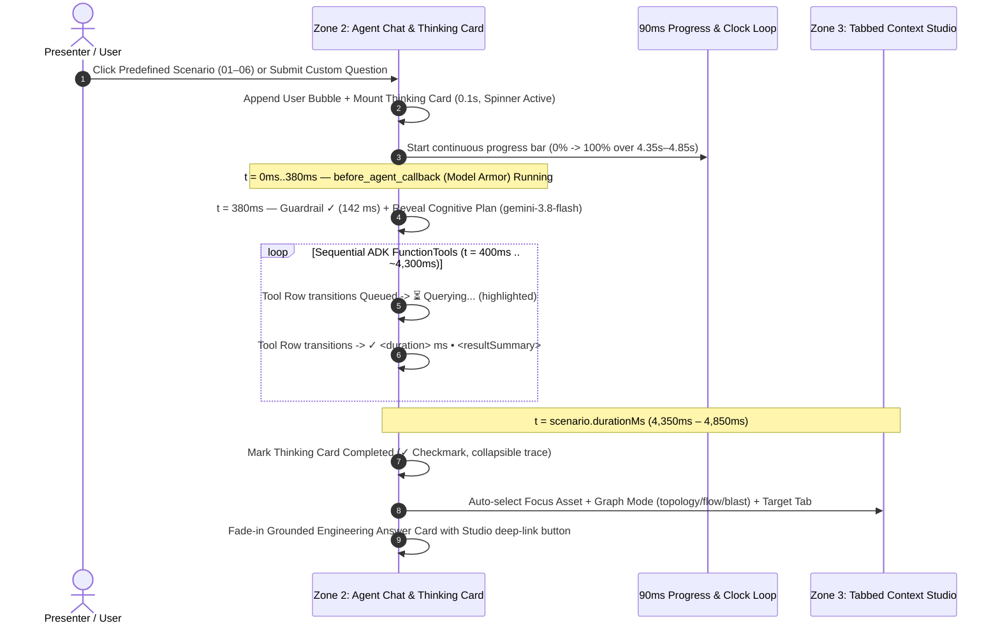

# Baseline Specification: OKF Query Agent Standalone Demo Mockup UI

- **Specification ID:** `DOC-SPEC-20261112-OKF-QUERY-MOCKUP-UI`
- **Target Artifact:** [`docs/okf-query-agent-mockup.html`](./okf-query-agent-mockup.html) (Single-File Standalone HTML/CSS/JS/SVG)
- **Domain Dataset:** Seabrook Station Nuclear / Process Cooling OKF v0.2 Bundle ([`build/okf_bundle/`](../build/okf_bundle/index.md)) + Qualitative Risk Assessment Matrix (`STD-RAM-001`) & HAZOP Standards
- **Reference Production UI:** [`query_agent/static/`](../query_agent/static/index.html) (`okf-query-agent-web`)
- **Status:** `BASELINE v1.0`

---

## 1. Purpose, Scope & Design Objectives

### 1.1 Context & Motivation
[`docs/okf-query-agent-mockup.html`](./okf-query-agent-mockup.html) is a self-contained, zero-dependency executive demonstration workbench for the **Engineering Open Knowledge Format (OKF) Spanner Graph-RAG Query Agent** (`okf_spanner_query_orchestrator`). It serves two primary purposes:
1. **Frictionless Executive & Stakeholder Demos:** Runs directly in any browser from a single `.html` file without requiring live Cloud Spanner, Dataplex, or Vertex AI credentials.
2. **UX Modernization Baseline:** Declutters the existing 3-pane production UI ([`query_agent/static/index.html`](../query_agent/static/index.html)) by replacing vertically stacked sub-panes with a **Conversational-First Split Studio** and a synchronized **4-Tab Context Studio**.

### 1.2 Core Functional Guarantees
- **Single-File Packaging:** 100% of styles, layout markup, SVG icons/markers, engineering datasets, and interactive controllers reside inside [`docs/okf-query-agent-mockup.html`](./okf-query-agent-mockup.html).
- **Simulated 4–5s Cognitive Thinking & Tool Telemetry (`4,350 ms – 4,850 ms`):** Every query animates a live elapsed clock (`0.1s` $\rightarrow$ `~4.6s`), `before_agent_callback` (Model Armor) pre-flight check, `gemini-3.8-flash` reasoning plan, and sequential ADK `FunctionTool` calls with realistic millisecond latencies and row/edge/chunk counts.
- **Complete OKF Architecture Coverage:** Explicitly surfaces **Dataplex Knowledge Catalog**, **Spanner ISO GQL Property Graph**, **768-d Vector + `TOKENLIST` Full-Text Reciprocal Rank Fusion (RRF)**, **5-Stage HAZOP & 4×5 Risk Assessment Matrix (Before vs. After Safeguards)**, **Multi-Hop Blast Radius**, and **End-to-End PDF Data Lineage**.

### 1.3 Explicit Non-Goals
- Does **not** make live network calls to Google Cloud Spanner, Vertex AI Agent Runtime, or Google Cloud Storage (all retrieval is deterministically simulated in-memory).
- Does **not** modify production source files under [`query_agent/`](../query_agent/) or [`extracter_agent/`](../extracter_agent/).

---

## 2. Internal File Map (`docs/okf-query-agent-mockup.html`)

Use this structural map when locating sections to inspect or modify in [`docs/okf-query-agent-mockup.html`](./okf-query-agent-mockup.html):

| Section | Line Range | Responsibility |
| :--- | :--- | :--- |
| **CSS Design System & Tokens** | `L11–L194` | `:root` / `[data-theme="light"]` default tokens, `[data-theme="dark"]` blueprint tokens, and `RAC 1–4` safety badge variables. |
| **CSS Layout & Components** | `L195–L1687` | Header (`56px`), Collapsible Asset Rail, Chat Stream, `4.5s` Thinking Card animations, Engineering Tables, and 4 Studio Tabs. |
| **HTML Application Shell** | `L1689–L1922` | Semantic `<header>`, `<aside id="asset-rail">`, `<section class="chat-pane">`, and `<section class="context-studio">` with SVG `<defs>`. |
| **JS 1. `ASSETS` Data Store** | `L1928–L2251` | 6 Seabrook Station equipment records + 3 OKF standard/procedure concepts, governance metadata, parameters, instruments, and conflicts. |
| **JS 2. `SOURCE_DOCS` Registry** | `L2253–L2327` | 7 authoritative engineering PDFs (`P&ID`, `RAM Standard`, `HAZOP Guide`, `Inspection Manual`) with revisions, roles, and excerpts. |
| **JS 3. `GRAPH_NODES` & `GRAPH_EDGES`** | `L2329–L2373` | 12 left-to-right P&ID topological nodes (`x, y, hop, blastTier, flowRole`) and 13 typed Spanner Property Graph edges. |
| **JS 4. `VECTOR_CHUNKS` Store** | `L2375–L2434` | 5 OKF v0.2 section chunks with `768-d` cosine similarity, `TOKENLIST` FTS scores, and fused `RRF (k=60)` scores. |
| **JS 5. `DEMO_SCENARIOS` Deck** | `L2436–L3163` | 6 clickable predefined engineering scenarios with thinking thoughts, timed ADK tool trajectories, Studio sync targets, and rich HTML answers. |
| **JS 6–7. State & Sync Helpers** | `L3165–L3348` | Central `state` object, `setTheme()`, `selectAsset()`, `setStudioTab()`, `setGraphMode()`, and `renderAssetRail()`. |
| **JS 8–11. Studio Tab Renderers** | `L3350–L3927` | `renderGraph()`, `renderGraphInspectorDock()`, `renderCatalogTab()`, `renderVectorTab()`, and `renderLineageTab()`. |
| **JS 12–13. Execution & Events** | `L3929–L4450` | `executeScenario()` (`4.5s` timer & tool animation loop), `handleCustomQuestion()`, pan/zoom handlers, and `init()`. |

---

## 3. UI Layout & Visual Design Specification

### 3.1 Conversational-First Split Studio Topology



### 3.2 Improvements Over Existing Production UI (`query_agent/static/`)
1. **Eliminates Vertical Sub-Pane Cramping:** In the production UI, the center column splits `54%` Graph over `46%` Catalog, squeezing both views. The mockup consolidates right-hand inspection into **4 full-height tabs** (`Graph`, `Catalog`, `Vector & RRF`, `Lineage & Docs`), showing one clean visual context at a time.
2. **Collapsible Left Explorer (`#btn-toggle-sidebar`):** Presenters can collapse the `262px` asset rail into `0px` during live Q&A to give `100%` horizontal screen real estate to the Agent Chat and Context Studio.
3. **Layered Left-to-Right P&ID Graph Layout:** Replaces overlapping radial circles with an intuitive left-to-right process engineering flow (`Upstream Suction` $\rightarrow$ `Pump & CCW Utility` $\rightarrow$ `Primary Node` $\rightarrow$ `Downstream Injection`, with SIS loops above and Source PDFs below).
4. **First-Class Vector & Hybrid RRF Visibility:** Exposes `768-d text-embedding-005` similarity, `TOKENLIST` keyword score, and fused `RRF (k=60)` ranking bars visually in Tab 3 rather than hiding retrieval scores inside raw JSON logs.

### 3.3 Theme & Color Tokens
- **Default Theme (`data-theme="light"`):** Crisp Enterprise Light (`#F4F6F9` canvas, `#FFFFFF` cards, `#0F172A` primary ink, `#1D4ED8` cobalt primary, `#0F766E` industrial teal).
- **Alternate Theme (`data-theme="dark"`):** Dark Industrial Blueprint (`#090D16` canvas, `#0F1623` surface, `#38BDF8` sky-cobalt accent, `#2DD4BF` teal—strictly **zero purple/violet** on dark backgrounds).
- **Typography:**
  - Display Headings: `Plus Jakarta Sans` (`600–800`)
  - UI & Tables: `Inter` (`400–700`)
  - Engineering Tags, Units, Timers & Hashes: `IBM Plex Mono` (`font-variant-numeric: tabular-nums`)
- **Semantic HAZOP Risk Assessment Code (`RAC 1–4`) Palette:**
  - `RAC 1` (*Extremely High — Stop, Immediate Correction*): Crimson (`--rac1-bg`, `--rac1-text`, `--rac1-solid: #dc2626`)
  - `RAC 2` (*High — Urgent Correction*): Deep Orange (`--rac2-bg`, `--rac2-text`, `--rac2-solid: #ea580c`)
  - `RAC 3` (*Moderate — Corrective Attention*): Amber-Gold (`--rac3-bg`, `--rac3-text`, `--rac3-solid: #ca8a04`)
  - `RAC 4` (*Low — Acceptable / ALARP & Verified Badges*): Emerald (`--rac4-bg`, `--rac4-text`, `--rac4-solid: #16a34a`)

---

## 4. Simulated 4–5s Thinking & Tool Execution Protocol



### Key Behavioral Invariants
1. **Concurrency Lock (`state.isThinking`):** While a 4.5s simulation is active, scenario pills and the submit button are disabled to prevent overlapping timers; clicking `↺ Reset Demo` (`#btn-reset-demo`) immediately clears all pending `setTimeout`/`setInterval` handles via `clearActiveTimers()`.
2. **Post-Completion Trace Inspectability:** When thinking finishes, the reasoning & tool card remains inspectable and can be toggled open/closed by clicking its header (`collapsed-trace` class).
3. **Custom Free-Form Prompt Fallback (`handleCustomQuestion`):** Typed prompts dynamically route to the matching domain scenario (if keywords like `hazop`/`risk`, `blast`/`fail`, `upstream`/`connect`, `lineage`/`pdf`, or `foul`/`vector` appear) or synthesize a grounded 2-tool (`lookup_entity_and_parameters` + `hybrid_search_okf_spanner`) response for any mentioned equipment tag in `4,400 ms`.

---

## 5. Embedded Data Contracts (In-Memory Schemas)

All mockup data inside [`docs/okf-query-agent-mockup.html`](./okf-query-agent-mockup.html) adheres to these five JavaScript object contracts:

```typescript
interface AssetRecord {
  id: string;                    // e.g. "RH-E-9A" or "standards/ram-methodology"
  kind: "equipment" | "concept";
  conceptId: string;             // e.g. "equipment/RH-E-9A"
  name: string;
  unit: string;
  unitShort: string;             // Grouping header in Left Rail
  eqClass: string;
  conflictCount: number;
  conflictSummary?: string;      // Displayed in amber callout if conflictCount > 0
  governance: {
    trustTier: string;           // "HUMAN-REVIEWED"
    status: string;              // "STABLE"
    approver: string;
    approvedAt: string;
    extractedBy: string;         // "extracter_agent / gemini-3.8-flash"
    bundleVersion: string;       // "v8-seabrook"
    md5: string;
    dataplexEntry: string;
  };
  summary: string;
  parameters: Array<{
    name: string;
    value: string;
    unit: string;
    source: string;
    conflict?: boolean;
  }>;
  instruments: Array<{
    tag: string;
    type: string;
    location: string;
    function: string;
  }>;
  sources: string[];             // Foreign keys into SOURCE_DOCS
}

interface GraphNode {
  id: string;
  label: string;
  sub: string;
  type: "CENTER" | "EQUIPMENT" | "INSTRUMENT" | "RAW_PDF";
  x: number;                     // Fixed SVG viewBox (820x500) X coordinate
  y: number;                     // Fixed SVG viewBox (820x500) Y coordinate
  hop: 0 | 1 | 2 | 3;
  conflict?: boolean;
  blastTier: 0 | 1 | 2 | 3;      // >0 pulses crimson/orange in Blast Radius mode
  flowRole: "upstream" | "core" | "loop" | "downstream" | "doc";
}

interface GraphEdge {
  id: string;
  source: string;
  target: string;
  type: "CONNECTS_TO" | "MONITORS_OR_TRIPS" | "DERIVED_FROM";
  label: string;
  detail: string;
  hop: 1 | 2 | 3;
  flow: boolean;                 // Animated dash flow when graphMode === "flow"
  blast: boolean;                // Crimson cascade arrow when graphMode === "blast"
}

interface DemoScenario {
  id: string;
  num: string;                   // "01" .. "06"
  shortLabel: string;            // Pill label in top Scenario Strip
  category: string;              // Card eyebrow badge on Welcome screen
  focusAsset: string;            // Key in ASSETS to select on completion
  targetStudioTab: "graph" | "catalog" | "vector" | "lineage";
  graphMode: "topology" | "flow" | "blast";
  durationMs: number;            // Target 4,000–5,000 ms total thinking window
  title: string;
  question: string;
  thought: string;               // Cognitive plan text shown at t = 380ms
  tools: Array<{
    name: string;                // Official ADK FunctionTool name
    engine: string;              // e.g. "Spanner SQL", "Spanner ISO GQL", "Vector 768-d + RRF"
    args: string;
    startMs: number;
    endMs: number;
    resultSummary: string;
  }>;
  renderAnswerHtml: () => string;
}
```

---

## 6. Baseline Inventory: Seeded Assets & Predefined Demo Queries

### 6.1 Seeded Plant Registry (`ASSETS` — 9 Records)
- **Equipment (`6`):**
  1. `RH-E-9A` — RHR Loop A Heat Exchanger (`RH / SI`, `1 ⚠️ Conflict` between `PID-1-SI-LR20448` Rev 11 and `PID-1-SI-LR20449` Rev 0) *[Initial Default Focus]*
  2. `RH-P-8A` — Residual Heat Removal Pump A (`RH / SI`)
  3. `SI-P-6A` — Safety Injection Pump A — Intermediate Head (`RH / SI`)
  4. `CBS-TK-10A` — Containment Recirculation Sump A (`SI / CBS`, `1 ⚠️ Note` on non-functional legacy level sensor `LE-2350`)
  5. `CC-E-17A` — Primary CCW Heat Exchanger A (`CC / SW`, Titanium tubes + LOOP `MOV V4` interlock)
  6. `F-33` — Spent Fuel Pool Prefilter (`SF`, `PDIS-2622` ΔP switch + `FG-2612` sight glass)
- **OKF Governance & Standards (`3`):**
  1. `standards/ram-methodology` — Risk Assessment Matrix (`4×5` Severity `I–IV` × Probability `A–E` $\rightarrow$ `RAC 1–4`)
  2. `hazop/guide-words-and-deviations` — HAZOP Guide Words & 5-Stage PHA Protocol
  3. `procedures/hx-inspection-manual` — Heat Exchanger Inspection & Fouling Manual (`OM-HX-101`)

### 6.2 Predefined Demo Queries Matrix (`DEMO_SCENARIOS` — 6 Queries)

| # | Scenario ID | User Intent Covered | Simulated Time | ADK `FunctionTools` Shown | Auto-Synced Studio Tab & Mode |
| :-: | :--- | :--- | :---: | :--- | :--- |
| **01** | `q1-specs` | **Equipment Detail & Safety Parameters** (`RH-E-9A` specs, 600 PSIG PSV `RH-V13`, `Interlock G/B`, `⚠️ CONFLICT`) | `4,450 ms` | `lookup_entity_and_parameters` $\rightarrow$ `read_full_okf_concept_from_spanner` $\rightarrow$ `trace_data_lineage_and_conflicts` | `🏛️ Knowledge Catalog` (`RH-E-9A`) |
| **02** | `q2-connectivity` | **Upstream & Downstream Connectivity** (3-hop ISO GQL P&ID streams, line sizes, inline MOVs/checks) | `4,600 ms` | `traverse_equipment_connectivity_graph` $\rightarrow$ `lookup_entity_and_parameters` | `🕸️ Knowledge Graph` (**Flow Trace Mode**) |
| **03** | `q3-hazop` | **Risk Assessment & HAZOP Study** (`STD-RAM-001` 4×5 grid + 4 deviations with **Risk Before Safeguard** $\rightarrow$ **IPLs** $\rightarrow$ **Risk After Safeguard**) | `4,850 ms` | `execute_multistage_risk_and_hazop_query` $\rightarrow$ `hybrid_search_okf_spanner` $\rightarrow$ `traverse_equipment_connectivity_graph` | `🧬 Vector & RRF` (RAM + HAZOP chunks) |
| **04** | `q4-blast` | **Blast Radius & Equipment Failure Impact** (`CC-E-17A` / `RH-P-8A` 3-tier cascade + Train B failover) | `4,550 ms` | `traverse_equipment_connectivity_graph` $\rightarrow$ `lookup_entity_and_parameters` $\rightarrow$ `hybrid_search_okf_spanner` | `🕸️ Knowledge Graph` (**Blast Radius Mode**) |
| **05** | `q5-lineage` | **Data Lineage & Source Documents** (4-stage provenance, PDF grid refs, MD5 hash, Dataplex aspect, conflict diff) | `4,350 ms` | `trace_data_lineage_and_conflicts` $\rightarrow$ `sync_or_inspect_knowledge_catalog` $\rightarrow$ `read_full_okf_concept_from_spanner` | `📄 Lineage & Docs` (`RH-E-9A`) |
| **06** | `q6-vector` | **Hybrid Vector + Keyword SOP Search** (`F-33` `PDIS-2622` ΔP fouling & 40% NDE tube plugging criteria) | `4,400 ms` | `hybrid_search_okf_spanner` $\rightarrow$ `lookup_entity_and_parameters` | `🧬 Vector & RRF` (`F-33` focus) |

---

## 7. Modification Playbook (How to Update Using This Baseline)

When requesting or implementing future updates to [`docs/okf-query-agent-mockup.html`](./okf-query-agent-mockup.html), reference these targeted extension points:

1. **Add or Modify a Predefined Demo Query:**
   - Append or edit an object in `DEMO_SCENARIOS` (`L2438–L3163`).
   - Keep `durationMs` between `4000` and `5000` (and ensure the last tool's `endMs` finishes ~`250–350 ms` before `durationMs` so the final synthesis message renders cleanly).
   - Both the top **Demo Queries strip** and the **Welcome 2×3 Grid** auto-render dynamically from `DEMO_SCENARIOS`.
2. **Switch Domain Dataset (e.g., to Petrochemical Cumene Plant or New Customer P&IDs):**
   - Replace records in `ASSETS` (`L1932`), `SOURCE_DOCS` (`L2255`), `GRAPH_NODES` / `GRAPH_EDGES` (`L2332`), and `VECTOR_CHUNKS` (`L2377`) while keeping the TypeScript-equivalent field contracts in Section 5 intact.
3. **Adjust Thinking Speed for Faster/Slower Demos:**
   - Update `durationMs` and each tool's `startMs` / `endMs` in `DEMO_SCENARIOS` (or introduce a global speed multiplier inside `executeScenario()` at `L3989`).
4. **Add a New Tab to the Right Context Studio:**
   - Add a `<button class="studio-tab" data-studio-tab="<id>">` inside `.studio-tabs` (`L1810`), add a matching `<div class="studio-panel" id="panel-<id>">` (`L1919`), and invoke its render function inside `selectAsset()` (`L3242`).
5. **Validate After Any Edit:**
   - Verify JavaScript syntax and static DOM ID bindings before committing:
     ```bash
     python3 -c '
     import re, subprocess, tempfile, pathlib
     html = pathlib.Path("docs/okf-query-agent-mockup.html").read_text()
     js = re.findall(r"<script>(.*?)</script>", html, re.S)[0]
     with tempfile.NamedTemporaryFile("w", suffix=".js", delete=False) as f:
         f.write(js); p = f.name
     subprocess.run(["node", "--check", p], check=True)
     '
     ```
