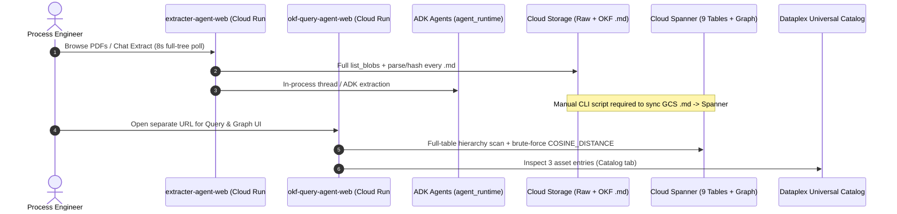

# Brownfield Baseline Specification: Engineering OKF Multi-Agent Knowledge Platform (Pre-v2)

## Document Control

| Field | Value |
| :--- | :--- |
| **Baseline ID** | `BASELINE-20261120-EXTRACTER-AGENT-SYSTEM` |
| **Workload Type** | `Hybrid` |
| **Assessment Track** | `Track B: Modern Cloud-Native (Undocumented/Untested)` |
| **Status** | `Verified Baseline` |
| **Author** | Platform Engineering Team |
| **Date** | `2026-11-20` |
| **Version** | `2.0` |
| **Discovery Reference** | `N/A` |
| **Companion Artifacts** | `docs/high-level-system-architecture.md`, `docs/data-ingestion-architecture.md`, `docs/codemender-sast-report.md` |

---

## 1. Executive Summary & Problem Framing (As-Is)

### 1.1 Business Context, As-Is Purpose & Brownfield Track Classification
- **Current System Purpose & Footprint:** This repository (`https://github.com/pantana-na/engineering-kg-and-extractor.git`) hosts the **Chemical Engineering OKF Multi-Agent Knowledge Platform**, currently deployed as two separate Cloud Run web workbenches (`extracter-agent-web` and `okf-query-agent-web`) paired with two official Google ADK (`google-adk`) conversational agents (`extracter_orchestrator` and `okf_spanner_query_orchestrator`) on the **Gemini Enterprise Agent Platform (`agent_runtime`)**, backed by **Google Cloud Storage (GCS)**, **Google Cloud Spanner (Enterprise Edition — Property Graph, Vector, Full-Text & Lineage)**, and **Google Cloud Dataplex Universal Catalog (`dataplex_v1`)**.
- **Upstream Evolution (`engineering-kg-gc` commit `2f8035b`):** A parallel repository (`https://github.com/pantana-na/engineering-kg-gc.git`) has progressed 16 commits ahead with native Office OOXML ingestion (`ooxml_parser.py`), alias twin consolidation, MOC authority tiering, fast memoized OKF indexing, externalized Cloud Run/Cloud Build config (`deploy_config.py` with Native IAP + Direct VPC egress + universal scale-to-zero `min_instances=0`), and `gemini-4-argon` defaults.
- **Brownfield Track Classification:**
  - [x] **Track B — Modern Cloud-Native Codebase:** Modern Python 3.11+ / FastAPI / Google ADK / Terraform stack requiring consolidation into a single unified workbench UI, Cloud Run Job offloading for long-running batch extraction & Spanner sync, native Spanner `ML.PREDICT` embeddings + ANN vector indexing, selectable Gemini 4 models, and WAF/SAIF 2.0 hardening.

### 1.2 As-Is Operational Scope & Autonomy Boundaries
- **Automated Legacy Workflows & Batch Jobs:** Single-document extraction via in-process background Python `threading.Thread` inside `extracter_agent/web_server.py`; batch extraction and Cloud Spanner ingestion exist only as local CLI scripts (`scripts/ingest_okf_bundle_to_spanner.py`, `scripts/run_clean_pdf_extract_and_spanner_sync.sh`).
- **Manual / Role-Gated Processes & Out-of-Scope Modules:** `reference/raw/` holds 11 immutable public reference PDFs (Seabrook P&IDs, Heat Exchanger Inspection Manual, HAZOP Training Guide, Risk Assessment Matrix) that must remain strictly read-only and preserved unchanged during v2 upgrades.
- **Existing LLM / Agent Autonomy & HITL Gaps:** Both ADK agents implement `before_agent_callback` Model Armor screening, but lack `after_tool_callback` Indirect Prompt Injection (`PIJ`) screening, `after_model_callback` outbound DLP/URL allowlisting, and an externalized deterministic HITL confirmation gate for destructive Spanner purge operations from the UI.

### 1.3 Observed Baseline SLAs, Traffic & Quality Metrics
- **Observed Operational Metrics:** Regional Cloud Run (`asia-southeast1`) + Regional Cloud Spanner Enterprise (`100` PUs). Initial `/api/status` and `/api/files` calls perform O(N) GCS listing, full `.md` parsing, SHA-256 hashing, and full `validate_okf_bundle_tool()` on every 8-second poll; `/api/spanner/hierarchy` runs 3 unpaginated full-table scans and ships the entire equipment tree to the browser.
- **Observed Agent / LLM Baseline Metrics:** `query_agent` achieves `100%` trajectory precision and `1.000` groundedness in prior live evals (`specs/plan/QUERY_AGENT_EVAL_REPORT.md`), while model selection is static per deployment via `GEMINI_MODEL` env var (`gemini-3.8-flash` locally / `gemini-4-argon` in `engineering-kg-gc`).

---

## 2. "As-Is" System Architecture, Topology & Reverse-Engineered Contracts

### 2.1 "As-Is" Architecture Diagram

### 2.2 Tier / Component Interaction Flow & Existing Agent Topology
| Tier / Layer | Existing Component | Technology & Version | Source Path(s) | Key Responsibilities & State Coupling |
| :--- | :--- | :--- | :--- | :--- |
| **Presentation / UI Tier** | Two separate 3-pane vanilla HTML/CSS/JS UIs | Vanilla JS + CSS + Cytoscape/Canvas | `extracter_agent/static/`, `query_agent/static/` | Eager DOM rendering of all files/tree nodes; 8s full-tree polling in Extractor; 450ms job polling in Query. |
| **Business / Service Tier** | Two separate FastAPI servers + CLI ingestion scripts | Python 3.11+, FastAPI, Uvicorn | `extracter_agent/web_server.py`, `query_agent/web_server.py`, `scripts/ingest_okf_bundle_to_spanner.py` | In-memory `_EXTRACTION_JOBS`, `_QUERY_JOBS`, `_SESSIONS_META` dicts (lost on container restart/scale-out); synchronous sequential Spanner RPCs. |
| **Data & Persistence Tier** | GCS buckets + Cloud Spanner Enterprise + Dataplex | GCS, Spanner SQL/GQL, `dataplex_v1` | `query_agent/spanner/schema.sql`, `query_agent/spanner/repository.py`, `query_agent/spanner/catalog_sync.py` | 9 Spanner tables + `OkfKnowledgeGraph`; Python-side `text-embedding-005` batching; missing ANN `VECTOR INDEX` and edge secondary indexes; 3 Dataplex asset entries. |
| **LLM / Agent Layer** | Dual Google ADK Orchestrators | `google-adk`, Vertex AI Gemini | `extracter_agent/agent/`, `query_agent/orchestrator.py` | 8 Extractor `FunctionTool`s, 7 Query `FunctionTool`s; single static `GEMINI_MODEL` env var; pre-flight `before_agent_callback` only. |

### 2.3 Current Compute Runtime, Config Inventory & Model Usage
- **Current Compute & Hosting:** Two separate Cloud Run v2 services (`extracter-agent-web`, `okf-query-agent-web`) in `asia-southeast1` + two Vertex AI Agent Engine runtimes + one Cloud Spanner Enterprise instance (`100` PUs). No Cloud Run Job exists yet.
- **Configuration Inventory (`.env` / `deploy_config.py`):**
  | Config Key | Current Source | Purpose | Target Unified `.env` / Secret Manager Mapping |
  | :--- | :--- | :--- | :--- |
  | `GEMINI_MODEL` | `.env` (`gemini-3.8-flash` / `gemini-4-argon`) | Shared default model | Keep `GEMINI_MODEL`, add `EXTRACTER_DEFAULT_MODEL=gemini-4-carbon`, `QUERY_DEFAULT_MODEL=gemini-4-hydrogen`, `ALLOWED_GEMINI_MODELS` |
  | `CLOUD_RUN_WEB_SERVICE` / `QUERY_WEB_SERVICE_NAME` | `.env` (two services) | Separate web service names | Consolidate to `UNIFIED_WEB_SERVICE_NAME=okf-engineering-workbench` + `PIPELINE_JOB_NAME=okf-pipeline-job` |
  | `CLOUD_RUN_SECURITY_MODE` / `INGRESS` / `VPC_*` | `extracter_agent/deploy_config.py` | Externalized IAP/Direct VPC flags | Reuse 4-level precedence for unified web service & Cloud Run Job |
  | `SPANNER_INSTANCE_ID` / `SPANNER_DATABASE_ID` / `EMBEDDING_MODEL` | `.env` | Spanner + `text-embedding-005` | Add `SPANNER_NATIVE_EMBEDDING_MODE=native_ml_predict`, `SPANNER_EMBEDDING_LOCATION` |
- **Current Model Selection & Runtime Coupling:** Single global `GEMINI_MODEL` env variable with no UI model selector and no per-request allowlist validation.

### 2.4 Reverse-Engineered Data Models, API Contracts & Hidden Business Logic Matrix
- **Core Data Entities & Schemas:** `query_agent/spanner/schema.sql` defines 9 tables (`RawSourceDocuments`, `OkfConcepts`, `OkfSectionChunks`, `EngineeringEntities`, `FactAssertions`, `ProcessConnections`, `InstrumentControlEdges`, `ConceptWikiLinks`, `FactLineageEdges`) and `PROPERTY GRAPH OkfKnowledgeGraph`.
- **Existing Endpoints:**
  - Extractor: `GET /healthz`, `GET /api/status`, `GET /api/files`, `GET /api/raw-pdf/{sub}/{file}`, `GET /api/okf/{id}`, `POST /api/chat/extract`, `GET /api/chat/jobs/{id}`.
  - Query: `GET /healthz`, `GET /api/status`, `GET /api/spanner/hierarchy`, `GET /api/spanner/graph`, `GET /api/spanner/concept/{id}`, `GET /api/catalog`, `POST /api/catalog/sync`, `POST /api/query/session/new`, `POST /api/query/chat`, `GET /api/query/jobs/{id}`.
- **Hidden Business Logic Extraction Matrix:**
  | Logic ID | Source Location | Discovered Business Rule / Calculation | Side Effects / State Mutations | Target Destination in Modernized SDD |
  | :--- | :--- | :--- | :--- | :--- |
  | `BL-001` | `extracter_agent/web_server.py:_normalize_seeded_bundle` | Auto-repairs missing YAML `type` and `sources.resource` on disk after GCS sync | Re-reads and rewrites `.md` files on local disk during status polling | Move normalization exclusively to write/extraction time & Cloud Run Job; keep read/status endpoints pure read-only. |
  | `BL-002` | `extracter_agent/web_server.py:extract_live_endpoint` | Runs single-doc extraction in a daemon Python `threading.Thread` inside the web container | Lost on scale-to-zero or container eviction; times out on batch runs | Offload batch extraction & Spanner sync to `okf-pipeline-job` Cloud Run Job (`JOB_MODE=extract\|sync\|extract_and_sync`). |
  | `BL-003` | `query_agent/spanner/repository.py:hybrid_rrf_search` | Computes query embedding in Python SDK and scans all rows with exact `COSINE_DISTANCE` | O(N) full-table scan over `OkfSectionChunks` | Upgrade to Spanner native `CREATE MODEL` + `ML.PREDICT` + `CREATE VECTOR INDEX` (`APPROX_COSINE_DISTANCE`) with small-table fallback. |
  | `BL-004` | `query_agent/spanner/catalog_sync.py:_emit_openlineage_events` | Emits OpenLineage events with static hardcoded `runId` UUIDs | Overwrites run history in Dataplex Lineage | Generate fresh UUID per sync execution (`job_execution_id`). |

---

## 3. "As-Is" Security, Privacy & SAIF Gap Assessment

### 3.1 Existing Input/Output Validation & Guardrail Gaps
- **Application Security & SAST Baseline:** Prior CodeMender SAST scans remediated path traversal, focus_tag injection, and XSS vectors in `engineering-kg-gc` (`docs/codemender-security-audit-summary.md`).
- **Prompt Injection & DLP Callback Gaps:** Both agents enforce `before_agent_callback` Model Armor checks, but lack `after_tool_callback` Indirect Prompt Injection (`PIJ`) inspection on untrusted document/tool payloads and `after_model_callback` outbound DLP/URL allowlist enforcement.

### 3.2 Existing Identity, Authorization & Execution Isolation
- **As-Is Auth & IAM Posture:** `engineering-kg-gc` uses Pattern 1B Direct Cloud Run Native IAP (`--iap`, `--no-allow-unauthenticated`, zero `allUsers`), but the FastAPI backend does not yet cryptographically verify `x-goog-iap-jwt-assertion` headers on every request.
- **Confused-Deputy & Sandboxing Gaps:** Need IAP verified user identity propagation (`X-Goog-Authenticated-User-Email` validated via IAP JWT) into audit logs and externalized deterministic HITL gate (`X-Confirm-Purge` + `X-Idempotency-Key`) for destructive Spanner purge triggers.

### 3.3 Existing Network Perimeter, Secrets & Compliance Posture
- **Perimeter & Encryption Gaps:** Direct VPC Egress (`--vpc-egress=all-traffic`) is externalized in `deploy_config.py`; Terraform lacks Cloud Run Job resource, Spanner AI Platform IAM binding (`roles/aiplatform.user` for Spanner service agent), and unified FinOps labels (`env`, `service`, `owner`, `cost_center`).

### 3.4 Governance (Rules 1–13), WAF 6-Pillar & SAIF Gap Matrix
| Governance Rule / Framework | Applicability | Current Brownfield State ("As-Is") | Status | Target SDD Remediation |
| :--- | :--- | :--- | :--- | :--- |
| **Google Cloud WAF 6 Pillars** | **Universal** | Missing ANN vector index, missing edge secondary indexes, full-table hierarchy scans, missing IAP JWT verification, no Cloud Run Job offloading. | `Partial` | Remediate across Sections 2–6 of `SPEC-20261120-UNIFIED-WORKBENCH-V2.md`. |
| **Pre-Build CodeMender SAST & SLSA L3 (Rules 3–4)** | **Universal** | Remediated in `engineering-kg-gc`, must re-verify after unified v2 UI/API/Job changes. | `Audited` | Re-run CodeMender SAST & unit/PBT suite before Phase 3 deploy. |
| **Cloud Run `/healthz`, Unified `.env` & Zero-Trust IAM (Rules 6, 8, 10)** | **Universal** | `/healthz`, unified `.env`, and Pattern 1B Native IAP flags exist; backend IAP JWT verification missing. | `Partial` | Add cryptographic `x-goog-iap-jwt-assertion` verifier middleware + unified service config. |
| **4-Step RCA & Zero Mockup Fallbacks (Rule 13)** | **Universal** | Compliant across existing agents; must preserve typed degraded responses for Job API / Spanner outages. | `Compliant` | Maintain typed `UPSTREAM_UNAVAILABLE_DEGRADED` responses in all v2 endpoints. |
| **Dual-Runtime, Google ADK, SAIF 2.0 & Live Eval (Rules 11–12)** | **`[AI-Agent Only]`** | `before_agent_callback` present; missing `after_tool_callback` Indirect `PIJ`, `after_model_callback` URL/DLP scrub, and per-session step/token budgets (`DMS`). | `Partial` | Add complete 4-point callbacks, execution budgets, and deterministic purge HITL gate. |

---

## 4. "As-Is" Resiliency, Reliability & State Integrity

### 4.1 Timeouts, Rate Limits & Anti-Loop Gaps
- **Universal:** Cloud Run web timeout is `900s`, insufficient for large batch extractions (100–5,000 docs) or full Spanner re-ingestion with embeddings; no explicit per-user rate limit middleware for Pattern 1B.
- **AI-Agent Only:** ADK runners lack explicit max-turn / tool-hop budget enforcement per session (`DMS`).

### 4.2 Idempotency, Stateful Coupling & Transactions
- **State Integrity:** `_EXTRACTION_JOBS`, `_QUERY_JOBS`, and `_SESSIONS_META` live in process RAM (non-shared across Cloud Run instances); no `X-Idempotency-Key` deduplication on batch job triggers or Spanner sync calls.

### 4.3 Current HA, Error Handling & Model Fallback Gaps
- **Universal:** Cloud Run scales to zero (`min_instances=0`) in regional multi-zone deployment; Spanner runs in regional multi-zone `asia-southeast1`.
- **AI-Agent Only:** Single static model ID; v2 adds allowlisted selectable Gemini 4 models (`gemini-4-carbon`, `gemini-4-hydrogen`, `gemini-4-argon`, `gemini-4-neon`) with `HttpRetryOptions` exponential backoff.

---

## 5. "As-Is" Observability, Characterization Safety Net & AgentOps

### 5.1 Current Health Probes, Tracing & Monitoring Gaps
- **Universal:** Both servers expose `GET /healthz`; structured JSON logging with `trace`/`spanId` and dependency readiness checks need standardization across the unified service and `okf-pipeline-job`.

### 5.2 Current Logging & Audit Trail Posture
- **Universal:** Standard Python `logging` to stdout; needs consistent JSON formatting and verified IAP user principal attribution for pipeline job triggers.

### 5.3 Characterization Test Suite (Golden Master), Baseline PBTs, CI/CD & Baseline Eval
- **Deterministic Characterization Tests:** `tests/test_agent_unit.py`, `tests/test_models_unit.py`, `tests/test_okf_unit.py`, `tests/test_query_agent_unit.py`, `tests/test_alias_twin_consolidation.py`, `tests/test_deploy_and_model_config.py`, `tests/test_moc_and_revision_lifecycle.py`, `tests/test_multiformat_ingestion.py`.
- **Generative Property-Based Tests (PBT):** `tests/test_okf_property.py` and Hypothesis PBTs inside `tests/test_deploy_and_model_config.py` and `tests/test_moc_and_revision_lifecycle.py`.
- **As-Is CI/CD Pipeline:** `cloudbuild.yaml` + `deploy.sh` + `terraform/` (Infrastructure Manager compatible).
- **Baseline Agent Evaluation:** `specs/plan/QUERY_AGENT_EVAL_REPORT.md` (`100%` pass rate, `1.000` trajectory precision, `1.000` groundedness).

---

## 6. "As-Is" Performance, Caching & Cost / FinOps Baseline

### 6.1 Observed Latency Bottlenecks & Current Caching
- **Extractor UI Bottlenecks:** `sync_bundle_from_gcs()` lists all blobs every 6s; `list_all_okf_files()` reads, parses YAML, and hashes every `.md` file on every `/api/status` and `/api/files` request; `/api/status` additionally executes `validate_okf_bundle_tool()` across the full bundle; frontend polls every 8s and renders all DOM nodes eagerly.
- **Query UI & Spanner Bottlenecks:** Unindexed brute-force `COSINE_DISTANCE`, missing secondary indexes on graph edge tables, 3 full-table scans on `/api/spanner/hierarchy`, sequential RPCs in `/api/spanner/concept/{id}`, and 9 sequential `SELECT COUNT(*)` queries in `get_live_counts()`.

### 6.2 Current Infrastructure Run-Rate, Sustainability (`CFE %`) & Token Spend
- **Universal:** Universal scale-to-zero (`min_instances=0`) on Cloud Run minimizes idle compute cost; primary fixed baseline cost is Cloud Spanner Enterprise (`100` PUs in `asia-southeast1`). Dataplex catalog overhead is negligible (3 asset entries).

---

## 7. Ambiguity Triage Log (`ask_question`) & Modernization ADRs

### 7.1 Ambiguities, Legacy Quirks & Defect Triage Log (`ask_question` Decisions)
| Item ID | Source Location | Observed Behavior / Anomaly | User Decision (`ask_question`) | Action in Target Spec |
| :--- | :--- | :--- | :--- | :--- |
| `AMB-01` | `engineering-kg-gc` sync | Contains `extracted_gc_knowledge_temp/` (350 GC `.md` files), GC eval datasets, and old `_agents/` | Exclude `extracted_gc_knowledge_temp/` & GC evals; preserve local `reference/`, `_agents/`, `AGENTS.md`, and custom `docs/` | Codified in `SPEC-20261120-UNIFIED-WORKBENCH-V2` Step 1. |
| `AMB-02` | `extracter_agent` + `query_agent` | Two separate Cloud Run services & static UIs | Merge into one unified Cloud Run service (`okf-engineering-workbench`) using modernized zero-build Vanilla ES Modules + CSS Design System | Codified in `SPEC-20261120-UNIFIED-WORKBENCH-V2` §§2 & 9. |
| `AMB-03` | `scripts/ingest_okf_bundle_to_spanner.py` | Batch extraction & Spanner sync only runnable via CLI; risk of HTTP timeout | Deploy single parameterized Cloud Run Job (`okf-pipeline-job`) with `JOB_MODE=extract\|sync\|extract_and_sync`, triggered from Extractor UI | Codified in `SPEC-20261120-UNIFIED-WORKBENCH-V2` §§2 & 4. |
| `AMB-04` | `query_agent/spanner/schema.sql` | Python-side embeddings + brute-force `COSINE_DISTANCE` + missing edge indexes | Upgrade to Spanner Native `CREATE MODEL` + `ML.PREDICT` embeddings + ANN `VECTOR INDEX` + edge secondary indexes | Codified in `SPEC-20261120-UNIFIED-WORKBENCH-V2` §§2 & 6. |

### 7.2 Confirmed Modernization Strategy & Architectural Decision Records (`ADRs`)
- **Confirmed Modernization Strategy (via `ask_question`):**
  - [x] **ADR-01 (In-Place Cloud-Native Hardening & Consolidation — Track B):** Sync upstream code improvements from `engineering-kg-gc`, consolidate the two web workbenches into a single Cloud Run service (`okf-engineering-workbench`) + single parameterized Cloud Run Job (`okf-pipeline-job`), upgrade Spanner to native `ML.PREDICT` embeddings + ANN vector/edge indexes, and harden under WAF 6 Pillars + SAIF 2.0.
- **ADR-02 (Reference Data Immutability Invariant):** `reference/raw/` remains strictly immutable and untouched by upstream syncs or runtime agents.

---

## 8. "As-Is" Failure Mode & Effects Analysis (FMEA) & Migration Risks

| ID | Legacy Component / Migration Boundary | Failure Mode / Cutover Risk | Impact | Detection Signal | Mitigation & Cutover Safeguard |
| :--- | :--- | :--- | :--- | :--- | :--- |
| **FMEA-01** | Upstream Sync (`engineering-kg-gc`) | Accidentally overwriting `reference/`, `_agents/`, `AGENTS.md`, or leaking GC-specific data | Loss of local reference PDFs or v2 governance rules | `git status` & automated sync diff audit | Explicit exclusion list during sync + regression test asserting `reference/raw/` integrity. |
| **FMEA-02** | In-Process Async Threads (`web_server.py`) | Container scale-to-zero or 900s timeout terminates batch extraction or Spanner sync | Partial OKF bundle or incomplete Spanner graph | Job status 404 or timeout | Offload batch extraction & Spanner sync to Cloud Run Job (`okf-pipeline-job`, up to 3600s+ timeout) with GCS manifest progress. |
| **FMEA-03** | Cloud Spanner DDL Migration | Existing live Spanner DB lacks `OkfTextEmbeddingModel`, `idx_okf_chunks_vec`, or new edge indexes | Query failures if code assumes indexes exist unconditionally | Spanner `NotFound` / DDL error | Provide idempotent `ensure_schema_v2()` DDL migration helper + automatic graceful fallback from `APPROX_COSINE_DISTANCE` / `ML.PREDICT` when running in-memory or pre-migration. |
