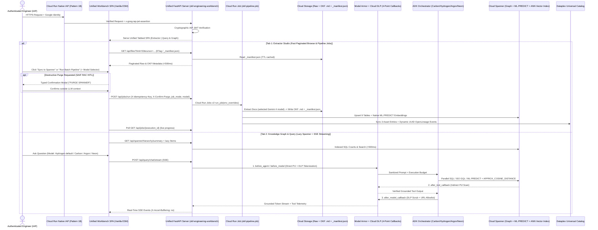

# Enterprise Solution Design & Specification: Unified Engineering OKF Workbench v2, Parameterized Cloud Run Pipeline Job, Selectable Gemini 4 Models & Spanner Native Embedding Optimization (`SPEC-20261120-UNIFIED-WORKBENCH-V2`)

## Document Control

| Field | Value |
| :--- | :--- |
| **Spec ID** | `SPEC-20261120-UNIFIED-WORKBENCH-V2` *(Consolidated Master Specification & Living Execution Plan — v1 → MOC → v2 → v2.2)* |
| **Workload Type** | `Hybrid` |
| **Status** | `Implemented & Deployed` |
| **Author** | Platform Engineering Team |
| **Date** | `2026-11-20` |
| **Version** | `2.2` |
| **Discovery Reference** | `N/A` |
| **Baseline Reference** | `specs/baseline/system-overview.md` |

---

## 1. Executive Summary & Problem Framing

### 1.1 Business Context & Problem Statement
- **Context & Motivation:** Process safety engineers, plant reliability leads, and knowledge operations teams currently switch between two separate Cloud Run web UIs (`extracter-agent-web` and `okf-query-agent-web`), must run CLI scripts manually to batch-extract documents or synchronize OKF Markdown bundles into Cloud Spanner, cannot switch Gemini 4 models dynamically per task, and face O(N) UI/backend latency bottlenecks as document counts scale toward thousands of files. Meanwhile, upstream repository `https://github.com/pantana-na/engineering-kg-gc.git` introduced multi-format Office ingestion (DOCX/XLSX/PPTX), alias twin consolidation, MOC authority tiering, fast memoized indexing, externalized Cloud Run IAP/VPC config, and universal scale-to-zero (`min_instances=0`).
- **Goals:**
  1. **Upstream Code Synchronization (Zero Reference Drift):** Port all application code, multi-format parsers, alias/MOC logic, Terraform/deploy externalization, and tests from `engineering-kg-gc` into `upgrade-v2` while strictly preserving local `reference/`, `_agents/`, `AGENTS.md`, custom `docs/`, and excluding `extracted_gc_knowledge_temp/` and GC-specific eval datasets.
  2. **Unified Modern Tabbed Workbench UI (`okf-engineering-workbench`):** Consolidate Extractor and Query/Graph workbenches into a single low-clutter, interactive, **Zero-Build Vanilla ES Modules + CSS Design System** SPA served by one unified FastAPI Cloud Run service, with instant top-level switching between **Extractor Studio** and **Knowledge Graph & Query** tabs.
  3. **UI-Triggered Spanner Sync & Parameterized Cloud Run Job (`okf-pipeline-job`):** Deploy a single parameterized `google_cloud_run_v2_job` supporting `JOB_MODE=extract | sync | extract_and_sync`, triggerable directly from the Extractor UI with live execution progress polling, container env overrides, and local-process fallback for offline/dev testing.
  4. **Selectable Gemini 4 Model Registry:** Expose a validated UI model selector supporting `gemini-4-carbon` *(Extractor default)*, `gemini-4-hydrogen` *(Query default)*, `gemini-4-argon`, and `gemini-4-neon` (`GEMINI_LOCATION=global`), strictly allowlisted on the backend and propagated to ADK runners and Cloud Run Job env overrides.
  5. **Large-Scale Performance & Spanner Native Embedding Optimization:** Eliminate O(N) UI/API bottlenecks up to **5,000 raw documents & 10,000 OKF concepts** via GCS `_manifest.json` metadata caching + server-side pagination, Cloud Spanner native **`CREATE MODEL` + `ML.PREDICT` embeddings**, Spanner Enterprise **ANN `VECTOR INDEX` (`APPROX_COSINE_DISTANCE`)**, secondary indexes on all graph edge tables, lazy two-tier Spanner hierarchy API, parallel concept dossier RPCs, SSE streaming, and dynamic OpenLineage UUID `runId`s.

### 1.2 Scope Definition & Operational / Autonomy Boundaries
- **In-Scope Automated Capabilities (Universal):**
  - Unified FastAPI server (`unified_web/server.py`) mounting Extractor, Query, Pipeline Job, and backward-compatible legacy API routes.
  - GCS `_manifest.json` incremental metadata cache + server-side paginated/searchable file explorer.
  - Parameterized Cloud Run Job runner (`scripts/pipeline_job_runner.py` + `okf-pipeline-job`) executing batch document extraction, index generation, GCS publication, Spanner `.md`-only sync with native `ML.PREDICT` embeddings, and Dataplex Universal Catalog sync.
  - Spanner DDL v2 migration (`OkfTextEmbeddingModel`, `idx_okf_chunks_vec`, and graph edge/filter secondary indexes).
- **Human-Gated / Role-Approved Capabilities (Universal):**
  - Destructive Spanner **Purge & Reload** (`purge=true`) triggered from the Extractor UI is strictly gated behind an explicit typed-confirmation modal (`PURGE SPANNER`) + backend deterministic verification of `X-Confirm-Purge: CONFIRMED` and `X-Idempotency-Key` headers.
- **Explicit Non-Goals (Out-of-Scope):**
  - Modifying, deleting, or overwriting any files under `reference/raw/` (Reference Immutability Invariant).
  - Importing GC-specific extracted bundles (`extracted_gc_knowledge_temp/`) or GC-specific eval datasets.
  - Introducing Node.js / npm / React build toolchains into the Docker image (explicitly selected Zero-Build Vanilla ES Modules).
  - Running live GCP production deployments before Phase 3 user sign-off.
- **`[AI-Agent Only]` Autonomous Agent vs. Externalized HITL Boundaries (`SAIF RAC`):**
  - **Autonomous Read-Only Scope:** Query Agent Spanner SQL/GQL/Vector/FTS/Lineage/HAZOP lookups, Dataplex catalog inspection, and read-only bundle/PDF browsing require no human confirmation.
  - **Deterministic Human-in-the-Loop (HITL) Gated Scope:** Triggering Cloud Run Job batch mutations (`JOB_MODE=extract | sync | extract_and_sync`) is an explicit user-initiated UI action outside the LLM context window (the LLM cannot invoke Cloud Run Jobs or purge Spanner autonomously); destructive `purge=true` additionally enforces typed UI confirmation + backend `X-Confirm-Purge` + `X-Idempotency-Key` deduplication.

### 1.3 Workload-Specific Acceptance Criteria & SLAs
- **Universal Operational SLAs (WAF Pillars 3 & 5):**
  - **Composite Availability SLO & Error Budget:** `99.9%` monthly availability (`43.2m` monthly error budget) for `okf-engineering-workbench` in `asia-southeast1`.
  - **API / Page Latency & Throughput:** Initial UI shell load `<= 1.5s`; paginated Extractor `/api/files` and Query `/api/spanner/hierarchy/summary` & `/items` `p95 <= 500ms` at up to `5,000` raw documents / `10,000` OKF concepts; Spanner concept dossier & interactive graph `p95 <= 800ms`; Cloud Run Job timeout default `3600s` (configurable up to `86400s` via `.env`).
  - **Recovery Objectives:** `RTO <= 30m` (Terraform redeploy + Spanner regional HA failover) | `RPO <= 5m` (GCS object versioning + Spanner automated point-in-time recovery).
- **`[AI-Agent Only]` Agentic Quality & Streaming SLAs (Rule 12 & SAIF 2.0):**
  - **Streaming Latency:** Query Agent `TTFT p95 <= 3.0s` via SSE streaming (`X-Accel-Buffering: no`); single-entity turn completion `p95 <= 8.0s`.
  - **Agent Evaluation Gates (`agents-cli eval`):** Tool Selection Precision `>= 95%`, Factual Groundedness `1.000` (`100%`), SAIF Adversarial Block Rate `100%`.

---

## 2. System Architecture, Topology & Code Contracts

### 2.1 Architecture Diagram


### 2.2 Service Interaction Flow & Agent Topology
- **Service & Component Interaction Flow (Universal):**
  - **Single Unified Cloud Run Service (`okf-engineering-workbench`):** Serves static ES Modules (`unified_web/static/`) at `/`, mounts unified API routers (`/api/models`, `/api/extractor/*`, `/api/query/*`, `/api/spanner/*`, `/api/jobs/*`, `/api/catalog*`, `/healthz`) and preserves backward-compatible aliases (`/api/files`, `/api/okf/{id}`, `/api/raw-pdf/{sub}/{file}`, `/api/chat/extract`, `/api/chat/jobs/{id}`, `/api/status`).
  - **Single Parameterized Cloud Run Job (`okf-pipeline-job`):** Executes `python -m scripts.pipeline_job_runner` using the same container image as the web service. Accepts container environment overrides (`JOB_MODE=extract | sync | extract_and_sync`, `GEMINI_MODEL`, `SYNC_MODE=FULL_MIRROR | INCREMENTAL`, `PURGE=true|false`, `TARGET_SUBFOLDER`, `BUNDLE_VERSION`, `JOB_EXECUTION_ID`). Writes structured live progress heartbeats (`_job_status/<execution_id>.json`) to GCS so the UI displays file-by-file progress regardless of which Cloud Run web instance handles the poll.
  - **Local Development Fallback:** When `CLOUD_RUN_JOBS_EXECUTION_MODE=local` (or when `K_SERVICE` is unset and Cloud Run Jobs API is not explicitly forced), `/api/jobs/run` spawns an isolated background subprocess running `scripts.pipeline_job_runner` writing the same status JSON locally, ensuring 100% UI testability locally and in CI.
- **Agent Topology & Orchestration Flow (Rule 11):**
  - **Extracter Orchestrator (`extracter_orchestrator`):** Official `google-adk` `Agent` with 8 typed `FunctionTool`s (`find_raw_documents_tool`, `process_raw_pdf_tool`, `inspect_existing_okf_concept_tool`, `generate_equipment_okf_tool`, `generate_okf_concept_tool`, `build_okf_indexes_and_validate_tool`, `validate_okf_bundle_tool`, `export_bundle_to_gcs_tool`), dynamically instantiated with the validated allowlisted Gemini 4 model (default `gemini-4-carbon`).
  - **Query Orchestrator (`okf_spanner_query_orchestrator`):** Read-only `google-adk` `Agent` with 7 typed `FunctionTool`s (`lookup_entity_and_parameters`, `traverse_equipment_connectivity_graph`, `trace_data_lineage_and_conflicts`, `hybrid_search_okf_spanner`, `read_full_okf_concept_from_spanner`, `execute_multistage_risk_and_hazop_query`, `sync_or_inspect_knowledge_catalog`), dynamically instantiated with the validated allowlisted Gemini 4 model (default `gemini-4-hydrogen`).
  - **Canonical MECE Intent Topology:** Both agents preserve cognitive model-driven MECE classification including `OTHERS` out-of-scope handling (zero regex/keyword routing).

### 2.3 Compute Runtime, WAF 6-Pillar Alignment & Model Selection
| Dimension | Web Frontend, Unified API & Pipeline Job (`cloud_run`) | Conversational AI & Reasoning Engine (`agent_runtime`) |
| :--- | :--- | :--- |
| **Target Runtime** | **Google Cloud Run v2 Service (`okf-engineering-workbench`)** + **Google Cloud Run v2 Job (`okf-pipeline-job`)** + Cloud Spanner Enterprise + GCS + Dataplex | **Gemini Enterprise Agent Platform (`agent_runtime`)** + ADK Orchestrators (`extracter_orchestrator`, `okf_spanner_query_orchestrator`) |
| **Compute & Sizing** | Non-root Python 3.11 container (`4 vCPU / 8 GiB`, `min_instances=0`, `max_instances=3` nonprod / `5` prod, `timeout=900s` web / `3600s` job) in `asia-southeast1` | Managed Vertex AI Agent Engine runtime in `asia-southeast1`; Vertex AI Gemini API endpoint in `global` |
| **Model Selection** | Allowlisted UI model selector & Cloud Run Job `GEMINI_MODEL` env override | Allowlisted Gemini 4 models (`GEMINI_LOCATION=global`): `gemini-4-carbon` *(Extractor default)*, `gemini-4-hydrogen` *(Query default)*, `gemini-4-argon`, `gemini-4-neon`; Spanner native `ML.PREDICT` remote model `text-embedding-005` |
| **Deployment & Governance** | Cloud Build (`cloudbuild.yaml` + SLSA L3 provenance) + Terraform Infrastructure Manager (`terraform/`) ([`devops_security_and_quality_standards.md`](../../_agents/rules/devops_security_and_quality_standards.md)) | `adk deploy agent_engine` / `agents-cli deploy --deployment-target agent_runtime` ([`google_adk_and_agent_runtime.md`](../../_agents/rules/google_adk_and_agent_runtime.md)) |

- **Google Cloud Well-Architected Framework (6 Pillars) Summary:**
  1. **Operational Excellence:** Unified `/healthz` readiness probe, structured JSON Cloud Logging with trace correlation, Cloud Run Job execution telemetry, 100% Terraform IaC (including `google_cloud_run_v2_job`), and single-image Cloud Build CI/CD.
  2. **Security, Privacy & Compliance:** Pattern 1B Direct Cloud Run Native IAP (`--iap`) with cryptographic backend `x-goog-iap-jwt-assertion` JWT verification, dedicated least-privilege SA (`roles/run.invoker` for IAP SA, `roles/run.developer` scoped to `okf-pipeline-job`, `roles/spanner.databaseUser`, `roles/storage.objectAdmin`, `roles/aiplatform.user`), zero `allUsers`, 4-point Model Armor + Cloud DLP ADK callbacks, externalized HITL gate on destructive Spanner purge, and CodeMender SAST gate.
  3. **Reliability:** Regional multi-zone Cloud Run + Cloud Spanner Enterprise HA, Cloud Run Job isolation eliminating HTTP timeouts on batch extraction/Spanner sync, `X-Idempotency-Key` deduplication on job triggers, bounded retries with exponential backoff + jitter, and typed `UPSTREAM_UNAVAILABLE_DEGRADED` responses (zero synthetic fallback data).
  4. **Cost Optimization (FinOps):** Consolidating 2 Cloud Run services into 1 + universal `min_instances=0` scale-to-zero, mandatory FinOps labels (`env`, `service`, `owner`, `cost_center`) across all Terraform resources, tiered Gemini 4 model selection (`gemini-4-hydrogen` fast default for queries, `gemini-4-carbon` default for extraction), and native Spanner `ML.PREDICT` + incremental MD5 skip avoiding redundant re-embedding.
  5. **Performance Optimization:** GCS `_manifest.json` incremental index, paginated/searchable Extractor & Spanner Hierarchy APIs, Spanner ANN `VECTOR INDEX` (`APPROX_COSINE_DISTANCE`) + 9 new graph edge/lookup secondary indexes, parallel `asyncio.gather()` concept dossier queries, SSE streaming (`X-Accel-Buffering: no`), and lazy tab mounting + virtualized rendering in the Vanilla ESM UI.
  6. **Sustainability:** Regional co-location in `asia-southeast1` (`CFE %` constrained by APAC data residency and low RTT to plant engineering users), scale-to-zero idle compute, 1-service container consolidation, GCS version lifecycle pruning (`num_newer_versions=5`), and incremental MD5 skipping to eliminate wasted LLM/embedding compute.

### 2.4 Data Models, API Contracts & UI State Schemas
- **Allowlisted Gemini 4 Model Registry (`unified_web/models.py`):**
  ```python
  ALLOWED_GEMINI_MODELS = (
      "gemini-4-carbon",    # Extractor default
      "gemini-4-hydrogen",  # Query default
      "gemini-4-argon",
      "gemini-4-neon",
  )
  DEFAULT_EXTRACTER_MODEL = "gemini-4-carbon"
  DEFAULT_QUERY_MODEL = "gemini-4-hydrogen"
  ```
- **Cloud Spanner DDL v2 Additions (`query_agent/spanner/schema.sql`):**
  ```sql
  -- 1. Native Spanner Remote Embedding Model (parameterized at migration time with project/location/model)
  CREATE OR REPLACE MODEL OkfTextEmbeddingModel
  INPUT(content STRING(MAX))
  OUTPUT(
    embeddings STRUCT<
      statistics STRUCT<truncated BOOL, token_count FLOAT64>,
      values ARRAY<FLOAT64>
    >
  )
  REMOTE OPTIONS (
    endpoint = '//aiplatform.googleapis.com/projects/${PROJECT_ID}/locations/${EMBEDDING_LOCATION}/publishers/google/models/${EMBEDDING_MODEL}'
  );

  -- 2. Enterprise ANN Vector Index (ScaNN) on OkfSectionChunks.embedding
  CREATE VECTOR INDEX IF NOT EXISTS idx_okf_chunks_vec
    ON OkfSectionChunks(embedding)
    STORING (concept_id, category, unit, section_heading, has_conflict)
    WHERE embedding IS NOT NULL
    OPTIONS (distance_type = 'COSINE');

  -- 3. Secondary Indexes on Graph Edge & Filter Columns (eliminating full scans at 10k+ concepts)
  CREATE INDEX IF NOT EXISTS idx_okf_concepts_cat_unit ON OkfConcepts(category, unit, concept_id);
  CREATE INDEX IF NOT EXISTS idx_engineering_entities_concept ON EngineeringEntities(concept_id, canonical_tag);
  CREATE INDEX IF NOT EXISTS idx_fact_assertions_entity ON FactAssertions(entity_id, has_conflict);
  CREATE INDEX IF NOT EXISTS idx_process_conn_from ON ProcessConnections(from_entity_id, to_entity_id);
  CREATE INDEX IF NOT EXISTS idx_process_conn_to ON ProcessConnections(to_entity_id, from_entity_id);
  CREATE INDEX IF NOT EXISTS idx_inst_ctrl_inst ON InstrumentControlEdges(instrument_entity_id, target_entity_id);
  CREATE INDEX IF NOT EXISTS idx_inst_ctrl_target ON InstrumentControlEdges(target_entity_id, instrument_entity_id);
  CREATE INDEX IF NOT EXISTS idx_inst_ctrl_source_concept ON InstrumentControlEdges(source_concept_id);
  CREATE INDEX IF NOT EXISTS idx_concept_wikilinks_from ON ConceptWikiLinks(from_concept_id, to_concept_id);
  ```
- **Unified REST & SSE API Contracts:**
  - `GET /healthz`: Returns `200 OK` with unified service status, active default models, Spanner connectivity readiness, GCS readiness, and pipeline job configuration.
  - `GET /api/models`: Returns `{ allowed_models: [...], defaults: { extractor: "gemini-4-carbon", query: "gemini-4-hydrogen" }, location: "global" }`.
  - `GET /api/files`: Enhanced backward-compatible Extractor explorer supporting `?limit=50&offset=0&q=&category=&subfolder=&since_version=&force_gcs=false&paginated=true` backed by `_manifest.json` + TTL cache. When `paginated=false` (legacy callers), preserves existing response shape; UI uses `paginated=true` for O(1) page responses.
  - `POST /api/chat/extract`: Extends `LiveExtractRequest` with optional `model: str | None` (validated against `ALLOWED_GEMINI_MODELS`; defaults to `gemini-4-carbon`).
  - `POST /api/jobs/run`:
    - **Headers:** `X-Idempotency-Key: <uuid>` (deduplicates accidental double-clicks within 60s), `X-Confirm-Purge: CONFIRMED` (required iff `purge == true`).
    - **Body:** `{ job_mode: "extract" | "sync" | "extract_and_sync", model: "gemini-4-carbon" | ..., sync_mode: "FULL_MIRROR" | "INCREMENTAL", purge: false, target_subfolder: null | "pid" | ..., bundle_version: "v2-unified", compute_embeddings: true, sync_dataplex_catalog: true }`.
    - **Response (`202 Accepted`):** `{ execution_id, job_name, job_mode, model, sync_mode, purge, status: "QUEUED" | "RUNNING", execution_backend: "cloud_run_job" | "local_subprocess", created_at }`.
    - **Error Contracts:** `400` (disallowed model, invalid `job_mode`, missing `X-Confirm-Purge` when `purge=true`), `401`/`403` (invalid IAP JWT), `409` (duplicate `X-Idempotency-Key` returns existing execution metadata), `429` (rate limit), `503` (`status: "UPSTREAM_UNAVAILABLE_DEGRADED"` when Cloud Run Jobs API is unreachable).
  - `GET /api/jobs` & `GET /api/jobs/{execution_id}`: Lists recent executions and returns live execution state, stage progress (`step`, `processed_count`, `total_count`, `percent`, `spanner_counts`, `error`, `log_excerpt`).
  - `GET /api/spanner/hierarchy/summary`: Lightweight indexed counts (`summary_counts`, `units: [{ unit, equipment_count, conflict_count, classes: [{ class_name, count }] }]`, `knowledge_categories: [{ category, count }]`) without full item arrays.
  - `GET /api/spanner/hierarchy/items`: Paginated/searchable drill-down (`?unit=&class_name=&category=&q=&limit=50&offset=0&conflicts_only=false`) returning `{ total, offset, limit, has_more, items: [...] }`. Legacy `GET /api/spanner/hierarchy` remains supported for compatibility (capped/cached).
  - `GET /api/spanner/concept/{concept_id}`: Runs `read_full_concept`, `lookup_entity_and_parameters`, and `trace_lineage_gql` concurrently via `asyncio.gather()` with bounded LRU cache (invalidated automatically when a `sync` job completes).
  - `POST /api/query/chat` & `POST /api/query/chat/stream` (SSE): Extends `ChatQueryRequest` with optional `model: str | None` (validated against `ALLOWED_GEMINI_MODELS`; defaults to `gemini-4-hydrogen`). `/api/query/chat/stream` streams real-time SSE `step`, `tool_call`, `token`, `done`, and `error` events with `X-Accel-Buffering: no`.
- **UI/UX Behavioral State Machine (Unified Workbench SPA):**
  - Top bar: App brand, **Workspace Tab Switcher** (`Extractor Studio` | `Knowledge Graph & Query`), **Context-Aware Gemini 4 Model Selector** (remembers per-tab selection in `localStorage`; Extractor defaults to `gemini-4-carbon`, Query defaults to `gemini-4-hydrogen`), and compact **Pipeline Jobs Drawer** badge showing running Cloud Run Job progress.
  - Tab States: `Idle` $\rightarrow$ `Loading` $\rightarrow$ `Streaming` / `Job Running` / `Awaiting Purge HITL Confirmation` $\rightarrow$ `Success` | `Degraded Mode` | `Error`. Lazy tab initialization ensures Query Spanner APIs are not called until the Query tab is opened, and Extractor polling pauses automatically when the Query tab is active or `document.hidden === true`.

---

## 3. Security, Privacy, Compliance & SAIF Alignment

### 3.1 Input/Output Guardrails & Injection Defenses
- **Universal Application Defenses:** Strict Pydantic allowlist validation for `model`, `job_mode`, `sync_mode`, `subfolder`, and `concept_id` (zero path traversal `..` or shell metacharacters); parameterized Spanner SQL/GQL queries only; strict HTML escaping + safe Markdown renderer in the Vanilla ESM UI; pre-build **CodeMender** SAST (`cm find/verify/fix`) and Artifact Analysis CVE scanning.
- **4-Point Inline Model Armor + Cloud DLP Callbacks (`extracter_agent/agent/guardrails.py` & `query_agent/guardrails.py`):**
  1. `before_agent_callback` & `before_model_callback`: Direct Prompt Injection (`PIJ`) screening via Model Armor + Cloud DLP/pattern PII/secret redaction prior to LLM submission or logging.
  2. `after_tool_callback`: Mandatory **Indirect Prompt Injection (`PIJ`)** inspection on retrieved PDF text, OKF chunks, and Spanner tool payloads before re-entering model context, quarantining embedded adversarial instructions while preserving benign engineering facts.
  3. `after_model_callback`: Outbound DLP sensitive-data scrubbing (`SDD`) + strict outbound Markdown image/URL allowlist verification (`IMO`) stripping unauthorized external image/link exfiltration vectors (``).

### 3.2 Identity Delegation, Authorization & Execution Sandboxing
- **Zero-Trust IAM & Pattern 1B IAP Verification (Rule 10):**
  - Cloud Run service `okf-engineering-workbench` deploys with `--iap --invoker-iam-check --no-allow-unauthenticated` (`iap_enabled = true`, `invoker_iam_disabled = false`, zero `allUsers` / `allAuthenticatedUsers`).
  - FastAPI middleware (`unified_web/security.py`) cryptographically verifies `x-goog-iap-jwt-assertion` (RS256/ES256 Google IAP public certs, issuer `https://cloud.google.com/iap`, exact Cloud Run audience) whenever `IAP_JWT_ENFORCEMENT=true` (enabled in Cloud Run deployments, explicitly bypassable only in local dev with `IAP_JWT_ENFORCEMENT=false`).
  - Dedicated least-privilege Service Account (`okf-workbench-<env>@...`) granted `roles/run.developer` (scoped to `okf-pipeline-job`), `roles/spanner.databaseUser`, `roles/storage.objectAdmin` (scoped to OKF bucket), `roles/aiplatform.user`, and `roles/dataplex.catalogEditor`; Spanner Service Agent granted `roles/aiplatform.user` for native `ML.PREDICT`.
- **Agentic Identity & Anti-Confused-Deputy (`SAIF 2.0`):**
  - Authenticated IAP user email (`sub`/`email`) is extracted from the verified IAP JWT, attached to structured audit logs and Cloud Run Job triggers (`TRIGGERED_BY`), and never overridden by untrusted client headers or LLM context.
  - Query Agent remains strictly read-only on Spanner; Cloud Run Job triggers and destructive `purge=true` actions live strictly in deterministic non-LLM FastAPI endpoints (`POST /api/jobs/run`), unreachable by ADK tool calls (`RAC`).

### 3.3 Network Security, Perimeter & Compliance
- **Perimeter & Encryption:** Externalized Direct VPC Egress (`CLOUD_RUN_VPC_MODE=direct`, `ALL_TRAFFIC`), unified `.env` (`NONPROD_*` / `PROD_*` blocks, zero committed secrets, `.env` gitignored), Secret Manager boundary for any future credentials, CMEK-ready Terraform variables, and immutable `reference/raw/` policy.

### 3.4 Governance Checklist (Rules 1–13) & SAIF 15-Risk Matrix
| Rule / Framework | Applicability | Requirement Verification |
| :--- | :--- | :--- |
| **Google Cloud WAF (6 Pillars)** | **Universal** | Validated via `validate_waf_saif.py --workload-type hybrid`; Pattern 1B ADR trade-off documented in §7. |
| **Rules 1–5 (SCM, Quality, CodeMender SAST, SLSA L3, Cloud Build)** | **Universal** | Developed on `upgrade-v2` branch, ruff/mypy/pytest checks, CodeMender SAST scan, single-image `cloudbuild.yaml` with immutable `${_ENVIRONMENT}-${SHORT_SHA}` tags. |
| **Rules 6–10 (Cloud Run `/healthz`/SLOs, Smoke Test, `.env`/CMEK, Terraform/VPC-SC/FinOps/CFE, Zero-Trust IAM)** | **Universal** | `/healthz` readiness probe, SSE `X-Accel-Buffering: no`, unified `.env.example`, Terraform `google_cloud_run_v2_service` + `google_cloud_run_v2_job` + FinOps labels, Pattern 1B Native IAP + JWT check (zero `allUsers`). |
| **Rule 13 (4-Step RCA & WAF Graceful Degradation)** | **Universal** | Mandatory 4-Step RCA + `ask_question` sign-off on any test/eval failure; typed `UPSTREAM_UNAVAILABLE_DEGRADED` responses; zero mockup records. |
| **Rules 11–12 (`google-adk`, SAIF 2.0 Guardrails & DLP-Safe Live Eval)** | **`[AI-Agent Only]`** | Official `google-adk`, MECE intents (`OTHERS`), allowlisted Gemini 4 models, 4-point callbacks, execution budgets (`DMS`), and live eval verification. |

- **Google SAIF & SAIF 2.0 15-Risk Mitigation Summary:**
  - **Data (`DP`, `UTD`, `EDH`):** Immutable `reference/raw/` policy + MD5 file integrity tracking (`DP`); Vertex AI zero-training enterprise terms (`UTD`); `before_agent_callback` DLP redaction (`EDH`).
  - **Infrastructure (`MST`, `MXF`, `MDT`, `DMS`):** CodeMender SAST + Artifact Registry immutable digests (`MST`, `MDT`); Direct VPC Egress + IAM least privilege (`MXF`); per-user app-level rate limits + `max_instances` cap + ADK max-turn/step budgets + Cloud Run Job timeout caps (`DMS`).
  - **Model (`MRE`, `IIC`, `PIJ`, `MEV`, `SDD`, `ISD`):** Strict model allowlist + IAP auth (`MRE`); Pydantic-validated `FunctionTool` registry (`IIC`); Model Armor on `before_agent` (Direct `PIJ`) and `after_tool_callback` (Indirect `PIJ`); canonicalized input checks (`MEV`); `after_model_callback` DLP scrubbing + verified IAP principal (`SDD`, `ISD`).
  - **Application & Agent (`IMO`, `RAC`):** `1.000` groundedness citations + HTML escaping + outbound URL allowlist (`IMO`); read-only Query Agent + externalized deterministic `/api/jobs/run` with `X-Confirm-Purge` typed HITL gate + `X-Idempotency-Key` (`RAC`).

---

## 4. Resiliency, Reliability & State Integrity

### 4.1 Execution Boundaries & Anti-Loop Safeguards
- **Universal Execution Boundaries:** Bounded pagination (`limit` clamped `1..200`), bounded Spanner graph traversal (`max_hops` clamped `1..3`, `max_nodes` default `120`, max `300`), per-IP/user token-bucket rate limiter on `/api/jobs/run` (`5 req/min`) and `/api/query/chat*` (`30 req/min`), Cloud Run Job timeout (`3600s` default), and `max_instances` caps (`3` nonprod / `5` prod).
- **Anti-Loop & Denial-of-ML-Service Safeguards (`SAIF DMS`):** Enforce `MAX_AGENT_TOOL_CALLS=12` and `MAX_AGENT_TURN_SECONDS=120` in both Extractor and Query ADK runners so runaway reasoning loops terminate deterministically with a typed budget-exceeded response.

### 4.2 Idempotency & Transactional Consistency
- **State Integrity:** `POST /api/jobs/run` enforces `X-Idempotency-Key` deduplication (60s TTL window returning the active `execution_id` rather than launching duplicate Cloud Run Jobs). Cloud Spanner sync (`sync_markdown_bundle_to_spanner`) writes idempotent `INSERT_OR_UPDATE` mutations keyed by `concept_id` / `chunk_id` / `fact_id` and tracks per-concept MD5 hashes so interrupted syncs resume cleanly without duplicates.

### 4.3 High Availability, Graceful Degradation & Model Fallbacks
- **Multi-Zone HA & Graceful Degradation (WAF Pillar 3 & Rule 13):**
  - Regional multi-zone Cloud Run (`asia-southeast1`) + Cloud Spanner Enterprise regional HA.
  - If Cloud Run Jobs API or GCS is transiently unavailable, `/api/jobs/run` and `/api/files` return HTTP `503` with `{"status": "UPSTREAM_UNAVAILABLE_DEGRADED", "component": "...", "retryable": true}` (or cached manifest stamped `is_cached_degraded: true` and `as_of_timestamp`) — strictly zero synthetic fake records.
  - If Spanner native `ML.PREDICT` or `APPROX_COSINE_DISTANCE` fails because an older DB has not yet applied DDL v2 or has fewer rows than Spanner's ANN threshold, `repository.py` logs a structured warning and degrades transparently to exact `COSINE_DISTANCE` (with `vector_search_mode: "EXACT_FALLBACK"` telemetry) or `client_sdk` embeddings when configured — never fabricating search hits.
- **Model Capacity & Retries:** All Gemini 4 calls (`gemini-4-carbon`, `gemini-4-hydrogen`, `gemini-4-argon`, `gemini-4-neon`) use `google.genai.types.HttpRetryOptions(attempts=5)` with exponential backoff + jitter for transient `429`/`503` responses.

---

## 5. Observability, Operations & AgentOps

### 5.1 End-to-End Tracing, Health Probes & Span Hierarchy
- **Universal Probes, SLOs & Distributed Tracing (Rule 6):**
  - Container-local `GET /healthz` verifies FastAPI readiness, configured default models, and non-blocking Spanner/GCS status; wired to Cloud Run Startup & Liveness Probes.
  - Structured JSON logs include `logging.googleapis.com/trace`, `spanId`, `execution_id`, `model`, `job_mode`, and latency `ms`.
- **AgentOps Span Hierarchy:** Every Query/Extractor turn records per-step latency (`STEP 0 GUARDRAIL` $\rightarrow$ `STEP 1 ROUTING` $\rightarrow$ `ADK TOOL CALL #N` $\rightarrow$ `AFTER_TOOL PIJ` $\rightarrow$ `SYNTHESIS` $\rightarrow$ `AFTER_MODEL DLP`) and streams step telemetry live over SSE to the UI.

### 5.2 Structured Logging & Correlation
- **DLP-Safe Structured Telemetry:** All API logs, job runner logs, and Dataplex OpenLineage events emit structured JSON correlated with `execution_id` and verified IAP user email (zero raw secrets, zero unredacted PII). OpenLineage `runId` uses a fresh `uuid.uuid4()` per sync execution.

### 5.3 CI/CD, Automated Testing & Continuous Evaluation
- **Universal CI/CD & Verification Gates (Rules 2–7):**
  - Single-image `cloudbuild.yaml` builds `okf-engineering-workbench` (used by both the Cloud Run Service and `okf-pipeline-job`), runs `pytest` (Unit + Hypothesis PBT), runs CodeMender SAST, pushes immutable `${_ENVIRONMENT}-${SHORT_SHA}` tag to Artifact Registry, and deploys via Terraform / `deploy.sh`.
- **Continuous Evaluation & Golden Datasets (Rule 12):** Existing local `evals/` datasets remain preserved for live `agents-cli eval` verification ($\ge 95\%$ tool precision, $1.000$ groundedness, $100\%$ SAIF guardrail block rate).

---

## 6. Performance Optimization, FinOps & Sustainability

### 6.1 Latency Engineering & Caching Strategy
- **Extractor Optimization (Target: `<500ms` at 5,000 raw docs / 10,000 OKF concepts):**
  1. Maintain a compact GCS JSON metadata manifest (`<prefix>/_manifest.json`) updated incrementally on every write/extraction/job completion, storing `{ concept_id, category, title, type, updated, has_conflict, size_bytes, content_hash, source_count, sources }`.
  2. Replace O(N) per-poll `list_blobs()` + full disk `.md` parsing + full `validate_okf_bundle_tool()` on `/api/status` & `/api/files` with a single-object `_manifest.json` ETag/generation check (cached in memory with 10s TTL) + lazy rebuild only on cache miss.
  3. Add server-side search & cursor/offset pagination on `GET /api/files` (`limit=50`), eliminating multi-MB JSON responses and eager DOM rendering.
  4. Pause Extractor background polling automatically when the user switches to the Query tab or backgrounds the browser tab (`visibilitychange`).
- **Query & Spanner Optimization (Target: `<500ms` hierarchy, `<800ms` concept/graph, `<3s` TTFT):**
  1. **Spanner Native Embeddings (`CREATE MODEL` + `ML.PREDICT`):** Batched in-DB embedding computation (`batch_size=100`) during ingestion (skipping unchanged MD5 concepts) + inline query embedding inside Spanner SQL.
  2. **Spanner ANN `VECTOR INDEX` + 9 Graph/Lookup Secondary Indexes:** Eliminates brute-force `COSINE_DISTANCE` scans and full edge-table scans on ISO GQL traversals.
  3. **Lazy Two-Tier Hierarchy API:** `/api/spanner/hierarchy/summary` returns only aggregated `Unit -> Class` and `Category` counts (`<10KB`), while `/api/spanner/hierarchy/items` loads 50 items per expanded node or instant `SEARCH(ConceptTokens, ...)` query.
  4. **Parallel Concept Dossier RPCs & Bounded LRU Caches:** `asyncio.gather()` across `read_full_concept`, `lookup_entity_and_parameters`, and `trace_lineage_gql`; bounded LRU caches (`max=256`, TTL 60s) invalidated immediately when a Spanner Sync job completes.
  5. **SSE Streaming (`POST /api/query/chat/stream`):** Eliminates 450ms polling overhead and delivers real-time step/token progress.

### 6.2 Unit-Cost Modeling, Sustainability & Token Economics
- **Universal FinOps & Sustainability (WAF Pillars 4 & 6, Rule 9):**
  - **Unit Economics KPI:** Target `< \$0.08` per 100-page engineering document extraction (batch) and `< \$0.005` per Spanner Graph-RAG query turn; idle compute `\$0/hr` for both `okf-engineering-workbench` and `okf-pipeline-job` via `min_instances=0`.
  - **FinOps Governance:** Mandatory Terraform labels (`env`, `service`, `owner`, `cost_center`) across Cloud Run Service, Cloud Run Job, Spanner, and GCS; consolidating two Cloud Run services into one eliminates duplicate container image builds and cold-start overhead.
  - **Sustainability (`GreenOps`):** Co-located in `asia-southeast1` (mandated APAC proximity/residency), universal scale-to-zero (`min_instances=0`), incremental MD5 skip preventing redundant LLM/embedding energy consumption, and GCS version lifecycle pruning (`num_newer_versions=5`).
- **Token Economics:** Defaulting Query Agent to fast **`gemini-4-hydrogen`** and Extractor Agent to **`gemini-4-carbon`** while keeping **`gemini-4-argon`** and **`gemini-4-neon`** selectable on demand balances latency, quality, and token spend per user task.

---

## 7. Architectural Decision Records (ADRs)

| ADR ID | Competing WAF Pillars / Constraints | Architectural Tension | Selected Resolution & Justification |
| :--- | :--- | :--- | :--- |
| **ADR-01** | **Security & Compliance** vs. **Cost Optimization & Simplicity** | Pattern 1A (Global ALB + Cloud Armor L7 WAF + IAP, ~$25–$40/mo fixed LB baseline) vs. Pattern 1B (Direct Cloud Run Native IAP `--iap`, `$0` LB baseline, single-region `*.run.app`). | Select **Pattern 1B (Direct Cloud Run Native IAP)** as default (matching `engineering-kg-gc`), compensated with mandatory backend cryptographic `x-goog-iap-jwt-assertion` verification, strict Pydantic schema validation, app-level rate limits, and `max_instances` caps. Pattern 1A remains configurable via `.env` (`CLOUD_RUN_INGRESS=internal-and-cloud-load-balancing`). |
| **ADR-02** | **Performance & Maintainability** vs. **Build Toolchain Simplicity** | React/Vite/TypeScript SPA (rich component ecosystem, adds Node/npm build stage) vs. Zero-Build Vanilla ES Modules + CSS Design System (single Python Dockerfile, zero npm CVEs). | Select **Zero-Build Vanilla ES Modules + CSS Design System** (`unified_web/static/`), implementing modular tab views, virtualized/paginated lists, command-palette filtering, and SSE streaming with zero Node.js dependencies. |
| **ADR-03** | **Reliability (No Timeouts)** vs. **Infrastructure Simplicity** | Two separate Cloud Run Jobs (`extract` vs. `sync`) vs. Single Parameterized Cloud Run Job (`okf-pipeline-job`). | Select **Single Parameterized Cloud Run Job (`okf-pipeline-job`)** with `JOB_MODE=extract \| sync \| extract_and_sync` container env overrides, sharing one container image and one Terraform `google_cloud_run_v2_job` definition. |
| **ADR-04** | **Query Performance at Scale** vs. **DDL Migration Complexity** | Keeping Python-side `text-embedding-005` + brute-force `COSINE_DISTANCE` vs. Cloud Spanner Native `CREATE MODEL` / `ML.PREDICT` + Enterprise ANN `VECTOR INDEX` + 9 edge secondary indexes. | Adopt **Spanner Native `ML.PREDICT` Embeddings + ANN `VECTOR INDEX` + 9 Secondary Indexes** with idempotent DDL migration (`ensure_schema_v2`) and automatic exact-scan/in-memory fallback so existing tests and small DBs remain 100% compatible. |

### ADR-01: Pattern 1B Direct Cloud Run Native IAP With Cryptographic Backend JWT Verification
- **Context & Options Considered:** Evaluated Pattern 1A (ALB + Cloud Armor + IAP), Pattern 1B (Direct Cloud Run IAP `--iap`), and Pattern 2 (App-Level OAuth2). Internal engineering workbenches require strong Google Workspace identity enforcement with `$0` idle baseline (`min_instances=0`).
- **Decision & Consequences:** Selected Pattern 1B by default with cryptographic `x-goog-iap-jwt-assertion` verification in `unified_web/security.py` and app-layer rate limiting. Trade-off: no edge Cloud Armor WAF or Cloud CDN unless switched to Pattern 1A via `.env`.

### ADR-02: Zero-Build Vanilla ES Modules Unified Workbench Over React/Vite
- **Context & Options Considered:** Evaluated React + Vite + Tailwind vs. modular Vanilla ES Modules + modern CSS variables/grid layout.
- **Decision & Consequences:** Selected Zero-Build Vanilla ES Modules (`unified_web/static/js/*.js` + `css/workbench.css`), keeping Dockerfile Python-only, eliminating npm supply-chain surface, and achieving `<1.5s` initial load via lazy tab mounting and paginated APIs.

### ADR-03: Single Parameterized Cloud Run Job (`okf-pipeline-job`)
- **Context & Options Considered:** Evaluated two dedicated Cloud Run Jobs vs. one parameterized Cloud Run Job with `JOB_MODE` override.
- **Decision & Consequences:** Selected single `okf-pipeline-job` reusing the unified Docker image with `JOB_MODE=extract | sync | extract_and_sync` and `GEMINI_MODEL` overrides. Simplifies Terraform, Cloud Build, and IAM (`roles/run.developer` on a single job resource).

### ADR-04: Spanner Native `ML.PREDICT` Embeddings & ANN Vector Index With Graceful Fallback
- **Context & Options Considered:** Evaluated Python-side Vertex SDK batch embedding vs. Spanner-native `CREATE MODEL` + `ML.PREDICT` + `CREATE VECTOR INDEX`.
- **Decision & Consequences:** Selected Spanner-native `ML.PREDICT` + ANN `VECTOR INDEX` (`distance_type='COSINE'`) as default (`SPANNER_NATIVE_EMBEDDING_MODE=native_ml_predict`), paired with 9 new secondary indexes on graph edges and automatic fallback to `COSINE_DISTANCE` / in-memory vectors for local unit tests and pre-threshold datasets.

---

## 8. Failure Mode & Effects Analysis (FMEA)

| ID | Component / Flow | Failure Mode | Blast Radius & User Impact | Detection Signal (SLO / Alert / Probe) | Automated Mitigation & WAF Graceful Degradation |
| :--- | :--- | :--- | :--- | :--- | :--- |
| **FMEA-01** | Cloud Run Jobs API (`okf-pipeline-job`) | Quota/IAM failure or transient 5xx when triggering batch extraction or Spanner sync | User cannot start batch job from UI | HTTP 503 on `/api/jobs/run` + structured error log | Return typed `503 UPSTREAM_UNAVAILABLE_DEGRADED` with actionable remediation message; idempotency key prevents duplicate retries. |
| **FMEA-02** | Spanner Native `ML.PREDICT` / ANN Vector Index | Remote model not yet provisioned, Spanner SA missing `roles/aiplatform.user`, or chunk count below ANN threshold | Hybrid vector search or embedding update fails | Spanner `InvalidArgument` / `PermissionDenied` warning log | Log structured warning and fall back transparently to `COSINE_DISTANCE` (query) or `client_sdk` embedding mode (if configured) with explicit `vector_search_mode` / `embedding_mode` telemetry; never return fabricated hits. |
| **FMEA-03** | GCS `_manifest.json` Cache | External CLI writes `.md` directly to GCS without updating `_manifest.json` | Extractor file list temporarily stale | `force_gcs=true` refresh or ETag mismatch | Provide explicit "Refresh from GCS" button (`force_gcs=true`) that rebuilds `_manifest.json` on demand and updates ETag; job runner always refreshes `_manifest.json` upon completion. |
| **FMEA-04** | Destructive Spanner Purge (`purge=true`) | Accidental click or Prompt Injection attempting to wipe Cloud Spanner | Complete knowledge graph wipe | Missing `X-Confirm-Purge: CONFIRMED` header or LLM attempting tool mutation | LLM has zero access to `/api/jobs/run`; UI mandates typing `PURGE SPANNER`; backend deterministically rejects `purge=true` with HTTP `400` unless `X-Confirm-Purge: CONFIRMED` + `X-Idempotency-Key` are present. |
| **FMEA-05** | Untrusted Document / RAG Output | Indirect Prompt Injection (`PIJ`) embedded in an engineering PDF/DOCX or Spanner chunk | Attempted agent hijack or URL exfiltration | `after_tool_callback` / `after_model_callback` security log | Quarantine adversarial payload in `after_tool_callback`, strip unauthorized Markdown URLs/images in `after_model_callback`, enforce `MAX_AGENT_TOOL_CALLS` budget. |
| **FMEA-06** | Invalid IAP JWT / Auth Bypass Attempt | Forged `X-Goog-Authenticated-User-Email` without valid `x-goog-iap-jwt-assertion` | Unauthorized access to enterprise plant data | HTTP `401` spike in Cloud Logging | Cryptographically verify `x-goog-iap-jwt-assertion` on every non-`/healthz` request when `IAP_JWT_ENFORCEMENT=true`; reject missing/invalid JWTs immediately. |

---

## 9. Step-by-Step Implementation Plan & Test Design

> [!IMPORTANT]
> Every step defines both **Deterministic Unit Tests** and **Generative Property-Based Tests (PBT)** (`hypothesis`). Any test failure triggers the **Mandatory 4-Step RCA Protocol (Rule 13)** — zero fake fallbacks, regex workarounds, or assertion weakening.

### Step 1: Upstream Sync From `engineering-kg-gc` (Strict Reference & Governance Preservation)
- **Implementation:** Sync all updated application code (`extracter_agent/`, `query_agent/`, `scripts/`, `terraform/`, `deploy.sh`, `cloudbuild.yaml`, `.env.example`, `tests/`) from `engineering-kg-gc` while strictly preserving local `reference/`, `_agents/`, `AGENTS.md`, custom `docs/`, and excluding `extracted_gc_knowledge_temp/` & GC-specific eval datasets. Update local `.env` cleanly to preserve local GCP project/bucket/Spanner values while adding new v2 keys.
- **Unit Tests:** Run full existing test suite (`pytest tests/`) to verify 100% baseline characterization parity and verify `git diff reference/` is completely empty.
- **Property-Based Tests (PBT):** Run existing Hypothesis suites (`tests/test_okf_property.py`, `tests/test_deploy_and_model_config.py`, `tests/test_moc_and_revision_lifecycle.py`).
- **Completion Criteria:** 100% pass rate across all synced tests; zero modifications to `reference/` or `_agents/`.

### Step 2: Core Data Models, Gemini 4 Model Allowlist, Spanner DDL v2 (Native `ML.PREDICT` + ANN Vector & Edge Indexes) & Security Middleware
- **Implementation:**
  - Create `unified_web/models.py` (allowlisted Gemini 4 model registry: `gemini-4-carbon`, `gemini-4-hydrogen`, `gemini-4-argon`, `gemini-4-neon`, defaults `carbon` for Extractor / `hydrogen` for Query; `PipelineJobRequest`, `PipelineJobStatus`, `PaginatedFilesResponse`, `HierarchySummaryResponse`, `HierarchyItemsResponse`).
  - Create `unified_web/security.py` (cryptographic `x-goog-iap-jwt-assertion` verifier with clean local dev gate, per-user rate limiter, and `X-Confirm-Purge` / `X-Idempotency-Key` HITL validator).
  - Update `query_agent/spanner/schema.sql`, `query_agent/spanner/repository.py`, and `query_agent/spanner/catalog_sync.py`:
    - Add parameterized `OkfTextEmbeddingModel` DDL generator + `ensure_schema_v2()` migration helper + `idx_okf_chunks_vec` ANN `VECTOR INDEX` + 9 secondary indexes.
    - Add Spanner native `ML.PREDICT` batched ingestion embedding path (`SPANNER_NATIVE_EMBEDDING_MODE=native_ml_predict` with `client_sdk` & in-memory fallback) and `APPROX_COSINE_DISTANCE` + native `ML.PREDICT` query embedding path in `hybrid_rrf_search()`.
    - Add `get_equipment_hierarchy_summary()` and `get_equipment_hierarchy_items()` (paginated & searchable).
    - Replace static OpenLineage `runId` UUIDs in `catalog_sync.py` with dynamic `uuid.uuid4()`.
- **Unit Tests (`tests/test_v2_models_and_spanner.py`):** Verify model allowlist acceptance/rejection, default model resolution, IAP JWT verification (valid/missing/tampered), purge HITL gate rejection without `X-Confirm-Purge`, Spanner DDL v2 rendering, native `ML.PREDICT` SQL generation, ANN fallback, lazy hierarchy summary/items pagination, and unique OpenLineage `runId`s.
- **Property-Based Tests (PBT):** Hypothesis invariants verifying arbitrary untrusted model strings outside the 4-model allowlist are 100% rejected, pagination slices partition total items with zero duplicates/overflows, and `purge=true` without valid HITL header is 100% rejected across fuzzed payloads.
- **Completion Criteria:** 100% unit and PBT pass rate.

### Step 3: ADK Agents Enhancement (Selectable Gemini 4 Models, 4-Point SAIF 2.0 Callbacks & Execution Budgets)
- **Implementation:**
  - Update `extracter_agent/agent/orchestrator.py`, `extracter_agent/agent/classifier.py`, `extracter_agent/agent/guardrails.py`, `extracter_agent/config.py`, `query_agent/orchestrator.py`, `query_agent/guardrails.py`, and `query_agent/config.py`:
    - Accept validated `model_name` override cleanly (`gemini-4-carbon` default for Extractor, `gemini-4-hydrogen` default for Query).
    - Complete all 4 SAIF 2.0 callback points (`before_agent_callback`, `before_model_callback`, `after_tool_callback` Indirect `PIJ` sanitizer, `after_model_callback` outbound DLP scrubber + Markdown image/URL allowlist).
    - Enforce per-session execution budgets (`MAX_AGENT_TOOL_CALLS`, `MAX_AGENT_TURN_SECONDS`).
- **Unit Tests (`tests/test_v2_adk_guardrails.py`):** Verify dynamic model binding on both agents, Indirect `PIJ` neutralization in `after_tool_callback`, unauthorized Markdown image/URL stripping in `after_model_callback`, PII token scrubbing, and tool-call budget enforcement.
- **Property-Based Tests (PBT):** Hypothesis fuzzing verifying zero unauthorized `` exfiltration tags survive `after_model_callback` and zero raw PAN/secret patterns survive DLP scrubbing across generated strings.
- **Completion Criteria:** 100% unit and PBT pass rate.

### Step 4: Unified FastAPI Server (`unified_web/server.py`), GCS `_manifest.json` Cache & Parameterized Cloud Run Job (`scripts/pipeline_job_runner.py`)
- **Implementation:**
  - Create `unified_web/manifest.py` (GCS `_manifest.json` incremental metadata cache + server-side filtered/paginated file explorer with ETag caching and on-demand rebuild).
  - Create `scripts/pipeline_job_runner.py` (Cloud Run Job entrypoint supporting `JOB_MODE=extract | sync | extract_and_sync`, `GEMINI_MODEL`, `SYNC_MODE`, `PURGE`, `TARGET_SUBFOLDER`, `BUNDLE_VERSION`, live GCS `_job_status/<execution_id>.json` heartbeats, `_manifest.json` refresh, and Spanner native `ML.PREDICT` + Dataplex sync).
  - Create `unified_web/jobs.py` (Cloud Run Jobs v2 API client `JobsClient.run_job` + `ExecutionsClient.get_execution` with container env overrides, `X-Idempotency-Key` deduplication, typed `503 UPSTREAM_UNAVAILABLE_DEGRADED` handling, and local subprocess fallback).
  - Create `unified_web/server.py` uniting Extractor, Query, Spanner lazy hierarchy, parallel `asyncio.gather()` concept dossier, SSE streaming (`/api/query/chat/stream`), Pipeline Jobs (`/api/jobs/*`), `/api/models`, `/healthz`, and backward-compatible legacy routes.
- **Unit Tests (`tests/test_v2_unified_api_and_jobs.py`):** FastAPI `TestClient` suite covering `/healthz`, `/api/models`, paginated `/api/files` & `_manifest.json` rebuild, `/api/jobs/run` across all 3 `JOB_MODE`s (local fallback + mocked Cloud Run Jobs API + `503` degraded mode), `X-Idempotency-Key` deduplication, `X-Confirm-Purge` HITL gate, lazy Spanner hierarchy summary/items, parallel concept dossier, cache invalidation after sync, and SSE `/api/query/chat/stream`.
- **Property-Based Tests (PBT):** Hypothesis tests verifying `X-Idempotency-Key` idempotency, pagination invariants on `_manifest.json`, and zero stack-trace leakage across fuzzed error inputs.
- **Completion Criteria:** 100% unit and PBT pass rate.

### Step 5: Modernized Unified Zero-Build Vanilla ES Modules Workbench UI (`unified_web/static/`)
- **Implementation:**
  - Build a clean, modern, low-clutter dark/light-balanced engineering design system (`unified_web/static/index.html`, `css/workbench.css`, `js/main.js`, `js/api.js`, `js/state.js`, `js/extractor-tab.js`, `js/query-tab.js`, `js/jobs-drawer.js`, `js/graph-canvas.js`):
    - **Top Unified Shell:** Tab switcher (**Extractor Studio** ↔ **Knowledge Graph & Query**), **Gemini 4 Model Selector** (`Carbon`, `Hydrogen`, `Argon`, `Neon` with context-aware per-tab defaults & `localStorage` persistence), and live **Pipeline Jobs Drawer** button with active badge.
    - **Extractor Studio Tab:** Paginated/searchable Raw Documents & OKF Concepts sidebar (server-side debounced search + "Load more" / virtualized slice), clean tabbed PDF / Rendered Markdown / Source Diff center pane, collapsible Extraction Assistant drawer, and **Pipeline Actions Bar** ("Run Batch Extract", "Sync OKF → Spanner", "Extract + Sync", plus explicit typed-confirmation modal for optional Purge & Reload). Pauses polling when hidden/inactive.
    - **Knowledge Graph & Query Tab:** Lazy two-tier Spanner Explorer (`Unit → Class` counts first, expand-on-demand paginated equipment + instant server-side search), clean SSE streaming engineering chat with live collapsible tool telemetry timeline (less clutter), and interactive Property Graph + Catalog Dossier drawer.
- **Unit & Behavioral Tests (`tests/test_v2_ui_contracts.py`):** Verify HTML/ESM static asset serving, zero broken script/CSS imports, DOM anchor contracts for tab switching, model selector options & defaults (`gemini-4-carbon` / `gemini-4-hydrogen`), purge confirmation modal contract, and state transition logic.
- **Property-Based Tests (PBT):** State reducer/model selection preference & pagination cursor transition invariants across randomized tab-switch and model-selection sequences.
- **Completion Criteria:** 100% unit and PBT pass rate; verified live in local server & browser inspection if requested.

### Step 6: Unified Terraform IaC (`okf-engineering-workbench` + `okf-pipeline-job`), Cloud Build, `deploy.sh`, `.env.example` & CodeMender SAST Gate
- **Implementation:**
  - Update `Dockerfile` (single unified Python 3.11 non-root image serving `unified_web.server:app` by default and runnable as `python -m scripts.pipeline_job_runner` for the Cloud Run Job; retire `Dockerfile.query_web` or keep thin compatibility shim).
  - Update `terraform/main.tf`, `terraform/variables.tf`, `terraform/outputs.tf` to provision unified `google_cloud_run_v2_service.okf_engineering_workbench` (Pattern 1B Native IAP, `min_instances=0`, `IAP_JWT_ENFORCEMENT=true`, FinOps labels), `google_cloud_run_v2_job.okf_pipeline_job` (timeout `3600s`, Direct VPC, dedicated SA, FinOps labels), IAM bindings (`roles/run.developer` on job, `roles/aiplatform.user` on Spanner service agent for `ML.PREDICT`), and Cloud Spanner Enterprise DB.
  - Update `extracter_agent/deploy_config.py`, `deploy.sh`, `cloudbuild.yaml`, `.env.example`, and local `.env` (gitignored, configured for brand-new GCP project `engineering-kg-demo`) to support the unified web service and pipeline job targets.
  - Author `scripts/bootstrap_gcp_project.sh` and Terraform `google_project_service` resources to idempotently enable all required GCP APIs (Cloud Run, Cloud Build, Artifact Registry, Vertex AI, Cloud Spanner, Cloud Storage, Dataplex, Data Lineage, IAP, Compute, IAM, Model Armor, Cloud DLP, Logging, Monitoring, Trace, Secret Manager, Infrastructure Manager) and IAM bindings in `engineering-kg-demo`.
  - Run `ruff` / type-checks, **CodeMender SAST** (`cm find`), `validate_waf_saif.py`, and full `pytest` suite.
- **Unit & Property-Based Tests (`tests/test_deploy_and_model_config.py`):** Verify unified service & Cloud Run Job config resolution, `NONPROD_*` vs. `PROD_*` isolation invariants, zero `allUsers` bindings in `terraform/main.tf`, and `terraform validate` (if `terraform` CLI is installed).
- **Completion Criteria:** Zero High/Critical SAST findings, `validate_waf_saif.py` PASS, `validate_sdlc_gate.py --phase execution` PASS, and 100% pytest pass rate.

### Step 7: v2.1–v2.2 Streamlined UX, Live Telemetry, Non-Blocking Worker SSE & MOC Lifecycle Completion
- **Implementation:**
  - **Streamlined Persistent Extractor Toolbar (Raw Docs & OKF Bundle Views):** Exactly 2 extract buttons (`Batch Extract + Sync (Job)` with interactive scope/sync launcher modal + Advanced Sync/Purge HITL; zero-Enter `Extract + Sync (Interactive)` executing immediately on click without a `?` popover) + `↻ Sync GCS` (`POST /api/gcs/sync`) + `Assistant` toggle (left-pane small refresh icon removed).
  - **All 6 Supported Document Types Always Visible:** `unified_web/manifest.py` seeds all 6 canonical `ALLOWED_RAW_SUBFOLDERS` (`data_sheets`, `pid`, `pfd`, `operating_manuals`, `standards`, `moc`) at count `0` so every supported doc type renders in sidebar filter chips and the Batch Job scope selector; `reference/raw/moc/README.md` added.
  - **Shared Live Execution Trace & Latency Card (`unified_web/static/js/telemetry-card.js`):** Auto-expanded while running in **both** Extractor Assistant (`POST /api/extractor/chat/stream`) and Knowledge Graph & Query (`POST /api/query/chat/stream`), displaying live model badge, elapsed timer, active `RUNNING` → `COMPLETED` tool/step rows, args summary, and exact per-step latency (`ms`) updating in place without duplicates.
  - **Non-Blocking Worker-Thread ADK SSE & 8x Parallel Vision:** Offloaded synchronous ADK tool execution to `asyncio.to_thread` with thread-safe SSE queueing + 15s `: keepalive` heartbeats; added `multimodal_execution_context` (`ContextVar`) in `extracter_agent/pdf/processor.py` propagating the selected Gemini 4 model across PDFs and standalone images, `max_workers=8`, `180s` per-attempt HTTP timeout, and live per-page `VISION // MULTIMODAL` / `VISION // GCS CACHE` progress events.
  - **MOC & Document Revision Lifecycle Completion (Consolidating `SPEC-20261005`):** Full `MOCChangeRecord`, `compare_revision_tokens()`, `is_moc_source()`, `superseded_sources`, `removed_instruments`, `removed_connections`, `MOC_AUTHORITY` / `PENDING_REDRAFT` Spanner lineage roles (`11/11` tests in `tests/test_moc_and_revision_lifecycle.py`), explicit `moc/*.pdf` rules in `extracter_agent/agent/orchestrator.py`, and color-coded `MOC_AUTHORITY` / `PENDING_REDRAFT` / `CONFLICTING` badges in `unified_web/static/js/query-tab.js`.
- **Unit & Property-Based Tests:** `tests/test_v2_ui_contracts.py`, `tests/test_v2_unified_api_and_jobs.py`, `tests/test_moc_and_revision_lifecycle.py`, `tests/test_v2_models_and_spanner.py` (including real PyJWT ES256 JWK Set cryptographic verification & `multimodal_execution_context` thread propagation).

### Step 8: v2.3 Node-Focused Query Intelligence, Strict Spanner/Dataplex Isolation & Extractor Upload/Lockout UX
- **Implementation:**
  - **Query Agent — Dynamic Node-Aware Pre-Constructed Prompts & Zero Fake Defaults:** Removed hardcoded `"D-2304"` / `"C-2301"` defaults across `PRE_BUILT_PROMPTS`, `GET /api/spanner/graph`, `unified_web/server.py`, and `repository.py`. Selecting any equipment, instrument, or graph node automatically updates all 4 prompt chips to target that node: (1) **HAZOP Study (Pre-Mitigation & Post-Mitigation Risk across relevant deviations)**, (2) **Upstream & Downstream Trace**, (3) **Document Lineage & Conflicts**, and (4) **Safety Instruments**. Enhanced `QUERY_ORCHESTRATOR_INSTRUCTIONS` Archetype 5 to mandate Pre-Mitigation vs Post-Mitigation Risk tables.
  - **Query Agent — Strict Spanner + Dataplex Isolation & 3-Section Node-Focused Dataplex Pane:** All three right-pane tabs (`Graph`, `Dossier`, `Dataplex`) query **exclusively** Cloud Spanner and Dataplex Universal Catalog (zero GCS / Raw PDF reads) and resolve equipment, instruments, and graph nodes via `_resolve_spanner_node_sync` & `GET /api/catalog?focus_tag=...` (rendering: 1. Asset Governance & Trust Card, 2. Node Lineage & Fact Coverage from Spanner, 3. Dataplex Universal Catalog Aspect Binding).
  - **Extractor Studio — Raw Document Upload to GCS (`POST /api/raw-docs/upload`):** Added `Upload Doc` button + modal asking Document Type (`data_sheets`, `pid`, `pfd`, `operating_manuals`, `standards`, `moc`), file picker (allowlisted formats, max 50 MB), and optional `Overwrite existing file` checkbox (returns HTTP `409` on duplicate when unchecked), uploading directly to GCS and rebuilding `_manifest.json` v2.2.
  - **Extractor Studio — Interactive Running Lockout Banner, Default Vertex LLM & Collapsible PDF Sources:** Added `#ext-running-banner` + UI action lockout disabling competing actions while an interactive extraction is in flight; removed `"Invoke Vertex LLM"` checkbox (LLM always default); added collapsible **`Referenced Source Documents (N)`** card with `Hide Sources` / `Show Sources` toggle in OKF concept viewer.
- **Unit & Property-Based Tests:** `tests/test_v2_unified_api_and_jobs.py` (raw upload allowlist/duplicate `409`/overwrite/path-traversal `400`/oversize `413`, node-focused `/api/catalog?focus_tag=...`, instrument/entity Spanner resolution without GCS), `tests/test_v2_ui_contracts.py` (upload modal, running banner, removed LLM checkbox, collapsible OKF sources, dynamic query prompts, zero `D-2304` defaults).

---

## 10. Consolidated Living Execution Plan, Deployment Inventory & Rule 13 RCA Log

*(Consolidates all historical v1/MOC/v2/v2.1/v2.2 plans and progress reports into this single authoritative file; indexed in [`specs/README.md`](../README.md).)*

### 10.1 Master Milestone & Verification Matrix

| Milestone | Scope | Status | Unit + PBT Verification |
| :--- | :--- | :--- | :--- |
| **v1 Foundation (2026-09-22 – 2026-10-05)** | OKF Extracter ADK Agent, Spanner Graph-RAG Query Agent (`100%` eval pass, `1.000` groundedness), Repository Sanitization, and MOC Authority / Document Revision Lifecycle (`MOC_AUTHORITY`, `PENDING_REDRAFT`, topological removals, `compare_revision_tokens`) | `Completed` | `PASS` (`test_moc_and_revision_lifecycle.py`: `11/11`, `test_okf_unit.py`, `test_query_agent_unit.py`) |
| **v2 Phase 1–2 (Steps 1–6)** | `engineering-kg-gc` code sync (zero `reference/` PDF changes), Unified Vanilla ESM Workbench (`okf-engineering-workbench`), Parameterized Cloud Run Job (`okf-pipeline-job`), Selectable Gemini 4 models (`carbon` / `hydrogen` / `argon` / `neon`), Spanner DDL v2 (`OkfTextEmbeddingModel` + `ML.PREDICT` + `idx_okf_chunks_vec` ANN + 9 edge indexes), Pattern 1B Native IAP + PyJWT ES256, Terraform IaC & `engineering-kg-demo` bootstrap | `Completed` | `PASS` (`validate_waf_saif.py`: `10/10 Passed`; `terraform validate`: Valid; `218+ passed`) |
| **v2.1–v2.2 UX, Telemetry & MOC Polish (Step 7)** | Persistent 2-extract-button toolbar + `Sync GCS` (left-pane refresh & `?` popover removed), all 6 doc types always shown + `reference/raw/moc/`, zero-Enter interactive SSE extraction + shared live `telemetry-card.js` in both chats, worker-thread non-blocking ADK SSE + 8x parallel vision + live per-page cache/vision progress, explicit MOC orchestrator rules + color-coded dossier role badges, consolidated `docs/` & `specs/` | `Completed` | `PASS` (`node --check` all 9 ESM files; full `pytest tests/` `220 passed, 2 skipped`) |

### 10.2 Live GCP Deployment Inventory (`engineering-kg-demo` / `asia-southeast1`)

| Resource | Live Identifier / Endpoint | Posture & Verification |
| :--- | :--- | :--- |
| **Unified Cloud Run Service** | `okf-engineering-workbench`<br>- Primary IAP URL: `https://okf-engineering-workbench-435347747480.asia-southeast1.run.app`<br>- Run URL: `https://okf-engineering-workbench-nzqke34jza-as.a.run.app` | Pattern 1B Direct Cloud Run Native IAP (`--iap`, `--invoker-iam-check`, **0 `allUsers`**); PyJWT ES256 JWK Set + `IAP_JWT_AUDIENCE=/projects/435347747480/locations/asia-southeast1/services/okf-engineering-workbench`; Direct VPC (`default`), `4 vCPU / 8Gi`, `3600s` (60m) request timeout, `--no-cpu-throttling`, `min=0..max=3`, timeout-immune decoupled interactive extraction (`/api/extractor/interactive/start` + `/events` + `/active`). |
| **Cloud Run Pipeline Job** | `okf-pipeline-job` (`4 vCPU / 8Gi / 86400s (24h) task timeout`, Direct VPC) | Image `asia-southeast1-docker.pkg.dev/engineering-kg-demo/okf-workbench/okf-pipeline-job:latest`; supports `JOB_MODE=extract \| sync \| extract_and_sync` + `GEMINI_MODEL` overrides up to Cloud Run Jobs max 24h execution. |
| **Cloud Spanner Enterprise DB** | `okf-knowledge-spanner` (`100 PU`, `ENTERPRISE`) / `okf_knowledge_graph` | DDL v2 (`11/11`): `OkfTextEmbeddingModel` (`ML.PREDICT` + Spanner SA `roles/aiplatform.user`), `idx_okf_chunks_vec` ANN `VECTOR INDEX`, and 9 graph/filter secondary indexes. |
| **GCS Knowledge Bucket** | `gs://engineering-kg-demo-okf-knowledge` (UBLA, `asia-southeast1`) | 11 raw PDFs under `reference/raw/`, OKF bundle under `okf-bundles/engineering-kg-demo/`, and vision cache under `cache/multimodal_v8/`. |
| **Vertex AI Gemini 4 Models** | `gemini-4-carbon`, `gemini-4-hydrogen`, `gemini-4-argon`, `gemini-4-neon` (`global`) | All 4 verified live on `engineering-kg-demo` (`global`). |

### 10.3 Root Cause Analysis (RCA) Log (Rule 13)
1. **Idempotency Deadlock (`unified_web/jobs.py`):** Non-reentrant `threading.Lock()` caused deadlock during `submit_job()` idempotency replay → Fixed cleanly with `threading.RLock()` and releasing lock before reading heartbeats.
2. **Missing Default VPC in New Project (`scripts/bootstrap_gcp_project.sh`):** `engineering-kg-demo` had `compute.skipDefaultNetworkCreation` → Added idempotent VPC `default` + subnet (`10.10.0.0/24`, PGA) + Cloud Router/NAT provisioning.
3. **Unescaped Commas in `gcloud --set-env-vars` (`deploy.sh`):** `ALLOWED_GEMINI_MODELS` commas split env args → Fixed using `^|^` pipe delimiter syntax.
4. **Live IAP JWT Verification Failure (`unified_web/security.py`, `pyproject.toml`, `deploy.sh`, `terraform/main.tf`):** `google-auth` required `PyJWT` for RFC 7517 `public_key-jwk` and needed explicit `IAP_JWT_AUDIENCE` → Approved Option 1: added `PyJWT[crypto]>=2.8.0`, thread-safe cached JWK Set ES256 verification, strict `iss`/`aud` checks, and real ES256 JWK cryptographic unit tests.
5. **Interactive Extraction 900s Timeout & Event-Loop Freeze (`unified_web/server.py`, `extracter_agent/pdf/processor.py`, `scripts/pipeline_job_runner.py`):** Synchronous ADK `process_raw_pdf_tool` ran on FastAPI's asyncio loop (`606s` concurrent latency), `max_workers=4` queued Page 5 behind Pages 1–4, and vision calls hardcoded `cfg.gemini_model` → Offloaded ADK SSE execution to a worker thread (`asyncio.to_thread` + 15s keep-alive heartbeats), added `multimodal_execution_context` propagating the selected Gemini 4 model across PDFs & images, raised concurrency to `max_workers=8` with `180s` per-attempt HTTP timeout, and streamed live per-page vision progress into `telemetry-card.js`.
6. **GCS Sync Guard When Offline (`unified_web/manifest.py`, `unified_web/server.py`):** `rebuild_manifest(force_gcs=True)` invoked GCS sync even when `USE_GCS_STORAGE=false` → Guarded `sync_bundle_from_gcs` strictly behind `cfg.use_gcs_storage`.
7. **15-Second UI Manifest Flapping (`unified_web/manifest.py`, `unified_web/server.py`):** Live `gs://engineering-kg-demo-okf-knowledge/okf-bundles/engineering-kg-demo/_manifest.json` remained frozen at schema `2.0` (`04:09:43Z`, `okf_file_count=0`, 3 subfolders) because `POST /api/gcs/sync` called `rebuild_manifest(..., persist_to_gcs=False)`. Every 15s when RAM TTL expired, `_try_load_gcs_manifest()` reloaded the stale GCS manifest → Fixed (Option 1): bumped `MANIFEST_SCHEMA_VERSION = "2.2"`, rejected older-schema GCS manifests to self-heal, normalized all 6 `ALLOWED_RAW_SUBFOLDERS` on every read, and set `persist_to_gcs=bool(cfg.use_gcs_storage)` in `POST /api/gcs/sync` and all post-extraction manifest rebuilds.
8. **Frequent Interactive UI Timeouts on Multi-Sheet P&IDs & Dataplex Catalog 403 (`unified_web/server.py`, `unified_web/static/js/extractor-tab.js`, `extracter_agent/agent/orchestrator.py`, `deploy.sh`, `terraform/variables.tf`, `scripts/bootstrap_gcp_project.sh`):** Extracting dense 5-sheet P&IDs (54 equipment items) exceeded the 900s Cloud Run HTTP timeout while holding a single long-lived SSE POST open, and `/api/catalog` lacked `roles/dataplex.catalogEditor` → Approved Fixes A+B+C + 24h Batch Job: raised Cloud Run Service timeout `900s → 3600s` (60m max) and Cloud Run Job `okf-pipeline-job` timeout `3600s → 86400s` (24h max); decoupled interactive extraction into background worker threads + reconnectable event-cursor polling (`POST /api/extractor/interactive/start`, `GET /api/extractor/interactive/{job_id}/events`, `GET /api/extractor/interactive/active`) with `sessionStorage` auto-reconnect and 10x transient retry resilience; added parallel 6–12 `generate_equipment_okf_tool` batching instructions in `ORCHESTRATOR_INSTRUCTIONS`; and granted `roles/dataplex.catalogEditor` live + persisted in `bootstrap_gcp_project.sh`.
9. **`Job trigger failed: [object Object]` / HTTP 422 on `POST /api/jobs/run` (`unified_web/static/js/api.js`, `unified_web/static/index.html`, `unified_web/static/js/extractor-tab.js`):** In `fetchJson()`, spreading `...options` *after* `headers: { ... }` caused any caller passing custom headers (`X-Idempotency-Key`, `X-Confirm-Purge`) to overwrite `headers` and drop `Content-Type: application/json`, causing FastAPI to return HTTP `422` with a `detail` array that `new Error(msg)` stringified as `"[object Object]"` → Approved Option 1: destructured `{ headers: customHeaders, ...restOptions }` before merging headers, added `formatApiErrorDetail()` for structured FastAPI error arrays/objects, and added Node.js regression test in `tests/test_v2_ui_contracts.py`; also moved `↻ Sync GCS` (`#btn-sync-gcs`) into the Extractor left sidebar `.wb-search-row` (matching Query Agent) and added `#interactive-sync-modal` (`INCREMENTAL` default / `FULL_MIRROR` selectable) on `Extract + Sync (Interactive)`.
10. **Batch Extraction `504 DEADLINE_EXCEEDED` Stall on Multi-Sheet P&IDs (`extracter_agent/pdf/processor.py`, `scripts/pipeline_job_runner.py`):** `effective_window = 2` bundled 2 dense landscape P&ID sheets (14 × 300-DPI PNGs, ~5.6 MB) into one non-streaming `generate_content()` call that exceeded Vertex AI's 180s HTTP proxy deadline, and nested retries (`HttpRetryOptions(attempts=4)` × `for attempt in range(3)`) multiplied that into 36-minute retry stalls per window; per-doc `asyncio.run()` also triggered `Event loop is closed` teardown noise → Approved Fix: switched landscape vector P&IDs to `effective_window = 1` (7 PNGs/sheet in parallel across `max_workers=8`), switched vision calls to streaming `generate_content_stream()` with deduplicated single-layer `HttpRetryOptions(attempts=3, timeout=300_000)` + automatic WAF Pillar 3 failover to `gemini-4-hydrogen` with bounded `ThinkingConfig(thinking_level="LOW")` on the fallback pass only (`VISION // FALLBACK`, primary/orchestrator/query thinking untouched), unified batch extraction onto a single `asyncio.run()` loop with live per-page GCS heartbeats, and added unit regression tests in `tests/test_v2_unified_api_and_jobs.py`.
11. **Spanner `Timed out waiting for transaction to begin.` in `hybrid_rrf_search` (`query_agent/spanner/repository.py`):** `APPROX_COSINE_DISTANCE` passed bare string `OPTIONS => '{"num_leaves_to_search": 50}'` instead of `JSON '{"num_leaves_to_search": 50}'` + `FORCE_INDEX=idx_okf_chunks_vec`, causing Spanner to reject the first query inside `with db.snapshot(multi_use=True) as snap:` with `400` and poison the inline-begin snapshot; reusing `snap` in the `except` fallback hung 60s in `_wait_for_transaction_begin()` → Approved Option 1: fixed `OPTIONS => JSON '{"num_leaves_to_search": 50}'` + `@{FORCE_INDEX=idx_okf_chunks_vec}`, isolated each stage (`ANN`, `exact COSINE_DISTANCE` fallback, `FTS SEARCH`) in its own fresh `with db.snapshot()` context, and added poisoned-snapshot regression test in `tests/test_v2_models_and_spanner.py`.
12. **Duplicate PDF Names in Dataplex/Dossier & Jobs Disappearing After Restart (`query_agent/spanner/repository.py`, `unified_web/static/js/query-tab.js`, `unified_web/jobs.py`):** `build_catalog_dossier()` passed per-fact `raw_citation_string` as `doc_code` so multiple facts from the same PDF+Rev generated duplicate document rows; and `PipelineJobDispatcher.list_jobs()` read only in-memory `self._jobs`, dropping running Cloud Run jobs after UI redeploys or scale-to-zero → Fixed both: canonical `(filename, revision)` deduplication with `fact_count` & strict role priority (`MOC_AUTHORITY` > `CONFLICTING` > `PENDING_REDRAFT` > `PRIMARY`) in Dataplex + Dossier; GCS/local `_job_status/*.json` hydration + live Cloud Run Executions API status reconciliation (`CANCELLED`/`SUCCEEDED`/`FAILED`) in `PipelineJobDispatcher.list_jobs()`.
